# Level chunks: enemy and challenge patterns

Owner: game designer (THJ approves) · Scope: `all` · Status: **Proposed**, a working catalogue (33 chunks; 19–32 added 2026-10-23, 33 on 2026-10-24) · Supersedes the level sequence in [`plans/2026-10-21-showcase-levels-design.md`](../plans/2026-10-21-showcase-levels-design.md) (THJ, 2026-10-22: patterns and chunks, not a sequence of levels)

A chunk is a small piece of a level (up to about 11 × 11 tiles) that asks the player one question. Each chunk has **several answers**, and each answer is a family mechanic: the best ones (★) are the smart solves, the plain ones (●) work at a cost, and the traps (✗) punish a careless play. Chunks combine into levels; this page doesn't order them.

- **Drawings:** every chunk is written as a text grid in a `grid` block and drawn by [`tools/grid_render.py`](../tools/grid_render.py) into [`level-chunks/`](level-chunks/) (one SVG per chunk, plus `index.html` with all of them). Edit the text, rerun the script, and the drawing follows.
- **Coordinates:** x counts from 0 at the left, y from 0 at the **bottom**, as in Unity's grid. Every tile shows its `x,y`, so "the Cyclone on 3,3" means the same thing in the text, the drawing and the prefab.
- **Run it:** `python claude-handoff/tools/grid_render.py claude-handoff/design/level-chunks.md`

```
.  floor     #  rock     _  gap (no tile)     ^  spikes     P  Corruption pool
E  exit      @  key tile ~  Cyclone           %  spider web  *  exploding mushroom
!  trap      &  poison pool                  J L U M T  John Linda Lucy Mark Toba
c  Dark Claw b  Black Claw s  Shaman  w  Worm     (the dark brood: drawn as diamonds)
a  Archer    O  Masher (2 × 2)                   (goblins: other shapes)
D  Mountain Deev (3 × 2)                         ?  marked: the Deev's poison drops here next turn
R  protectee d  decoy
A cell can hold a unit and its terrain: c^ is a Claw on spikes, J@ is John on the key tile.
```

**Rules the chunks rely on**, from the GDD (`design/gdd/`), plus two read from code:

- **Spikes** (`HazardEntity.cs`, to confirm in play): they tick at the start of the enemy turn. With interval 3 they rise on round 3 and then every 4th round (one turn is spent re-arming). On the rise they strike whoever stands there, either side; while up, anyone who steps on is hit; they drop at the next enemy turn. Damage 3 in the asset. The countdown shows on the spike.
- **Masher**: the decided reckless-tank rules (D-092 to D-098). Each provoking hit drags it one step toward the attacker; next to its target it slams that tile and the four around it, goblins included; Crippled, it can't step; Stunned, it doesn't answer; it can't be pushed or Commanded.
- **John's Shield** covers family only, so a protectee needs walls, not John.
- **Enemy movement**, read from the presets: Dark Claw 4, Archer 3 (shoots 3), Dark Shaman 3 (shoots 2), Masher 1, Dark Worm 1. So a Claw reaches anyone within 5 this turn, and a Worm almost never surprises you.
- **Dark Shaman heal**: the starting values in [`plans/2026-10-23-dark-shaman-heal-design.md`](../plans/2026-10-23-dark-shaman-heal-design.md) (its questions are open): one wounded dark ally (75% HP or less) within 3, +10, never itself, ends its turn, cooldown 2, and it never walks to heal.
- **Hazards** beyond spikes and pools: see the [hazard reference](#hazard-reference).
- **Enemy alert state** ([Enemies](gdd/enemies.md#alert-state-unaware-and-alerted) EN-12 to EN-17, built on `main`; decided after chunks 1–32 were drawn): enemies start Unaware and don't act until a family member (or ally, protectee, decoy) stops within their sight (3 Manhattan steps through walls by default, the Masher 2), something happens to them (any hit, damage, status or taunt), or a family ability lands within their alert range (2). Waking spreads to every sleeper within 2 of the one that woke, and an enemy that starts the level seeing the family spreads too. Bosses always start alert; a level can set "all enemies start alert" ([Missions and structure](gdd/missions-structure.md) MI-27), and one unit can be set "starts alert". Most chunks are drawn as if the enemies were already alert; with the rule on, most of them gain an opening question (who wakes what, and from where). Where a drawing wakes the pack at level start, its knobs say so; see also the [pattern knobs](#pattern-knobs) and [to check](#to-check).

## Contents

| # | Chunk | Kind | Showcases |
| --- | --- | --- | --- |
| 1 | [Two at once, then the throat](#1-two-at-once-then-the-throat) | Teaching | Lucy: sidewinders, Cyclone |
| 2 | [The chasm](#2-the-chasm) | Teaching | Lucy: Blink and its decoy |
| 3 | [The gallery](#3-the-gallery) | Teaching | John's Shield, Papa's Shelter |
| 4 | [The alcoves](#4-the-alcoves) | Teaching | Shield Dash, Lucy's Role |
| 5 | [Chorus](#5-chorus) | Teaching | Lucy's Role as a puzzle |
| 6 | [The pockets](#6-the-pockets) | Enemy | Archers out of reach; Shield Flare |
| 7 | [The bell](#7-the-bell) | Enemy | Black Claw |
| 8 | [The wall that walks](#8-the-wall-that-walks) | Enemy | Masher |
| 9 | [The spike band](#9-the-spike-band) | Challenge | Spikes |
| 10 | [Mirror pools](#10-mirror-pools) | Challenge | John–Linda Dance |
| 11 | [Spread pools](#11-spread-pools) | Challenge | Several pools; Footrace, Command Shield Dash |
| 12 | [The ring](#12-the-ring) | Challenge | Protect while surrounded |
| 13 | [The prism](#13-the-prism) | Challenge | Tempest Bloom |
| 14 | [The gauntlet](#14-the-gauntlet) | Challenge | Catch & Return |
| 15 | [The bell over the teeth](#15-the-bell-over-the-teeth) | Combination | Black Claw + spikes + Linda's lane |
| 16 | [It crushes its own](#16-it-crushes-its-own) | Combination | Masher + Command + Wrath |
| 17 | [Command chain](#17-command-chain) | Combination | Command → lane → Command Shield Dash → spikes |
| 18 | [The bell as a shield](#18-the-bell-as-a-shield) | Combination | Black Claw used to protect |
| 19 | [The mender](#19-the-mender) | Enemy | Dark Shaman heal |
| 20 | [Two menders](#20-two-menders) | Enemy | Shamans mending each other |
| 21 | [Summoner behind the screen](#21-summoner-behind-the-screen) | Enemy | Dark Shaman summon; Chained Assault |
| 22 | [The brood that splits](#22-the-brood-that-splits) | Enemy | Dark Worm split |
| 23 | [Outranged](#23-outranged) | Enemy | Archers; the Shift view |
| 24 | [The nook](#24-the-nook) | Enemy | Dark Claw rush; body-blocking |
| 25 | [Mushroom field](#25-mushroom-field) | Hazard | Exploding mushrooms |
| 26 | [Webs](#26-webs) | Hazard | Spider webs |
| 27 | [Snare and shove](#27-snare-and-shove) | Hazard | Traps, Crippled, Harmonic Slam |
| 28 | [Pull them off the mender](#28-pull-them-off-the-mender) | Combination | Black Claw bell + Shaman range |
| 29 | [Who can it mend?](#29-who-can-it-mend) | Combination | Shaman + goblins |
| 30 | [Worm relay](#30-worm-relay) | Combination | Worms + Sisters' Rivalry |
| 31 | [Worms on the teeth](#31-worms-on-the-teeth) | Combination | Worm split + spikes, mushroom |
| 32 | [The nest](#32-the-nest) | Combination | Pools + Shaman |
| 33 | [The Deev's wave](#33-the-deevs-wave) | Boss | Mountain Deev: wave, rain |

Then: [enemy reference](#enemy-reference), [hazard reference](#hazard-reference), [more pairings](#more-pairings-to-try), [coverage](#coverage), [gaps](#gaps), [pattern knobs](#pattern-knobs), [to check](#to-check).

---

## Teaching chunks

### 1. Two at once, then the throat

```grid id=01-lucy-throat title="1. Two at once, then the throat"
# # # # # # # # #
# . . c # . . c .
# U . . c . c . .
# . . . # . . . c
# # # # # # # # #
--
arrow 1,2 3,3 lucy main ember
arrow 1,2 4,2 lucy dy=8 sidewinder
step 3,3 1
step 4,2 2
cells 4,2 lucy
note 4,2 Cyclone here
```

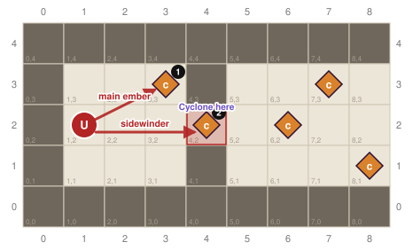

**Question:** two Claws now, three more coming through a 1-tile throat. How does a 15 HP mage stay untouched?

| Answer | How | |
| --- | --- | --- |
| Fire Embers | One cast on 3,3: the sidewinder finds the Claw on 4,2 by itself | ★ |
| Cyclone | Once 4,2 is clear, a Cyclone there: nothing walks through it, and it drifts into the three | ★ |
| Blink | Step back; the decoy draws them into the throat, where the embers reach them in a line | ● |
| Fight in the open | Trade embers with three Claws | ✗ |

**Knobs:** throat 2 wide (the Cyclone no longer seals it); enemies act first; an Archer behind the three.

### 2. The chasm

```grid id=02-lucy-chasm title="2. The chasm"
. . . _ _ . E E
c . U _ _ . . E
. c . _ _ a . .
--
arrow 2,1 5,2 lucy Blink
arrow 0,1 1,1 enemy
arrow 1,0 1,1 enemy
note 2,1 decoy stays
```

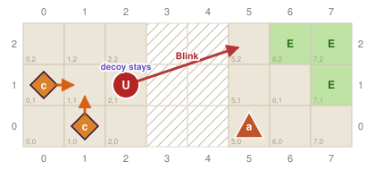

**Question:** the goal is across a gap and two Claws are on her heels.

| Answer | How | |
| --- | --- | --- |
| Blink | Across the gap; the decoy on 2,1 keeps the Claws busy | ★ |
| Fire Embers first | Kill the Archer on 5,0 from the edge (3 tiles), then Blink | ● |
| Walk | No path | ✗ |

### 3. The gallery

```grid id=03-john-gallery title="3. The gallery"
. a . . a . . a .
_ _ _ _ _ _ _ _ _
. . . . . . . . .
J U . . . . . . E
# # # # # # # # #
--
zone 0,1 2,2 john Shield reach
arrow 1,4 1,1 enemy dx=6 aimed at Lucy
arrow 1,1 0,1 john John takes it
```

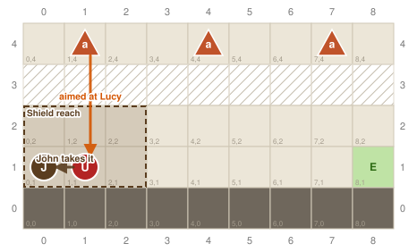

**Question:** Archers across a chasm fire at Lucy the whole way. Walking her to the exit teaches one rule: stay next to Papa.

| Answer | How | |
| --- | --- | --- |
| John's Shield (Role) | Lucy within 2 of John: he takes each arrow at ×0.5; the tether shows who he covers | ★ |
| Papa's Shelter | Next to John, Lucy throws one more ember: the same position protects her and makes her stronger | ★ |
| Shield Up | Halves what John takes while he covers her | ● |
| Fire Embers | Archers on 1,4 and 4,4 are within 3 of the gallery's near tiles | ● |
| Run ahead with Lucy | She's out of his reach and takes full hits | ✗ |

### 4. The alcoves

```grid id=04-john-alcoves title="4. The alcoves"
# # # c # c # # #
U J . . . . . . E
# # # c # c # # #
--
arrow 1,1 4,1 john Shield Dash
arrow 0,1 3,2 lucy follow-up
step 3,2 1
step 3,0 1
```

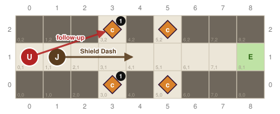

**Question:** four Claws in alcoves either side of the corridor.

| Answer | How | |
| --- | --- | --- |
| Shield Dash | Down the corridor: both Claws beside the path take 4 × and are shoved (the walls stop the push here; on spikes it matters) | ★ |
| Lucy's Role | Fires right after: her two embers finish one of them | ★ |
| Cyclone | In the corridor: the Claws step out into it | ● |
| Sword, one by one | Four turns of trading hits | ● |

### 5. Chorus

```grid id=05-chorus title="5. Chorus"
# # # # # # #
# c . . . c #
# . . U . . #
# . J . . L #
# # . c . # #
--
arrow 3,2 3,0 lucy
arrow 3,2 5,3 lucy
arrow 3,2 1,3 lucy
step 3,0 1
step 5,3 2
step 1,3 3
```

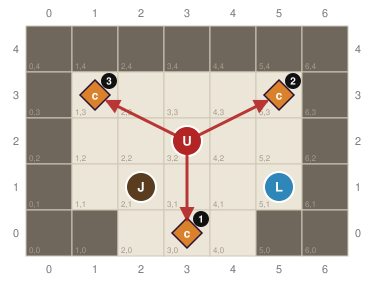

**Question:** three Claws, each tuned to die to one family hit plus Lucy's two follow-up embers. Lucy stands within 3 of all three. Her Role skips the enemy she hit last, and is planned to fire 3 times a round.

| Answer | How | |
| --- | --- | --- |
| Lucy's Role | Each family action lands near a *different* Claw: John on 3,0, Linda's arrow on 5,3, Linda's Crescendo on 1,3. Three follow-ups, three kills | ★ |
| Explosive Crescendo | Any action counts as a trigger, so an area shot sets up the third | ● |
| Hitting the same Claw twice | The second follow-up is wasted (she skips it) | ✗ |

**Knobs:** a Claw at 4 tiles from Lucy (she must step first); a fourth Claw to show the limit; Sisters' Rivalry, if a basic arrow gets the kill.

## Enemy chunks

### 6. The pockets

```grid id=06-pockets title="6. The pockets"
. . # . # . .
. a # . # a .
# # . . . # #
U . . J@ . . .
# # . . . # #
. a # . # a .
. . # . # . .
--
arrow 0,3 3,3 lucy fireball
arrow 3,3 1,5 lucy Flare
arrow 3,3 5,5 lucy
arrow 3,3 1,1 lucy
arrow 3,3 5,1 lucy
```

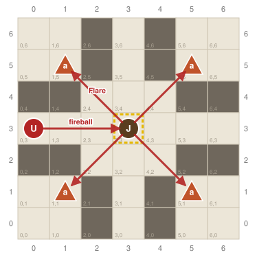

**Question:** four Archers in sealed corner pockets, 2 tiles diagonal from the centre. Nothing walks in (movement is four-way) and Linda's lanes don't line up.

| Answer | How | |
| --- | --- | --- |
| Shield Flare | John on 3,3 casts Shield Up (their arrows feed his Wrath), Lucy fires at him, four copies go down the diagonals | ★ |
| Explosive Crescendo | One pocket every other turn | ● |
| Fire Embers | From the centre, 2 to 3 tiles: a pocket or two a turn while all four shoot | ● |
| Vault | Mark lands in a pocket: the push and Fist Blitz clear one | ● |
| Blink | Lucy alone in a pocket, next to an Archer | ✗ |

**Knobs:** three pockets and a Claw in the fourth (the Flare hits the first enemy within 2); pockets at 1 and 2 mixed; a Sheltered Lucy with Sidewinders throwing several embers at John (if each ember flares on its own: to check).

### 7. The bell

```grid id=07-bell title="7. The bell"
# # # # # # # # #
# c . . . . . c #
# . . c b c . . #
# . . . . . . . #
# . . . . . . . #
# . J U . . L . #
--
arrow 2,0 3,1 4,2 john ring
arrow 1,4 3,2 enemy
arrow 7,4 5,2 enemy
step 4,2 1
```

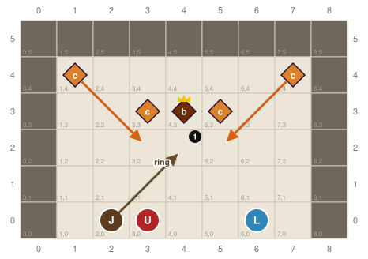

**Question:** hitting the Black Claw (40 HP) sends every Dark Claw within 5 at the attacker. Who should ring it, and from where?

**Alert state:** as drawn, Lucy on 3,0 is 3 steps from the Claw on 3,3, so it starts Alerted and its spread wakes the Black Claw and the Claw on 5,3 at level start; the corner Claws (1,4 and 7,4) sleep until the bell rings (EN-15). For a fully sleeping bell, add one row between the family and the pack: then the bell both starts the fight and turns it.

| Answer | How | |
| --- | --- | --- |
| Shield Up + Wrath | John rings it with Shield Up on: the pack piles onto him at 60%, every hit stacks Wrath, his next swing lands at up to +105% | ★ |
| John's Shield + Papa's Shelter | Lucy stays beside him: covered and stronger | ★ |
| Cyclone | Ring it from behind a Cyclone: the pack runs into it | ★ |
| Linda's Role | The pack's path crosses her row; 2 Watch Shots a round | ● |
| Burst the leader | Mark–John Family Watchers (Vulnerable), then Linda–Lucy Marks-Sisters through it | ● |
| Mark rings | His Role answers each hit, but he has 15 HP | ● |
| Lucy's stray sidewinder | An ember picks the Black Claw: the whole pack goes for her | ✗ |

### 8. The wall that walks

```grid id=08-masher-wall title="8. The wall that walks"
# # # . . . . # #
# # # . . . . # #
# # # ^ ^ ^ ^ # #
. . . . O O . . E
J L M . O O . c E
# # # # # # # # #
--
cells 4,5 linda Linda pokes from here
arrow 4,5 4,3 linda poke
arrow 5,2 5,3 enemy steps 1
zone 3,1 7,1 john free after one pull
```

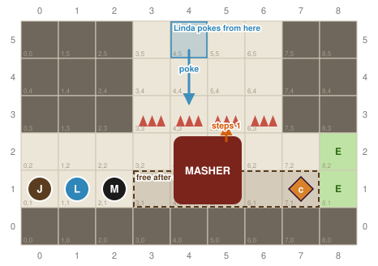

**Question:** the Masher fills a 2-wide bridge. It can't be pushed, only lured. The ledge above is reached through the spike bay.

| Answer | How | |
| --- | --- | --- |
| Linda's arrow (lure) | From 4,5, one poke pulls it a step north, half onto the spikes, and row 1 opens. A second poke brings it next to her: it slams her | ★ |
| Shield Up as bait | John pokes from the ledge instead, and takes the slam at 60% | ● |
| Harmonic Slam | Crippled, it can't step: hit it freely from range that turn | ● |
| Stunning Vault | Stunned, it doesn't answer that turn | ● |
| Through the bay | Walk the spikes on a down turn, never ending a move next to it | ● |
| Kill it | 80 HP, every hit answered | ● |
| Command | It's Immovable (but Command can walk Linda to the ledge) | ✗ / ● |

## Challenge chunks

### 9. The spike band

```grid id=09-spike-band title="9. The spike band"
. c . . . . . c .
. . . . . . . . .
^ ^ ^ ^ . ^ ^ ^ ^
. . . . @ . . . .
. J . . L . . U .
--
zone 4,0 4,4 linda Linda's column
arrow 1,4 4,3 4,1 enemy around by the stone
```

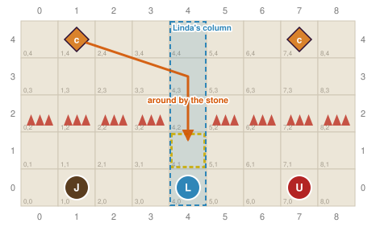

**Question:** a band of spikes with one safe stone. Who crosses, when, and where?

| Answer | How | |
| --- | --- | --- |
| Linda's Role | The stone is in her column: anything that ends a move past it gets a Watch Shot | ★ |
| Shield Dash, Vault (pushes) | Shove enemies onto the band on the turn before it rises | ★ |
| Command | Walk an enemy onto a spike before the rise | ★ |
| Timing | Cross on a down turn | ● |

### 10. Mirror pools

```grid id=10-mirror-pools title="10. Mirror pools"
. P . . . . . P .
. . . . # . . . .
. . . . # . . . .
. . J . . . L . .
--
zone 4,0 4,3 note mirror axis
arrow 2,0 1,2 john Dance
arrow 6,0 7,2 linda mirrored
```

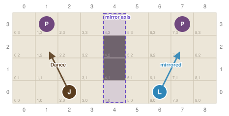

**Question:** two pools mirrored about the middle, John and Linda mirrored too.

| Answer | How | |
| --- | --- | --- |
| John–Linda Dance | One Duo: John to 1,2, Linda to the mirrored 7,2, both beside a pool; each Cleanses, and Linda still has an AP to shoot | ★ |
| Walk separately | Works, but spends both units' turns | ● |

**Knobs:** a rock on one side breaks the mirror (the Dance lands one short); the mirror flip key; Claws spawning on turn 2.

### 11. Spread pools

```grid id=11-spread-pools title="11. Spread pools"
. P . . # . . P .
_ _ . . # . . _ _
. _ . . . . . _ .
P _ . . . . . _ P
_ _ . . . . . _ _
. . . . . . . . .
. . J U M . L . .
--
arrow 3,0 0,4 lucy Blink
arrow 4,0 6,2 8,4 mark move, Vault
arrow 2,0 2,3 mark Command
arrow 2,3 2,5 john free dash
cells 6,5 linda
note 6,5 Footrace finish
```

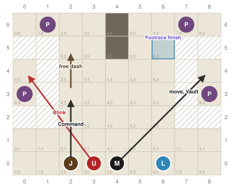

**Question:** four pools, each spawning a Claw every 3 turns until cleansed (Cleanse: 1 AP, from 1 tile). Two sit on islands. How does the family split?

| Pool | Answer | |
| --- | --- | --- |
| West island 0,3 | Lucy Blinks to 0,4 and Cleanses | ★ |
| East island 8,3 | Mark moves, then Vaults to 8,4 | ★ |
| Top-left 1,6 | Mark Commands John 3 tiles north; the free Shield Dash (Command Shield Dash) carries him beside it | ★ |
| Top-right 7,6 | Mark–Linda Footrace to 6,5: the winner hits the fresh Claw at ×1.5, the loser's +1 AP pays the Cleanse | ★ |
| Any | Father's Resolve: +1 AP to whoever stands at a pool | ● |
| Any | Route moves through allies: Pass-by fills FTP for the second Duo | ● |

**Knobs:** first spawns staggered (2, 3, 4) so the order matters; a pool on a spike tile; a Black Claw asleep beside one (EN-12). A Cleanse is a family ability, so it makes noise (EN-14b): a Black Claw within 2 of the pool wakes when the pool is cleansed, and so does its pack (EN-15). Claws the pool spawns start Unaware too, unless the family is within 3 of them (EN-12).

### 12. The ring

```grid id=12-ring title="12. The ring"
# # # # . P . # # # #
# # # # c . c # # # #
# # # # . ~ . # # # #
# # # # . . . # # # #
P c . . . L . . . c P
. . . . J R U . . . .
. a . . . M . . . a .
# # # # . . . # # # #
# # # # . . . # # # #
# # # # c . c # # # #
# # # # . P . # # # #
--
zone 1,6 9,6 linda Watch row
zone 5,7 5,9 linda Watch column
```

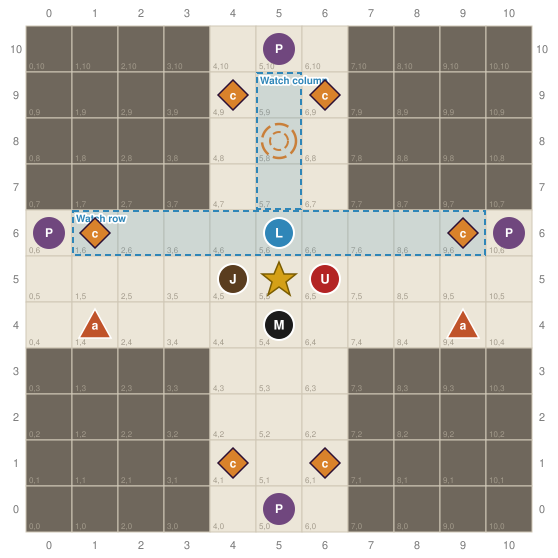

**Question:** the protectee on 5,5, four arms, a pool at each end, enemies acting first. Win by surviving 6 turns **or** cleansing all four pools. John's Shield can't cover the protectee.

| Answer | How | |
| --- | --- | --- |
| Linda's Role | On 5,6 her row runs down both side arms, her column up the north arm: one tile watches three arms, with only 2 Watch Shots a round | ★ |
| Cyclone | Walls an arm (5,8 here); two can stand at once from turn 3 | ★ |
| Tempest Bloom | Her arrows split inside the Cyclone into the side files (chunk 13) | ★ |
| Catch & Return | Mark behind a queue in a side arm (chunk 14) | ★ |
| John–Lucy Hide and Seek | Decoys around the plaza draw the wave off the protectee | ● |
| Shield Up, John's Shield | John plugs the south arm; his Shield covers Lucy and Linda, not the protectee | ● |
| Cleanse sortie | Faster win, protectee exposed | ● |

**Knobs:** a Black Claw in one arm (chunk 18); the Masher down a wide arm; Toba's taunt and heals; two arms only.

### 13. The prism

```grid id=13-prism title="13. The prism"
# # # c # # #
# # # . # # #
. c . ~ . c .
# # # . # # #
# # # . # # #
# # # L # # #
--
arrow 3,0 3,3 linda
arrow 3,3 1,3 linda
arrow 3,3 5,3 linda
arrow 3,3 3,5 linda
```

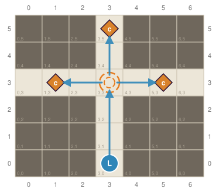

**Question:** three Claws round a corner from Linda, a Cyclone at the crossing.

| Answer | How | |
| --- | --- | --- |
| Tempest Bloom | Her arrow enters the Cyclone and splits toward every side but back: one shot, three Claws | ★ |
| Linda's Role | Her Role arrows bloom too: the crossing guards itself | ★ |
| Explosive Crescendo | One side at a time | ● |
| Cyclone alone | Drifts into one side | ● |

### 14. The gauntlet

```grid id=14-gauntlet title="14. The gauntlet"
# # # # # # # #
L . c c M c . .
# # # # # # # #
--
arrow 0,1 4,1 linda dy=-6 out
arrow 4,1 0,1 mark dy=6 back
```

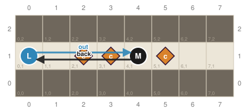

**Question:** Claws queued in a corridor between Linda and Mark.

| Answer | How | |
| --- | --- | --- |
| Catch & Return | Her arrow pierces the line, Mark (4 tiles away) catches it and sends it back: each Claw hit twice | ★ |
| Vault | How Mark gets behind the queue in the first place | ● |
| Linda–Lucy Marks-Sisters | A piercing arrow with no falloff | ● |
| Mark–Lucy Chained Assault | Up to 3 targets within 4 | ● |
| Fist Blitz + Continuous Attack | Mark kills down the line from his end | ● |

## Combination chunks

### 15. The bell over the teeth

```grid id=15-bell-spikes title="15. The bell over the teeth"
# . c . b . c . #
# . . c . c . . #
# ^ ^ ^ . ^ ^ ^ #
# . . . @ . . . #
# . J U . . . . #
# . . . L . . . #
--
arrow 4,0 4,5 linda dx=-8 rings (Longshot)
arrow 2,5 4,3 4,1 enemy pack funnels
zone 4,1 4,4 linda
```

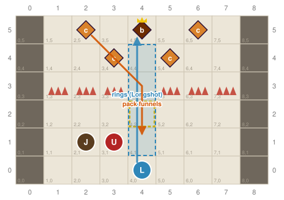

**Question:** the pack sleeps beyond a spike band with one stone, which is in Linda's column. Ring the bell so the pack comes the way you want.

**Alert state:** the bell is now real: Linda's hit wakes the Black Claw (EN-14a), its spread wakes every Claw within 2 of it, and its call turns them on her (EN-1, EN-15). But as drawn, Lucy on 3,1 is 3 steps from the Claw on 3,4, so the whole pack wakes at level start. Start her on 1,1 (5 steps) to keep the pack asleep; John on 2,1 and Linda on 4,0 are already outside sight.

| Answer | How | |
| --- | --- | --- |
| Linda rings (Longshot) | On the turn before the spikes rise: the pack either bleeds on the band or funnels onto the stone, into her Watch Shots | ★ |
| John's Shield | John within 2 of Linda takes the pack's hits at ×0.5 | ★ |
| Shield Dash rings | John dashes up the stone column; the end tile is beside the Black Claw. He ends among the pack | ● |
| Papa's Shelter | Lucy beside John for the clean-up | ● |

### 16. It crushes its own

```grid id=16-masher-crush title="16. It crushes its own"
. . c . . . . .
. . . . O O . .
M . . J O O . a
. . . c . . . .
--
arrow 2,3 3,2 mark Command
cells 2,1 3,2 3,0 3,1 enemy
step 3,2 1
step 3,1 2
step 4,1 3
```

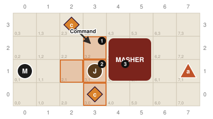

**Question:** the Masher's slam hits the target's tile and the four around it, goblins included. Make it hit its own side.

| Answer | How | |
| --- | --- | --- |
| Command | 1: Mark walks the Claw from 2,3 to 3,2, beside John (decline the free dash: John is the bait) | ★ |
| Shield Up + Wrath | 2: John at 60%, Wrath armed | ★ |
| Sword (provoke) | 3: John strikes the Masher; its slam lands on 3,1 and the tinted tiles: both Claws take 10 × | ★ |
| Mark's Role | The slam hits family, so Mark punches back... which provokes it again. Strong, or a chain gone wrong | ● / ✗ |

### 17. Command chain

```grid id=17-command-chain title="17. Command chain"
. . . . . . . . .
. . c . . . . . .
L . ^ . . . . . .
. . . . . c ^ . .
. M . . J . . . .
--
arrow 2,3 3,2 mark Command
arrow 0,2 3,2 linda dy=8 Watch Shot
arrow 4,0 4,3 john free Shield Dash
arrow 3,2 2,2 john dy=-8 push
arrow 5,1 6,1 john push
step 3,2 1
step 0,2 2
step 4,0 3
```

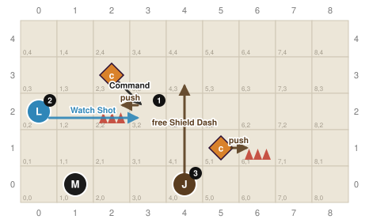

**Question:** the spikes rise this enemy turn. How many hits from one AP?

| Step | What fires | Cost |
| --- | --- | --- |
| 1 | Mark Commands the Claw from 2,3 to 3,2, in Linda's row | 1 AP |
| 2 | Linda's Role: a Command move counts, so she shoots it | free |
| 3 | Command Shield Dash: John dashes north from 4,0; the Claws beside the path are pushed onto 2,2 and 6,1 | free |
| 4 | The spikes rise at the start of the enemy turn and strike both | free |

### 18. The bell as a shield

```grid id=18-bell-protect title="18. The bell as a shield"
# c . c b c . # #
# . . . . . . . #
# . . . . . . J #
# . . R . . . . #
# . . U . . . . #
--
arrow 7,2 7,3 4,3 john dash rings
arrow 1,4 3,3 enemy dx=-6
arrow 3,4 2,2 enemy
```

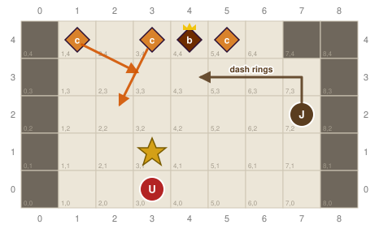

**Question:** the pack is heading for the protectee. Turn the Black Claw's rule into a taunt.

**Alert state:** the protectee on 3,1 is 3 steps from the Claw on 3,4, so the pack starts Alerted (EN-12, EN-15), as the question wants. A protect level would set "all enemies start alert" anyway (MI-27).

| Answer | How | |
| --- | --- | --- |
| Shield Dash rings | John dashes west along row 3; the end tile is beside the Black Claw: the pack turns on John, away from 3,1 | ★ |
| Father's Resolve | Someone gives John +1 AP so he can Shield Up as well | ★ |
| John–Lucy Hide and Seek | Decoys around the protectee | ● |
| Cyclone | Between the pack and the protectee | ● |
| Toba's taunt | When Toba is in the squad | ● |

---

## Enemy chunks, part 2

The Dark Shaman's heal below uses the starting values recommended in [`plans/2026-10-23-dark-shaman-heal-design.md`](../plans/2026-10-23-dark-shaman-heal-design.md), whose questions are still open: it heals one wounded dark ally (75% HP or less) within 3 for 10, never itself, ends its turn, cooldown 2, and it never walks to heal. "Dark" is the brood: Dark Claw, Black Claw, Dark Worm, Dark Shaman. The drawings show the brood as diamonds and goblins as other shapes, so who can be mended reads at a glance.

### 19. The mender

```grid id=19-mender title="19. The mender"
# # # . s . # # #
# . . . . . . . #
# . c b c . . M #
# . . . . . . . #
# . . . L . . . #
# J . U . . . . #
--
range 4,5 3 heal mends here
arrow 4,1 4,5 linda dx=7 Marks-Sisters
arrow 7,3 5,4 mark Vault
arrow 4,5 3,3 heal dx=-5 +10
```

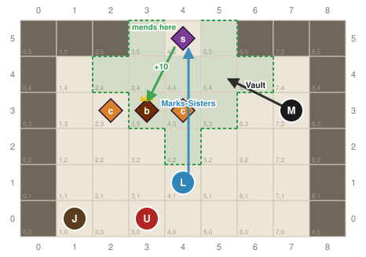

**Question:** a Shaman behind its pack mends anything you wound. What do you hit, and from where?

| Answer | How | |
| --- | --- | --- |
| Marks-Sisters (Linda–Lucy) | Up column 4 from 4,1: the Claw on 4,3 and the Shaman on 4,5 both take 12 ×, no falloff | ★ |
| Vault + Fist Blitz | Mark Vaults from 7,3 to 5,4, then Blitzes the Shaman 2 tiles away | ★ |
| Finish or don't start | Kill a dark ally outright, or leave it above 75%: a Claw at 12 HP or less within 3 gets +10 | ★ |
| Fight out of its range | It doesn't walk to heal: anything fought on rows 0 and 1 is out of its reach | ★ |
| Explosive Crescendo | On the Shaman's cell: it and anything beside it | ● |
| Blink + Fire Embers | Lucy reaches it, but lands beside the pack | ● |
| Chip everything | 10 HP back on the Black Claw every other turn | ✗ |

**Knobs:** the Shaman one tile deeper (Marks-Sisters' 5 tiles no longer reach); a Black Claw as the wounded one (the heal prefers the leader); Shaman on Late tier.

### 20. Two menders

```grid id=20-two-menders title="20. Two menders"
# . . . . . . . . #
L . s . . s . . . #
# . . c . . c . . #
# . . . . . . . . #
# . . . M . J U . #
--
arrow 0,3 5,3 linda dy=-8 Marks-Sisters
arrow 2,3 2,4 5,4 5,3 heal mend each other
arrow 5,3 8,3 mark Command
```

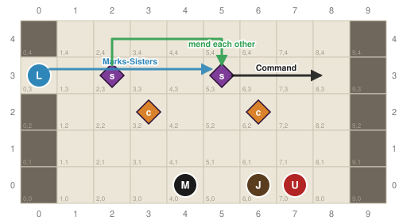

**Question:** two Shamans 3 apart. Neither can mend itself, but each mends the other.

| Answer | How | |
| --- | --- | --- |
| Marks-Sisters | From 0,3 along row 3: both Shamans take 12 ×. Each can mend the other once, then waits 2 turns | ★ |
| Stunning Vault | Stun one: it skips its turn, so the other gets no heal. Burst the other | ★ |
| Command | Mark (4 tiles) walks the Shaman from 5,3 to 8,3: now 6 apart, out of each other's reach (Sapping Order: Weak too) | ★ |
| Family Watchers (Mark–John) | Both Vulnerable: +20% on everything for 2 turns | ● |
| One per turn | Focus one; it is mended once, then dies | ● |
| Spread the damage | Each heal undoes half a turn's work | ✗ |

### 21. Summoner behind the screen

```grid id=21-summoner title="21. Summoner behind the screen"
# # . . s . . # #
# # # c # c # # #
. . . . . . . . .
. . . . . . . . .
. . . . M L . . .
. . J U . . . . .
--
range 4,5 2 shaman summons land here
arrow 4,1 3,4 mark Chained Assault
arrow 4,1 4,5 mark dx=-5
arrow 4,1 5,4 mark
arrow 5,1 4,5 linda dx=6 Crescendo
```

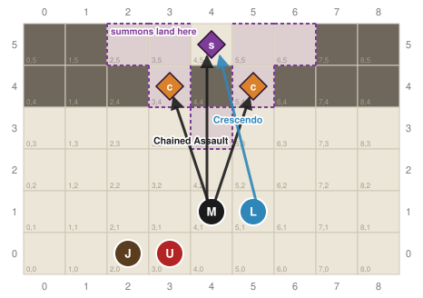

**Question:** a Shaman behind a wall, two Claws plugging the gaps. Every 3 turns it calls another Claw onto a free tile within 2, with no cap, and its Claws stay when it dies.

| Answer | How | |
| --- | --- | --- |
| Chained Assault (Mark–Lucy) | From 4,1, both Claws and the Shaman are within 4: three targets, one Duo | ★ |
| Explosive Crescendo | Linda from 5,1 on 4,5 (5 tiles), over the wall | ★ |
| Vault | Mark leaps the screen to beside the Shaman (over rock: to check) | ● |
| Kill the screen | Refilled every 3 turns, sometimes on your side of the wall (4,3 is within 2) | ● |
| Wait it out | One more Claw every 3 turns, forever | ✗ |

### 22. The brood that splits

```grid id=22-worm-split title="22. The brood that splits"
# # # # # # # # #
. . . . w . . . .
. . . . . . . . .
. . J U . w . . L
. . . . . . . . .
--
cells 3,3 5,3 4,2 4,1 6,1 5,2 5,0 enemy children land?
zone 4,1 7,1 linda Watch
arrow 3,1 4,3 lucy ember
arrow 3,1 5,1 lucy dy=-7 sidewinder
```

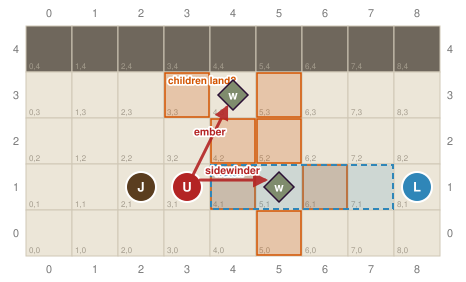

**Question:** a Worm (28 HP) splits when it dies, into a 12, then 6, then 4 HP brood. Worms move 1. Where and how do you kill them?

| Answer | How | |
| --- | --- | --- |
| Fire Embers | Sidewinders pick their own targets: the more worms, the more each cast is worth (Sidewinders, Shelter) | ★ |
| Lucy's Role | Follow-ups clean up children after every family hit | ★ |
| Kite | Worms move 1: step back and they never reach you | ★ |
| Choose where it dies | Kill it where its children land badly (chunk 31) | ★ |
| Linda's arrow | Pierces a line of children (×0.6 per enemy) | ● |
| Linda's Watch | Worms end a move in her lanes every turn: her 2 Watch Shots a round go on 4 HP children (with the planned limit) | ✗ |
| Kill it beside Lucy | Its children surround a 15 HP mage: the worm on 5,1 has a child landing tile next to her | ✗ |

### 23. Outranged

```grid id=23-outranged title="23. Outranged"
# # . a . a . # #
_ _ _ _ _ _ _ _ _
. . . . . . . . .
. . . . . . . . .
. J U L . . M . .
--
cells 7,2 1,2 2,2 3,2 4,2 5,2 6,2 2,1 3,1 4,1 5,1 6,1 enemy danger zone
arrow 3,0 3,4 linda dx=-6 4 > 3
arrow 3,0 4,1 4,4 linda Crescendo
```

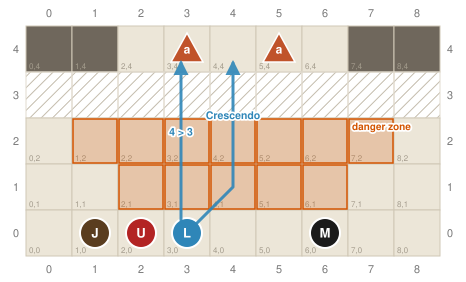

**Question:** two Archers (range 3, move 3) on a ledge across a gap. They can't cross; the family can't walk up.

| Answer | How | |
| --- | --- | --- |
| Linda's range | From row 0 her 4 reaches the ledge; theirs can't reach row 0 even after moving | ★ |
| Explosive Crescendo | On 4,4, between them: both Archers in one shot | ★ |
| Shift view | The danger zone shows exactly which tiles are safe: a lesson for the view itself | ★ |
| Vault | Mark lands on 4,4 between them and pushes both (Stunning Vault: both skip a turn). Across the gap: to check | ● |
| Shield Up + Papa's Shelter | John and Lucy step into row 1 and trade embers with arrows | ● |
| Blink onto the ledge | Lucy alone between two Archers | ✗ |

### 24. The nook

```grid id=24-nook title="24. The nook"
. . c . . . c . .
. . . . . . . . c
# . . . . . . . .
L . . . @ . . . .
# # # # J # # # #
# # # # U # # # #
--
zone 1,2 4,2 linda Watch
arrow 2,5 2,2 3,2 enemy move 4
arrow 6,5 6,2 5,2 enemy
```

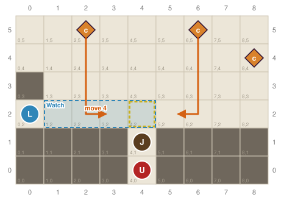

**Question:** Dark Claws move 4 and land beside their target this turn. Choose where they can land.

| Answer | How | |
| --- | --- | --- |
| Body-block | John on 4,1 seals the nook: only 4,2 can reach him, and nothing can reach Lucy | ★ |
| Linda's Watch | 4,2 and 1,2 (the only tile beside her) are in her row: whatever lands there is shot | ★ |
| Shield Up + Wrath | One attacker a turn, each hit a stack | ★ |
| Papa's Shelter, Lucy's Role | Lucy behind John: Sheltered, and following up on everything he hits | ★ |
| Cyclone on 4,2 | Nothing can reach John at all, until it drifts | ● |
| Lucy out front | From 5 tiles away a Claw lands beside her this turn | ✗ |

## Hazard chunks

### 25. Mushroom field

```grid id=25-mushrooms title="25. Mushroom field"
. . . c . . . . .
. . c * c . . c .
. . . . . . * . .
. . . . . . . . .
. . . . . . . . .
. J . L . U . M .
--
cells 2,4 4,4 3,5 3,3 enemy blast
arrow 3,0 3,4 linda shoot the cap
arrow 7,0 7,4 mark dx=6 Command
arrow 7,4 6,4 mark
```

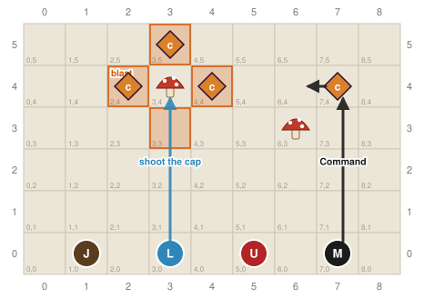

**Question:** exploding mushrooms block walking, can be targeted, and blast everyone around them for 7 ×, either side. What sets them off, and who is standing there?

| Answer | How | |
| --- | --- | --- |
| Linda's arrow | From 3,0 up column 3, the cap is the first thing in line: three Claws in the blast | ★ |
| Gather, then pop | Ring a bell or bait with a decoy so the pack bunches round a cap | ★ |
| Command | Mark walks the Claw from 7,4 to 6,4, beside the second cap; then any hit on it | ★ |
| Shield Dash, Vault | Push an enemy beside a cap | ● |
| Fire Embers | A sidewinder may pick a cap (to check): great or terrible | ● / ✗ |
| Walk past one | It's a wall until it's blown, and a blast beside you hurts | ✗ |

### 26. Webs

```grid id=26-webs title="26. Webs"
P . . . . . . c .
% % % % % % % % %
% % % % % % % % %
. . . . . . . . .
. U . . . . . . .
. . . J . M . L .
--
arrow 1,1 1,5 lucy Blink
arrow 7,5 7,3 enemy stalls
cells 7,1 7,2 7,3 7,4 linda Watch
arrow 5,0 3,0 3,2 mark dy=6 Command
arrow 3,2 3,5 john free dash
```

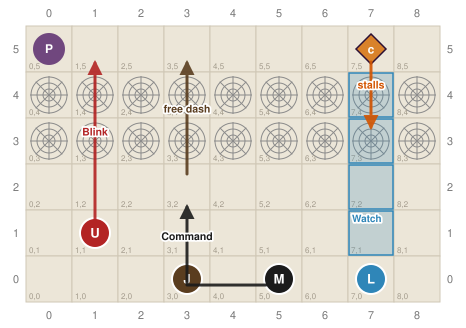

**Question:** two rows of webs (each costs 2 to enter, for everyone) between the family and a pool.

| Answer | How | |
| --- | --- | --- |
| Blink | Lucy to 1,5, over both web rows, and Cleanses | ★ |
| Command Shield Dash | Mark walks John to the web's edge (3,2); the free dash carries him over both rows to the pool (whether a dash pays web cost: to check) | ★ |
| The webs as a wall | A Claw (move 4) stalls after 2 web tiles, in Linda's column | ★ |
| Vault, John–Linda Dance | Jump or Duo-move across (cost: to check) | ● |
| Pass-by | Route moves through allies to fill FTP for the Duo | ● |
| Walk | 2 per web tile: three turns to the pool | ✗ |

### 27. Snare and shove

```grid id=27-snare title="27. Snare and shove"
. . . ^ . ^ . . .
. . . c L c . . .
. . J . . . . . .
. . ! . . . ! . .
. . . . . . . U .
--
arrow 4,3 4,4 linda step
arrow 2,2 5,2 john Shield Dash
arrow 3,3 3,4 john dx=-8 push
arrow 5,3 5,4 john dx=8 push
step 4,3 1
step 2,2 2
```

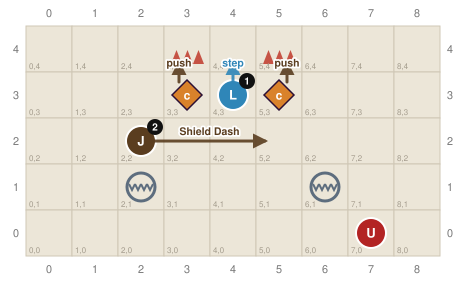

**Question:** Crippled enemies can't walk, and take 4 × for each tile they're pushed (and Shield Dash adds 4 × more). Traps Cripple whoever steps on them; so does Linda's Harmonic Slam.

| Answer | How | |
| --- | --- | --- |
| Harmonic Slam → Shield Dash | 1: Linda Cripples both and steps to 4,4. 2: John dashes 2,2 → 5,2: each Claw takes the dash, the Crippled bonus and the push, onto the spikes | ★ |
| Traps | Free Crippling: lure with a bell or a decoy onto 2,1 or 6,1 | ★ |
| A Crippled Masher | Can't step: it answers only if it's already beside you (chunks 8, 16) | ★ |
| Vault push | Mark's landing pushes Crippled enemies too | ● |
| Crippled isn't harmless | It still hits whoever stands next to it | ✗ |

## Combination chunks, part 2

### 28. Pull them off the mender

```grid id=28-off-the-mender title="28. Pull them off the mender"
# # . . . . . . . # #
# . . c b c . . L . .
# . . s . . . . . . .
# . . . . . . . J U .
# . . . . . . . . . .
# . . . . . . . . . .
--
range 3,3 3 heal mends here
arrow 8,4 4,4 linda dy=-7 rings the bell
arrow 5,4 5,5 7,5 enemy the pack follows
```

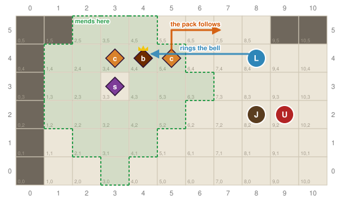

**Question:** the Black Claw sits inside the Shaman's reach. The bell pulls the pack to whoever rang it.

| Answer | How | |
| --- | --- | --- |
| Ring from far | Linda from 8,4: her arrow passes the Claw and rings the Black Claw; the pack charges her, out of the Shaman's reach | ★ |
| John's Shield + Shield Up | John on 8,2 covers Linda (2 tiles) and soaks | ★ |
| Command | Walk a wounded Claw 3 tiles out of reach before finishing it | ★ |
| Decoys (Blink, Hide and Seek) | Draw the pack away (if enemies go for decoys: to check) | ● |
| Kill the Shaman first | Chunk 19 | ● |
| Ring from close | The fight happens inside heal range | ✗ |

### 29. Who can it mend?

```grid id=29-who-mends title="29. Who can it mend?"
# # # . s . # # #
# . a . . . a . #
# . . c . c . . #
# . . . . . . . #
# . . . . . . . #
# J U . . . L M #
--
range 4,5 3 heal mends diamonds only
arrow 4,5 3,3 heal dx=-5 +10
note 2,4 goblin
note 6,4 goblin
```

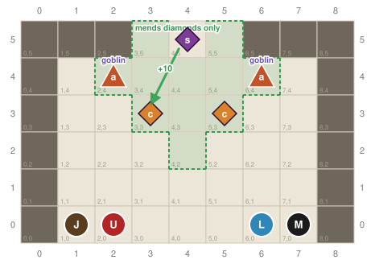

**Question:** a Shaman with Archers and Claws. It mends the Claws, never the goblins.

| Answer | How | |
| --- | --- | --- |
| Chip the goblins | Damage on the Archers sticks | ★ |
| Burst the brood | Big single hits on the Claws (Sword with Wrath, Fist Blitz, Blood Debt): kill, don't wound | ★ |
| Explosive Crescendo on an Archer | Area damage where it lasts | ● |
| Kill the Shaman first | | ● |
| Fire Embers into the pack | Sidewinders wound Claws they don't kill; the Shaman undoes it | ✗ |

**Knobs:** the Masher instead of the Archers (a goblin: it's never mended, but it answers every hit); a Worm brood (every child is dark, and mendable).

### 30. Worm relay

```grid id=30-worm-relay title="30. Worm relay"
# # # # # # # # #
. . w . w . w . L
. . . . . . . . .
. . . U . . . . .
. . . . . . . . .
--
note 2,3 4 HP
note 4,3 4 HP
note 6,3 6 HP
arrow 8,3 6,3 linda dy=-7 kill
arrow 3,1 4,3 lucy kill
arrow 3,1 2,3 lucy
step 6,3 1
step 4,3 2
step 2,3 2
```

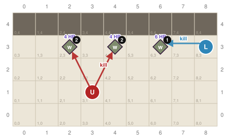

**Question:** a brood of small worms within both sisters' reach. Sisters' Rivalry: when one kills with a basic attack, the other gets +1 AP and a ready basic attack (AP cap 3).

| Answer | How | |
| --- | --- | --- |
| Sisters' Rivalry | 1: Linda kills 6,3: Lucy +1 AP. 2: Lucy's main ember and sidewinder kill 4,3 and 2,3: Linda +1 AP. The relay clears a brood in one turn | ★ |
| Fire Embers | Main ember and a sidewinder can kill two small worms at once | ★ |
| Lucy's Role | Follow-up kills (whether they count as a basic attack: to check) | ● |
| John or Mark finishes them | No AP handed over: the relay stops | ✗ |

### 31. Worms on the teeth

```grid id=31-worm-teeth title="31. Worms on the teeth"
. . ^ . . . .
. ^ w ^ . * w
. . ^ . . . .
. . . . U . J
. . L . . . .
--
arrow 2,0 2,3 linda dx=-6 kill on the eve
arrow 4,1 5,3 lucy then the cap
note 2,3 rise next turn
```

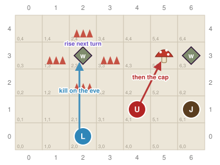

**Question:** where its children land is decided by where it dies.

| Answer | How | |
| --- | --- | --- |
| Kill it on the spikes' eve | Linda from 2,0 kills the worm on 2,3 the turn before the rise: its children land on the spikes around it | ★ |
| Kill it beside a cap | John kills the worm on 6,3; Lucy's ember on the mushroom blasts the children (if the blast reaches diagonals: to check) | ★ |
| Cyclone beside it | The children land in its path | ● |
| Kill it in the open | Three children, three more targets | ✗ |

### 32. The nest

```grid id=32-nest title="32. The nest"
# P . . . . . P #
# . . . s . . . #
# c . . . . c . #
# . . . . . . . #
# . U J . M . . #
# . . . . . L . #
--
range 4,4 2 shaman summons
arrow 2,1 2,5 lucy Blink, Cleanse
arrow 5,1 4,3 mark Stunning Vault
```

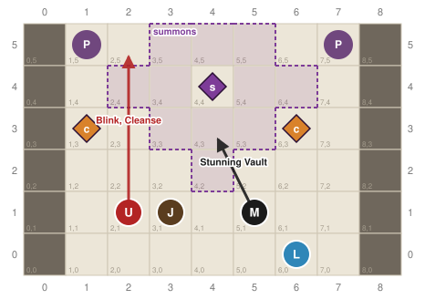

**Question:** two pools (a Claw every 3 turns each, one alive per pool) and a Shaman (a Claw every 3 turns, no cap, plus heals). Cleanse first or kill first?

| Answer | How | |
| --- | --- | --- |
| Split the family | Lucy Blinks to 2,5 and Cleanses; Mark Stunning-Vaults beside the Shaman: no summon, no heal next turn | ★ |
| Mark–Linda Footrace | Race to beside the east pool; the loser's +1 AP pays the Cleanse | ★ |
| Kill the Shaman first | Its summons have no cap; the pools have one Claw each | ● |
| Cleanse first | Caps the pools, but the Shaman keeps adding | ● |
| Fight the waves | Pools, summons and heals outpace the family | ✗ |

## Boss chunks

### 33. The Deev's wave

```grid id=33-deev-wave title="33. The Deev's wave"
# # # . . . . . # # #
# . . ? . M . . . . #
# . . . D D D . . . #
. . U . D D D J . ? .
# . . . . . . . . . #
# . . ? . L . . ^ . #
# # # . . . . . # # #
--
arrow 2,3 0,3 enemy dy=-8 wave
arrow 7,3 9,3 enemy dy=-8 into the rain
arrow 5,1 5,0 6,0 enemy slides aside
arrow 5,5 5,6 4,6 enemy
note 0,3 safe
```

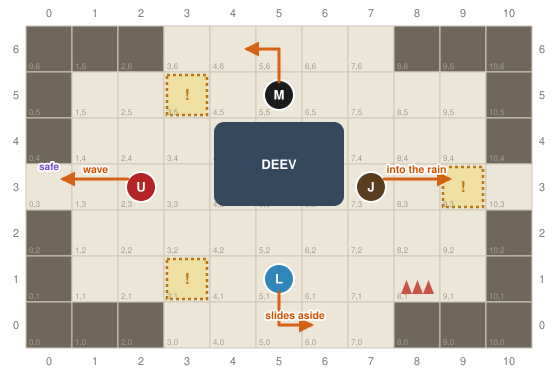

**Rules used** (read from `BossMountainDeev.cs` and its presets, `main`; the GDD's EN-7):
- The Deev never moves (3 × 2, Immovable, 100 HP).
- **Wave:** on any enemy turn after it was hit, it pushes every family member within 9 (the whole arena) 2 tiles away from it. The push follows a walkable path to the reachable tile farthest from the Deev, so a unit with its back to a wall slides to the side, and one with nowhere farther to go stays put. Only the family is pushed; other enemies never move with it. No damage. It waves once per enemy turn, however many hits it took.
- **Rain:** a wind-up marks tiles (10 in M12) and ends its turn; next turn poison drops on them: 6 × to a family member on the tile each tick, for 3 turns. The wind-up comes back every other turn.
- Marked tiles, pools and spikes are all walkable, so the wave can push you onto them.

**Question:** you must hit it to win, and every turn you do, the arena tilts: everyone slides 2 tiles away from it, maybe into the rain. Where do you end your turn?

| Answer | How | |
| --- | --- | --- |
| Read the landing | End the turn on tiles whose landing is safe: Lucy on 2,3 lands on 0,3 | ★ |
| Back to the wall | The pocket ends at 0,3 and 10,3 have nowhere farther to go: a unit standing there isn't pushed (to check) | ★ |
| All in one turn | One wave per enemy turn, however many hits: Family Watchers first (Vulnerable for 2 turns), then everyone; Wrath; Linda–Lucy's arrow; Mark's Continuous Attack | ★ |
| The wave as a free move | Choose a start tile whose landing is next turn's best tile: Linda slides from 5,1 to the corner 6,0, still in reach of it | ★ |
| Hit it on the wind-up turn | The marked tiles are known before you act, so this turn's landings can be checked against them | ★ |
| Come back in | After a wave the family is 2 tiles out: Vault (3) brings Mark back beside it; Command + free Shield Dash runs John along its side (the dash's 4 × on every enemy next to the path) | ● |
| John–Linda Dance | Two units back into reach in one move, mirrored either side of it | ● |
| John on 7,3 | The wave slides him 2 tiles right, onto the marked tile at 9,3: the poison drops on him | ✗ |
| Lucy beside it | 15 HP, pushed through a pool's path or into a corner with no way back but walking | ✗ |

**Knobs:**
- Spikes on the push landings, on the same clock as the wind-up.
- No pockets: every wave sends the family into the corners.
- Pools already on the floor from the last rain, narrowing the safe landings each cycle.
- Dark Claws or Worms in the arena: the wave never moves them, so they stand where they are and block push paths (a blocked path shortens the push).
- **Its tentacles, if Q5 is restored:** the Deev takes no damage until they die (about 1 HP each, Inactive). Sidewinders, Linda's pierce and Tempest Bloom clear several at once, and every tentacle you kill is one less thing in your push path.

---

## Enemy reference

What each enemy asks, and the chunks that use it. Moves and reach read from the presets (`Resources/UnitSpecific/Enemy/`); every enemy has 2 AP.

| Enemy | HP | Moves | Reach | The question it asks | Answers that shine | Chunks |
| --- | --- | --- | --- | --- | --- | --- |
| Dark Claw (brood) | 16 | 4 | melee | Where will it land? It reaches anyone within 5 this turn | Body-blocking, Watch lanes, Cyclone, John's Shield | most; 24 on its own |
| Black Claw (brood) | 40 | 4 (to check) | melee | Who rings the bell, and from where? | Shield Up + Wrath, ringing from range | 7, 15, 18, 19, 28 |
| Archer Goblin | 24 | 3 | 3 | Can you outrange it or reach it? Never mended | Linda's 4, Shield Flare, Crescendo, Shift view | 3, 6, 23, 29 |
| Dark Shaman (brood) | 50 | 3 | shot 2, heal 3, summon 2 | Who goes first? Finish or don't start | Burst Duos, Vault, Blink, Stun, fighting out of range | 19, 20, 21, 28, 29, 32 |
| Dark Worm (brood) | 28 → 12 → 6 → 4 | 1 | melee | Where do you kill it? | Sidewinders, Lucy's Role, hazards, Sisters' Rivalry | 22, 30, 31 |
| Masher Goblin | 80 | 1 | slam, 2 × 2 | Where will its slam land? Never mended | Lures, Command, Cripple, Stun | 8, 16 |
| Mountain Deev (boss) | 100 | 0, 3 × 2 | wave 9 (push 2), rain on marked tiles | Where do you end the turn, knowing the wave will move you? | Burst in one turn, pocket tiles, Vault and Command to come back | 33 |

## Hazard reference

| Hazard | Rule (from the prefabs) | Chunks |
| --- | --- | --- |
| Spikes | Rise at the enemy turn on round 3, then every 4th round; strike on the rise and on step-on while up; 3 damage; both sides | 9, 15, 17, 27, 31 |
| Corruption pool (`CP_Spawner`) | A Dark Claw every 3 turns, one alive per pool; one Cleanse destroys it | 10, 11, 12, 32 |
| Spider web | Entering costs 2 instead of 1; both sides | 26 |
| Exploding mushroom | Blocks walking; can be targeted; blasts everyone around it for 7 ×, both sides (shape and trigger: to check) | 25, 31 |
| Trap | Cripples whoever steps on it (whom exactly: to check) | 27 |
| Poison pool (`CP_Poison`) | 2 × to the family each tick, lasts 2 turns (the base prefab); the Mountain Deev's rain uses its own copy: 6 ×, 3 turns, on tiles it marked the turn before | 33; a knob for any chunk (a timed no-go zone) |

## More pairings to try

Seeds for further chunks, not drawn yet:

| Pairing | The question |
| --- | --- |
| Shaman + Worm brood | Every child is dark and mendable: kill the brood fast or kill the mender |
| Shaman + Masher | The Masher is never mended, but hitting it pulls it toward you, maybe into the Shaman's pack |
| Archers + webs | They keep shooting while you crawl: Blink, Vault and Duo moves earn their keep |
| Claws + traps | Claws move 4 and path straight: will they step on a trap? (AI: to check) |
| Masher + mushrooms | Does its slam set off a cap beside its target? (to check) |
| Poison pools + John–Linda Dance | Two units out of two pools in one move |
| Worms + a 1-tile throat | Kill the lead worm in the throat: its children cork it for the Claws behind (if allies can't pass through: to check) |

## Coverage

Which chunks each mechanic answers. **★** smart solve, **●** works, **✗** a trap for it.

| Mechanic | ★ | ● | ✗ |
| --- | --- | --- | --- |
| John: Sword | 16, 29 | 4, 5 | |
| John: Shield Dash | 4, 9, 17, 18, 27 | 15 | |
| John: Shield Up, Wrath | 6, 7, 16, 24, 28, 33 | 3, 8, 12, 23 | |
| John: Father's Resolve | 18 | 11 | |
| John: Blood Debt | | 29 | |
| John: Shield (Role) | 3, 7, 15, 28 | 12 | |
| Lucy: Fire Embers | 1, 22, 30 | 2, 3, 6, 23, 25 | 29 |
| Lucy: Cyclone | 1, 7, 12 | 4, 13, 18, 24, 31 | |
| Lucy: Blink | 2, 11, 26, 32 | 1, 19 | 23 |
| Lucy: Follow-up (Role) | 4, 5, 22, 24 | 30 | |
| Linda: arrow | 8, 15, 23, 25, 28, 31 | 5, 22 | |
| Linda: Explosive Crescendo | 21, 23 | 5, 6, 13, 19, 29 | |
| Linda: Harmonic Slam | 27 | 8 | |
| Linda: Watch (Role) | 9, 12, 13, 15, 17, 24, 26 | 7 | 22 |
| Mark: Fist Blitz, Continuous Attack | 19, 33 | 14, 29 | |
| Mark: Vault (Stunning Vault) | 9, 11, 19, 20, 32 | 6, 8, 14, 21, 23, 26, 27, 33 | |
| Mark: Command | 9, 16, 17, 20, 25, 28 | 8 | |
| Mark: Counter (Role) | | 7, 16 | |
| Cleanse, Pass-by | | 10, 11, 12, 26, 32 | |
| Duo: John–Linda Dance | 10 | 26, 33 | |
| Duo: Mark–Linda Footrace | 11, 32 | | |
| Duo: John–Lucy Hide and Seek | | 12, 18, 28 | |
| Duo: Linda–Lucy Marks-Sisters | 19, 20, 33 | 7, 14 | |
| Duo: Mark–Lucy Chained Assault | 21 | 14 | |
| Duo: Mark–John Family Watchers | 33 | 7, 20 | |
| Duo: Linda–Toba Healing Marks | | | |
| Synergy: Papa's Shelter | 3, 7, 24 | 15, 23 | |
| Synergy: Shield Flare | 6 | | |
| Synergy: Command Shield Dash | 11, 17, 26 | 33 | |
| Synergy: Tempest Bloom | 12, 13 | | |
| Synergy: Catch & Return | 12, 14 | | |
| Synergy: Sisters' Rivalry | 30 | | |
| Shift view (danger zone) | 23 | | |

## Gaps

Mechanics with no smart solve yet, and a chunk idea for each:

| Mechanic | Chunk idea |
| --- | --- |
| Blood Debt | **The one who hurt her**: one Archer hit Lucy last turn and stands among several; John's ×1.3 and Wrath on the marked one is the difference |
| Mark's Counter, Atman's Focus | **Bait the monk**: Mark alone in front, the pack hitting him and his Role answering each hit while his barrier builds |
| Linda–Toba Healing Marks | **Line of the wounded**: family lined up in one column after a poison-pool turn, enemies at its end |
| Toba (any) | Every chunk with Toba in the squad needs a pass once his kit is settled |

## Pattern knobs

The same few variables turn one chunk into many:

| Knob | Turns it |
| --- | --- |
| Width of a passage | 1 seals with a Cyclone or John; 2 needs two blockers |
| Distance against a range | Enemies at 3 vs 4 decide whether Lucy (3), Linda (4), Command (4) or Blink (5) reaches |
| Clocks | Spike rises and pool spawns, on the same or offset turns |
| Who acts first | Enemies first turns a puzzle into a crisis |
| Symmetry | Exact mirror rewards the Dance; a broken mirror tests it |
| Enemy tier | The same chunk, Tutorial to Late |
| What's at stake | Defeat all; reach the exit; protect; cleanse; survive N turns |
| Who's mendable | A Shaman nearby turns "wounded" into "not yet hurt"; goblins next to it don't count |
| Who moves you | A wave or a push you don't control: plan where you'll land, not where you stand |
| Where things die | Worm children and Claw summons land beside the dead or the caster: on hazards, in lanes, next to Lucy |
| Sleeping or awake | Unaware enemies (EN-12) give the family a turn to set up before contact: Pass-by for FTP, Shield Up, Linda's lane. "All enemies start alert" (MI-27), "starts alert" on one unit, or a family member within 3 of one at level start turns it into a crisis. Spacing makes the packs: sleepers within 2 of each other wake together (EN-15); 3 apart, they can be pulled one group at a time. A level's sight bonus (EN-17) widens or narrows every enemy's sight |
| The bell | Who starts the fight, and from where: hitting a Black Claw wakes it and turns its pack on the attacker (EN-1, EN-15). Other bells: Family Watchers' shout, any family ability landing within 2 of a sleeper (EN-14b), a Hide and Seek decoy or a protectee stopping within 3 (EN-13, a lure), a Cleanse next to a sleeper |

## To check

| # | Question | Chunks |
| --- | --- | --- |
| 1 | Spike timing (round 3, then every 4th), strike on the rise and on step-on, 3 damage? Does the AI avoid raised spikes? | 9, 15, 17 |
| 2 | What does the Cyclone drift toward? | 1, 12, 13 |
| 3 | Does each ember that reaches a shielded John flare on its own? | 6 |
| 4 | Who wins the Footrace, and where do both end? | 11 |
| 5 | Does a caught arrow split in a Cyclone; does Mark catch Role arrows? | 12, 14 |
| 6 | Do rocks block Linda's arrow; can Vault or the Dance cross a gap or the Masher? | 6, 8, 11 |
| 7 | Are the Masher's decided rules built? | 8, 16 |
| 8 | Do enemies go for decoys (Blink, Hide and Seek)? | 2, 12, 18 |
| 9 | Can the player see which enemies a sidewinder may pick? | 7 (its trap is only fair if visible) |
| 10 | The Shaman heal's values are the plan's recommendations, not decided (heal ends the turn, 10, cooldown 2, range 3, not itself) | 19, 20, 28, 29, 32 |
| 11 | Where do Worm children land? Can they land on hazards? Do they carry the dark tag (the heal plan lists it as a risk)? | 22, 30, 31 |
| 12 | Mushrooms: blast shape (four-way or with diagonals) and size; what sets them off (any hit, enemy hits, a sidewinder picking it)? Does the AI avoid them? | 25, 31 |
| 13 | Traps: whom they Cripple (the trap is Neutral, its effect hits its enemies), single use or not, does the AI avoid them? | 27 |
| 14 | Do Blink, Vault, Shield Dash, Command walks and the Dance pay web cost? | 26 |
| 15 | Which way do Shield Dash and Vault push, and does a push into rock do anything? | 17, 27 |
| 16 | Chained Assault's "within 4": of Mark, of Lucy, or of the activator? | 21 |
| 17 | Does a kill by Lucy's follow-up count for Sisters' Rivalry? | 30 |
| 18 | The Black Claw's move (assumed 4, like the Dark Claw) | 7, 28 |
| 19 | Enemy alert state (EN-12 to EN-17): which chunks need "start alert", and which become better puzzles with Unaware enemies (the bell, the nook, the mender, the nest look like the best candidates)? Checked so far: 7 and 15 wake their pack at level start as drawn (fix in their notes), 18 starts alert as it should. The rest still to read against sight 3 and alert range 2 | all |
| 20 | Deev wave: which footprint tile is "the Deev" for the push (the code measures from its current cell); does a unit at a pocket's end really stay put? | 33 |
| 21 | Deev wave: is the landing previewed? Without a ghost of each member's landing while the Deev is wounded, "read the landing" is guesswork | 33 |
| 22 | Deev turn order: can it wave and wind up in the same turn, and wave on the turn the poison drops? (the code allows the wave once the drop is done) | 33 |
