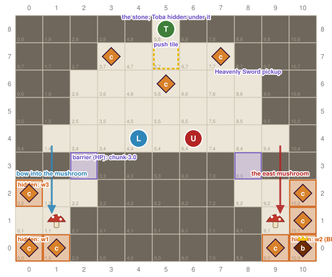

# Onboarding demo D3: paper levels for M1 to M4

Size: L    Tier: 3 (level content, story beats, roster; THJ approves each paper level before it's built)    Assigned to: miso-game-designer
Branch: `thj/onboarding-demo` (D-604, reverses D-602's "build on `main`"), scope this branch
Status: **M1 and M2 approved for building (D-631; M1 updated for D-632, D-633). M3 and M4 approved by THJ 2026-11-25 (D-688 to D-690): M3 with the Masher in the yard, built greybox first with open necks; M4 as written.** (First written 2026-11-23.) Every question is answered: groundwork D-605 to D-608, D-612, D-613; Cleanse D-614; stations D-618; paper-level questions D-619, D-620, D-622 to D-626; build rule D-621 ([Answers](#answers)).

Parent plan: [`2026-11-22-onboarding-demo.md`](2026-11-22-onboarding-demo.md), Phase 3 (D3). Item source: [`design/demo-tweaks-snapshot.md`](../design/demo-tweaks-snapshot.md) (THJ's snapshot of the tweak doc, 2026-11-23), sections 1, 6 and 7. Worked example and history: [onboarding levels](onboarding/2026-10-26-onboarding-levels.md), [after-Hearth design](onboarding/2026-11-09-onboarding-after-hearth-design.md), [post-Hearth challenge](onboarding/2026-11-11-post-hearth-challenge-design.md), [Trail balance](2026-11-11-trail-balance-design.md).

## Why

Phase 3 builds four missions from paper levels (snapshot section 1, rows 7 to 11):

| Mission | Squad | Snapshot |
|---|---|---|
| M1 · Linda & Mark (The Ridge) | Linda, Mark | A Masher Goblin; Catch & Return is the answer to it (M1-01 to M1-03, X-26) |
| M2 · Lucy & John (The River) | Lucy, John | One level; Shield Flare; Dark Worms; ends on the Pile (M2-01 to M2-06) |
| M3 · Defence (replaces The Trail) | Linda, Lucy + John or Mark | One level: barriers (after the greybox, D-689), enemy waves, exploding mushrooms, the Masher (D-688; the snapshot said a Black Claw); ends with Toba (M3-01 to M3-07) |
| M4 · 3 levels | Toba (fixed) + picks | An open cleanse fight with a Dark Shaman; a healing room; the boss and saving Ryker (M4-01 to M4-03) |

## Goal

Four paper levels that a builder can greybox without asking a design question, each within THJ's decisions, with every new-tech touch flagged.

## Acceptance criteria

- [x] Source grids of every level reworked (section 1, unchanged from the groundwork pass).
- [x] One paper level per mission with the skill's table (source, teaches, twist, squad, enemies, turns, first trigger, win/loss, cues, alert, FTP and clue, fallback, time), a grid block for every new layout, and the build lines.
- [x] Every distance a ★ relies on is counted on the grid in the text (not yet checked in a drawing: the coordinator renders, gate 7).
- [x] New to-checks in one table; new tech marked **!**.
- [x] X-20 and X-19 finalized against the snapshot.
- [x] THJ's approval per mission (M1, M2: D-631; M3, M4: 2026-11-25, D-688 to D-690).

## Scope

In: M1, M2, M3, M4 level 1 (grids); M4 level 2 (Mithra's Rest) and level 3 (the Queen) as change lists; the mission assets' shape; X-19, X-20.
Out: Home beats (M3-07, chunk 3.3), final text (`miso-narrative`), X-15 and X-27 (they change numbers, not layouts), M4-03's end sequence content.

## Touches

Systems: new prefabs `GB_m1-ridge`, `GB_m2-river`, `GB_m3-defence`, `GB_m4-cleanse`, with the old levels they replace renamed, not overwritten (D-621; [build rule per level](#build-rule-per-level-d-621)); `DungeonSafeRooms/LevelDivineRelicRoom 1.prefab`, `Level3/Level3-C1.prefab`; mission assets `MS2 - The Ridge`, `MS1 - The River`, `M2 - The Trail` (becomes M3), `M4 - The White Mothers`; wiring tools `SearchWiring.Ridge/River/Trail`, `M4SquadSlots`, tests `SearchTrailTests`, `M4SquadPickTests`; `Unit_Toba.prefab` (`unlockedAfterMission`); **(core: AI)** barriers, chunk 3.0.
USPs: all four (see [USP check](#usp-check)).
Docs: see [Docs to update](#docs-to-update).

---

## 1. Source levels as read

All blocks below are the **verbatim output of `tools/level_to_grid.py`**, run 2026-11-22 on `main` by a read-only Explore agent (the designer has no shell). Titles carry the offset: grid x = prefab x + the title's x shift (for example "offset x-1" means prefab x = grid x + 1). y = 0 is the bottom row. `_` = no GridCell; `.` may hold a rock prop (props block nothing). Coordinates in my prose are **grid** coordinates of each block.

The tool's guidmap (`reward-tools/guidmap.json`) is out of date (no `GB_*`, potions, Home states); the tool only needs unit and terrain GUIDs, so nothing was missed in the grids. Rebuild it before the next tool use that needs level GUIDs.

### M1 source: The Ridge (`Content/Levels/Greybox/GB_s2-ridge.prefab`)

```grid id=src-ridge title="Source: GB_s2-ridge (offset x-1, y+0)"
. . . _ _ _ _ _ _ _ _ _ _
c . c _ _ _ _ _ _ _ _ _ _
. c . _ _ _ _ _ _ _ _ _ _
. . . _ _ _ _ _ _ _ _ _ _
. . . . _ _ _ _ _ _ _ _ _
. L M . . . c c . . . . .
_ . . _ _ _ _ _ _ _ _ _ _
```

| Item | As built (verified from the YAML unless marked) |
|---|---|
| Size | 31 cells: a 3-wide room (x 0..2, y 2..6, plus 3,2), the start row y1, a 1-wide corridor 3,1 → 12,1, two cells below (1,0 2,0) |
| Squad | Linda 1,1, Mark 2,1 (placed; `MS2 - The Ridge`: Linda + Mark fixed, no free slot) |
| Enemies | 5 Dark Claws: rush pack 0,5 / 2,5 / 1,4; corridor 6,1 / 7,1. No HP overrides (Tutorial ×0.6: about 9.6) |
| Tier, alert, turn order | Tutorial; no `LevelAlertSettings` (Unaware by default; the pack wakes by sight at start, C4b); **turn order overridden: enemies first** (D-353) |
| Objectives | Default: defeat all |
| FTP, locks | No `LevelStartFPFiller`, no `LevelAbilityLock` (so Catch & Return, Footrace and every ability are open; Catch & Return open by default, D-352) |
| Sequences | Intro and outro set; level start plays the shared sleeper panel (C4b; the after-Hearth plan cut it, not checked if removed) |
| Rewards | XP 30, Gold 20 + Steel 2 fixed |
| Not built | The `after-ridge` blocks of 2026-11-09 and 2026-11-11 (Early tier, family first, a Claw at 10,1) were never built (D-501 queued them; the Trail balance plan says the Ridge is untouched) |

### M2 source: The River (`Content/Levels/Greybox/GB_s1-river.prefab`)

```grid id=src-river title="Source: GB_s1-river (offset x+0, y+0)"
_ _ . . . . _ _ . . _ . _ . . _ _
_ . . . . . . _ . a _ . _ a . _ _
_ . . . . . c _ _ _ . . . _ _ . .
U J . . . c . . . . . . . . . . .
_ . . . . . c _ _ _ . . . _ _ . .
_ . . . . . . _ . a _ . _ . . _ _
_ _ . . . . _ _ . . _ . _ . . _ _
```

| Item | As built |
|---|---|
| Size | 79 cells: the clearing x 0..6, the ford x 7..14 with four 2 × 2 islands (8..9 × 5..6, 13..14 × 5..6, 8..9 × 0..1, 13..14 × 0..1) and the middle strip, the far bank x 15..16 |
| Squad | Lucy 0,3, John 1,3 (Papa's Shelter at start) |
| Enemies | Clearing: Dark Claws 5,3 / 6,4 / 6,2. Ford: Archer Goblins 9,5 / 13,5 / 9,1 on islands (they can step inside their island). No HP overrides |
| Tier, alert, turn order | Tutorial; Unaware by default; family first |
| Objectives | Default: defeat all |
| FTP, locks | No filler, no locks |
| Rewards | XP 30, Gold 20 + Timber 1 + Fabric 1 fixed |
| Not built | The `after-river` blocks (1-tile islands, alert, Early) |

### M3 source: The Trail (`M2 - The Trail.asset`: Trailhead → Blood **or** Tracks → The Pile)

As built: post-Hearth challenge revision 2 (C3, `9e9e0ca63`) at Standard tier (C4, `75d97cd05`, D-516). All four: all enemies start alert; Linda and Lucy placed, a deploy slot for the free pick (John or Mark); the Linda–Lucy Duo locked; no FTP filler. Mission: Lucy + Linda fixed, 1 free, Toba excluded; Health Potion 2, FP Potion 1; XP 40, Gold 5; completion sequence = the Yard (`Yard_Midnight_SequentialSequence`), initiation = the Map Table clue scene.

```grid id=src-trailhead title="Source: GB_m2-trailhead (offset x+0, y+0)"
c . . U L . . . c c . .
. c . . . . _ . . . . .
--
note 3,0 deploy slot
```

Front and back: Claws 0,1 / 1,0 behind, 8,1 / 9,1 ahead. Default objective (defeat all).

```grid id=src-tracks title="Source: GB_m2-tracks (offset x+0, y+0)"
_ _ . . . . . . . _
. . . . _ . . . . c
L U . . . c . b . .
. . . . . . _ . . c
_ _ . . . . . . c _
--
note 0,1 deploy slot
level hidden pack 9,3 9,1
```

Black Claw 7,2 (health factor 0.75 → 30), Dark Claws 5,2 / 8,0, hidden pair 9,3 / 9,1 revealed by a hidden "turn 1 reached (enemy)" stage. Then "Eliminate all enemies."

```grid id=src-blood title="Source: GB_m2-blood (offset x+0, y+0)"
_ _ _ _ c _ _ _ _ . _ _ _ _ c _ _ _ _ _
_ _ _ _ . _ _ _ _ c _ _ _ _ . _ _ _ _ _
_ _ _ _ c _ _ _ _ . _ _ _ _ c _ _ _ _ _
L U . . . . . . . . . . . . . . . . . .
. . . . . . _ _ . c . . . . . . _ _ . .
--
note 0,0 deploy slot
level hidden gullies 4,4 14,4
```

Reach objective: "Follow the blood. Two of you, to its end." (tiles 18,1 / 19,1 / 19,0), hidden kill-all; turn-2 gully pair. (The aggregation enum was read as "count 2", not looked up.)

```grid id=src-pile title="Source: GB_m2-pile (offset x+0, y+0)"
_ _ _ U L . _ _ _ _ _
. c . . . . . _ . . .
. _ _ . _ _ . . . c .
. . . . _ _ . . . . _
. . . . . . . . . . c
_ c . . . . . . . . _
--
note 5,4 deploy slot
level hidden west 1,4 1,0
level hidden east 9,3 10,1
```

"Search the pile." (any Bergson on 3,3 or 6,3) → both sides revealed → defeat all; the tally's "Still counting?" / "…No." ending (MI-28; its fade is saved per save).

### M4 source: `M4 - The White Mothers.asset` ("Into the Rootwell")

Roster: **Lucy + Linda fixed, 1 free pick, Toba excluded** (C5a); but five of its levels **place Toba themselves** (MI-3), so most M4 fights already field 4 Bergsons-side units (sisters, the pick, Toba). Items: Health Potion 3, FP Potion 4. Rewards: XP 120, Gold 20, 4 materials. Home state after: `M4 - HomeState`. Graph (straight line, two AND pass-through nodes): **LevelDomFight → Level2-C1-TArtEx → Mithra's Gift (Divine Relic room) → Level2-C2 → Level2-C3-1 → Level2-C3-2 → Level3-C1**. Labels still read (1/5) to (5/5) with a (4.5/5) (GDD MI Q4).

```grid id=m4-l1 title="Source: LevelDomFight (offset x-6, y+4)"
_ . . . . . . _
. L . . . . . .
. . . . . . . .
. U . . . . . .
_ . . . . . . _
--
note 2,2 deploy slot
note 6,2 Toba (as enemy)
```

Toba's duel (MI-25): "Defeat the stranger!", all alert; Ryker placed off the grid.

```grid id=m4-l2 title="Source: Level2-C1-TArtEx (offset x+0, y+5)"
_ _ _ _ . a . . a . _ _ _ _
_ P . _ _ _ _ . _ _ _ . . _
. . . c % . % c . . % . L .
. . c . . . c . % . . T U .
_ P . _ . _ _ _ _ _ _ . . _
_ _ _ _ . a . . a . _ _ _ _
--
note 11,3 deploy slot
note 13,3 Ryker
```

Two Corruption pools (1,4 / 1,1), 4 Archers on the top and bottom rims, 4 Dark Claws, 4 webs. "All units reach the exit." Not all-alert.

```grid id=m4-l3 title="Source: Level2-C2 (offset x+10, y-1)"
. . . . . _ _ _ _ _ _
. . . . c _ _ _ _ _ _
_ _ . . . . _ _ _ _ _
_ _ % . . . . % . P _
_ _ . . % . . . % . _
_ _ . c _ _ . . _ _ _
_ _ . . _ _ % . _ _ _
P . a . . % c % . . _
P . . c . b . . . . U
_ _ a . . . . . . T .
_ _ . . _ _ _ _ _ . .
_ _ P P _ _ _ _ _ . L
--
note 0,10 Deer
note 10,1 deploy slot
```

Five pools, a Black Claw, 4 Claws, 2 Archers, 7 webs, the Whitemother (Deer). "Reach the Pathmother." / "Whitemother must survive." / defeat all. No loss on a wipe (GDD MI Q12).

```grid id=m4-l4 title="Source: Level2-C3-1 (offset x+25, y-8)"
_ _ _ . . . _ . . _ _ _
_ _ _ . . . * . . . _ _
_ . U . . . . a . . . _
. T . . . . O O c . . .
. . . . . . O O c . . .
_ L . . . . . a . . . _
_ _ . . . . * . . . _ _
_ _ _ . . . _ . . _ _ _
--
note 0,4 Deer
note 2,3 deploy slot
```

**A Masher** (2 × 2 at 6,3), 2 Claws, 2 Archers, 2 exploding mushrooms; escort the fawns, the Pathmother must survive.

```grid id=m4-l5 title="Source: Level2-C3-2 (offset x+25, y-8)"
_ _ _ . P . _ P . P _ _ _ _ _ _ _
_ _ _ . . . * . . . . _ _ _ _ _ _
_ U . . . . c . a . . . _ _ _ _ _
. . T . . . . c . . . . . . . . .
. . . . . . . c . . s . . . . . .
_ L . . . . c . a . . . _ _ _ _ _
_ _ . . . . * . . . . _ _ _ _ _ _
_ _ _ . P . _ P . P _ _ _ _ _ _ _
--
note 0,4 Deer
note 2,3 deploy slot
```

Six pools, a Dark Shaman, 4 Claws, 2 Archers, 2 mushrooms; escort the new Pathmother. FTP +5 and heal 7 at load (GDD).

```grid id=m4-l6 title="Source: Level3-C1 (offset x-6, y+5)"
_ _ _ . . . _ _ _
_ _ . . . . . _ _
. . . . . . . . .
L T . . . . . . .
U . . . . . . . .
. . . . . . . . .
_ _ . . . . . _ _
_ _ _ . . . _ _ _
--
note 1,1 Ryker
note 1,3 deploy slot
note 8,3 Goblin Queen (1 x 2)
```

The Goblin Queen (EN-6; 320 HP at Standard), all alert, enemies first, Family Super Time on her death (MI-23). Its hero HP overrides are ignored (pre-rename fields, D-363).

`Mithra's Gift` (`DungeonSafeRooms/LevelDivineRelicRoom 1.prefab`): "Take the Divine Relic from the altar, then reach the exit." Not drawn: it's a safe room. **Read 2026-11-23: no `DivineRelicPickUp` is placed in either relic room prefab, and it has no `SafeRoomFunction`** (to check how the relic is given today, T-12).

---

## 2. Facts the paper levels rest on

Read 2026-11-23 from the assets by a read-only Explore agent (paths in its report; summarised here). V = verified in the asset or code; A = assumed.

| Fact | V/A | Where it matters |
|---|---|---|
| Hero move 3 (`radiusV` 3 × `Stat_SPD`; SPD's base value not found, assumed 1) | V formula, A value | Every route |
| **Masher:** 2 × 2, Unmovable, can't be swapped; walk 1 × SPD; attack and counter target a 4-way neighbour and slam a plus of 5 cells, every faction; damage 8 × `Stat_DMG` (enemy DMG by tier 1 / 0.75 / 0.5 / 1, so 6 at Early); sight 2; HP 80 × tier | V | M1 |
| **Masher counter:** answers the attacker by walking (its walk range only) to a cell next to them, or strictly closer; slams only if it ends next to them; can plow one-cell units out of its step | V | M1 |
| **A 2 × 2 can only step where two cells side by side are free** (its footprint) | V (footprint rule, skill) | M1's alcove |
| **Linda's arrow pierces a 2 × 2 and flies on**; each unit is hit once per arrow; falloff ×0.9 per earlier hit on that arrow (`onHitExtraModifier` 0.9) | V | M1 (C4b's "no falloff" and the Trail logs' "6 then 4" disagree with the code: T-1) |
| **Catch & Return copy is Linda's** (owner, stats); a fresh hit ledger, so a unit between them is hit out and back; the Masher answers both hits **once, against Linda**, after the action | V (code; not played) | M1 |
| Dark Worm (THJ, D-623): **a worm splits on the first damage it takes**, into 2 worms of the next size, on its cell and the nearest free cell; its HP doesn't matter until the last children (4 HP, 2 damage), which die normally. So one placed worm = 1 + 2 + 4 split hits, then 8 small worms of 4 HP. Move 1, melee. (The code read found "a killing blow still splits" and the GDD's EN-4 says built worms split on death: T-16 aligns them with THJ's rule) | V (THJ) | M2 |
| Exploding mushroom: set off by any hit, 1.5 s delay, flat 7 to every unit around it (radius 1 radial: read as the 8 cells), both sides; re-arms after 3 turns; blocks walking; the AI doesn't avoid it (not found) | V / A (shape) | M3 |
| Dark Shaman: move 3, bolt 2, heal 3, summon 2, 50 HP | V | M4-1 |
| Corruption pool: a Dark Claw about every 4th turn (interval 3, first at about turn 3) on a free neighbour, one alive per pool; pool health 10; **one Cleanse (50 × DMG, radius 1, diagonals likely) destroys it** | V | M4-1 |
| Healing Room heal: `SafeRoomFunction.healHpModifer`, per prefab; Anahita's Ashiyan = 0.5 × the HP cap (half of max HP, not a full heal: GDD MI-22 Q11 needs fixing) | V | M4-2 |
| `TurnStartActionPointLimit`: one chosen turn per level load, not "while a condition holds" | V | M3 lever |
| Hidden unit revealed onto a taken cell: moves to the nearest free cell | V | M2, M3 |
| Sisters' tally: on automatically when both sisters are deployed and the mission isn't excluded; the "Still counting?" fade is `SistersTally_FadeOut` (played inside the Pile's end sequence today), saved by asset name | V | M3 |
| `TurnReached` counts from the moment its stage starts; no built "every turn while X holds" sequence | V | M3's push |
| `MoveUnitSequence` moves GUnits only; a neutral GUnit (the Deer is a model) could be a stone; Toba's Wall has no HP and can't be moved | V | M3 |
| Mark's kit on the prefab: Fist Blitz, Move (walk), **Vault (open by default)**, Command (locked; node "Command", whose text starts "Mark commands an ally to move"), Cleanse, his Duos. For the demo (X-26 = Command, D-633): Vault locked, Command open, as data | V | M1 |

### Rules every mission inherits

| Rule | For D3 | Source |
|---|---|---|
| Revenge, Pass-by | Back on after the Hearth | H-03, H-04 |
| Cleanse | **Locked in every level except M4 level 1** (`LevelAbilityLock` per level, or locked by default and unlocked in M4-1) | D-614, X-01 |
| Family Roles | As built (1 FTP each, no limit) until X-15 | X-15 |
| Linda–Lucy Duo | Locked through M3; first used in M4 (D-470) | D-470 |
| Turn order | Family first in every mission level (D-468 for the Ridge; the others are already family first) except the Queen (enemies first, as built) | D-468, MI-23 |
| FTP | Kept in each level's `LevelStartFPFiller` so X-28 is one sweep | Plan risks |
| Grounded arrows | Return to the quiver when a level is won, before its ending (H-08) | H-08 |

---

## 3. Paper levels

Coordinates in each block start at 0,0 (bottom left). `#` = no GridCell. Big units' footprints grow up and right from their anchor; the Masher is drawn on all four of its cells, as chunk 8 draws it (T-3: confirm the builder reads it as one Masher).

### M1 · Linda & Mark: "The wall that waits" (new `GB_m1-ridge`)

**Decided:** the Masher and Catch & Return beat replaces the corridor beat, in a widened stretch (D-605); Mark reaches the catch spot by a side path (D-606). The arrow does pierce a 2 × 2 (section 2), so the fallback isn't needed.

**The design move.** The Masher stands in a 2 × 2 alcove cut into the 1-wide corridor. With no second cell beside it in any direction, it **can't take a single step**: it can only slam whoever ends next to it. That makes its rule readable in one sentence ("never stand next to it") and makes the catch's value clear: Linda's plain arrows land under it and stay there (LI-6, LI-7), so plinking empties her quiver, while every caught arrow hits it twice and comes back.

**Why Mark stands next to it for a moment.** Linda's bow reaches 4. With a 2-cell Masher between them and one cell of space on Linda's side, Mark's catch tile is 4 from her and next to the Masher. So the rhythm is: Mark steps in (Move), Linda fires twice (two catches), Mark steps back out (Move). Nobody ends the turn next to it.

```grid id=m1-ridge title="M1 · The Ridge: the wall that waits"
c c c c # # # # # # # # #
. c . . M . . . . # # # #
. . . . # # # # . # # # #
. . . . # O O # . # # # #
. L . . . O O . . . . . .
--
cells 1,4 3,4 enemy hidden: back (turn 2 of the Masher stage)
zone 4,3 8,3 mark the ledge
arrow 4,3 8,3 8,0 mark dx=-8 the side path
arrow 3,0 7,0 linda dy=-8 bow
arrow 7,0 3,0 mark dy=8 caught, back
step 7,0 1
step 3,0 2
step 8,0 3
note 7,0 catch tile
note 8,0 rest tile
note 12,0 clue
level name The Ridge
level tier early
level alert all
level hidden back 1,4 3,4
```

The block has 5 rows, so y runs 0..4 (bottom row y = 0).

| Item | Plan |
|---|---|
| Source | **Big change: a new prefab `GB_m1-ridge`** from this block; the old `GB_s2-ridge` is renamed (D-621) and `MS2 - The Ridge` points at the new one. `SearchWiring.Ridge` targets the new prefab (stages, sequences, clue props, HP). Today's corridor queue and Vault beat go |
| Teaches | **Catch & Return as the answer to the Masher** (M1-02), after **Watch and Mark's Counter** in the opening fight (M1-03) |
| Twist | A wall that never moves but punishes anyone beside it; plain arrows get stuck under it |
| Squad | **Linda 1,0 in the room; Mark 4,3, on the ledge's first cell** (D-632: they start apart, so Mark's walk to the catch is short). Kit: Mark's attacks and **Command**, no Vault (X-26 = Command, D-633; data: Vault locked, Command open for the demo); no Cleanse (D-614) |
| Opening sequence (new, D-632) | Before control, after the intro: camera on Linda in the room → pan along the ledge to Mark at its mouth → back. Placeholder lines (`miso-narrative`): Mark "I'll take the high path. Keep them off me." · Linda "Keep up, little brother." Then the Role lines (Cues). H-01: any enemy intro plays last |
| Command in M1 (D-633) | **Beat 1, ★:** Mark Commands a pack Claw into Linda's lane: Command moves count for Watch (D-039, FR table). From 4,3 the Claw on 2,4 is 3 away (in his 4); walked to 1,2 (3 from 2,4), it stands in Linda's column 2 from her: Watch fires. **Beat 2:** little use. From the ledge (8,1 to 8,3) Linda on 3,0 is 5 or more away, outside Command's 4; only while Mark is still within 4 of her (on 3,2, say: 3 from 1,0) can he walk her the 2 steps to 3,0 and save her the Move. **No shortcut:** Command can't move the Masher (Immovable, EN-3); a Commanded unit walks, so it can't pass the Masher or cross missing cells; nothing it does gets Mark past the Masher (T-18: whether Command can target Mark himself; even so, he'd walk). Cost: 1 AP (cooldown 1), so a Command turn delays his walk by one Move |
| Cells | Room x 0..3, y 0..4 (20). Corridor y 0: 4,0, the Masher's alcove 5..6 × 0..1, then 7,0 to 12,0. Ledge 4,3 to 8,3, down 8,2 and 8,1 to 8,0. **Missing on purpose:** 4,1, 7,1 (no sideways step), 5,2 and 6,2 (no step up); there is no row below y 0 (no step down). So the Masher's only neighbours are 4,0 and 7,0 |
| Enemies | **Pack** (alert): Dark Claws 0,4, 2,4, 1,3, factor 0.8 (≈ 13). **Masher** anchor 5,0, alert, factor 0.45 (≈ 36 at Early). **Hidden `back`:** Dark Claws 1,4, 3,4, factor 0.8, revealed at the start of the Masher stage's second family turn |
| Beat 1: the pack (Roles) | Family first. Distances (rechecked for the new starts): 1,3 is 3 from Linda (1,0) and 3 from Mark (4,3); 2,4 is 3 from Mark (2,3, 3,3 beside him) and 4 from Linda; 0,4 is 5 from Linda (down column 0 to 0,0 beside her) and 5 from Mark. All three reach a hero on enemy turn 1. At 13 HP nothing dies to one hit (bow 6, Explosive 8, Blitz 8), so enemy turn 1 comes. **Watch:** every tile beside Linda (0,0, 2,0, 1,1) is in her row 0 or column 1, so any Claw that reaches her ends in her lane and draws Watch (her first real use: it was off in Memory 1). **Counter:** Mark's only open neighbour on the start row of the ledge is 3,3 (4,2 and 4,4 don't exist; 5,3 is behind him), so a Claw that goes for Mark hits him from 3,3, 1 away, and draws his Counter (T-17: a hit on Mark himself counts, as the FR table reads "hits a family member"). A Claw that hits Linda is 5 or more from Mark: no Counter there. Lever if T-17 fails: Mark starts on 3,2 (2 from 2,0 and 1,1; the walk to the ledge is 2 steps longer). ★ Explosive Arrow on 1,4 from 1,0 (4 away) hits 0,4, 2,4, 1,3 and 1,4's empty cell: 8 on all three; Mark finishes one; Watch and the Counter take the rest on the enemy turn. ● Bow and Blitz one at a time: a round longer |
| Stage 1 → 2 | Pack dead → sequence: camera along the corridor to the Masher (its first-appearance close-up, EN-10, plays here: last, before control returns, H-01) → the setup lines (below) → objective **"Get past the Masher."** |
| The setup (M1-02: "a short setup shows how the Masher works") | Mark: "I'll knock it over." · Linda: "Don't stand next to it. Look." The player sees the rule on the board: the Masher is alert, so hovering it shows its counter preview (EN-2: path, cells, damage), and its only two neighbour tiles are the danger. Camera, two lines and the preview, no scripted hit (D-620) |
| Beat 2: the catch (distances on the grid) | Linda on **3,0**: the Masher's nearest cell 5,0 is 2 away, so she's never next to it, and it can't step to her. Her bow along row 0 reaches 4,0, 5,0 (Masher), 6,0 (same unit), **7,0**: 4 tiles, inside her 4. **Mark** goes along the ledge: from his start 4,3 to 8,3 is 4 steps, then 8,2, 8,1, 8,0 (3 more): from the ledge's end, **one Move** drops him on the rest tile **8,0** (2 from the Masher's 6,0: safe). If he ends beat 1 near 4,3 (he fights there), one turn of two Moves takes him to 8,1, and the next turn he steps 8,1 → 7,0 (2 steps) to catch. Linda's walk is 1,0 → 3,0 (2 steps). Each turn: Mark 8,0 → 7,0 (1 AP), Linda fires twice from 3,0 (the arrow passes the Masher, reaches Mark 4 away with an enemy between: the catch is offered, MA-3), Mark 7,0 → 8,0 (1 AP). Each catch hits the Masher out and back: 6 + 6 = 12, and the arrow returns to her quiver |
| Answers | ★ **Catch & Return** as above: 24 a turn, quiver full, the Masher dies in 2 of Linda's turns (36 HP). ● **Linda alone from 3,0:** 6 a shot, and each arrow lands under the Masher, locked until it dies: three arrows = 18, then she's empty (Encore: T-4). ● **Explosive Arrow** on the Masher from 3,0: 8, then a grounded arrow too (LI-4, to confirm). ✗ **Mark hits it** (Fist Blitz ends next to it): it slams Mark (6) and the plus around him; his Counter answers, which provokes another slam: a loop paid in FTP and HP (chain cap 10). ✗ **Ending the turn on 7,0 or 4,0:** it slams on its turn |
| Pressure | The hidden `back` pair arrives in the room on the stage's second family turn (camera and bark), acts the next enemy turn: from 3,4, three steps (3,3, 3,2, 3,1) put a Claw beside Linda on 3,0. So plinking alone gets her hit from behind; the catch kills the Masher first. Mark's Counter can't reach them from 8,0: Linda deals with them (Watch on column 3 or row 0) |
| Win / loss | Stage 1 the pack dead (hidden objective). Stage 2 "Get past the Masher." = the Masher dead; a hidden "turn 1 reached" stage reveals `back` (the Trail pattern). Stage 3 "Clear the ridge." (defeat all). Loss: default (family down) |
| Cues | Level start: one line each for the Roles (M1-03; placeholders, `miso-narrative`): Linda "Anything that steps into my line gets an arrow." · Mark "Anything that touches her answers to me." Stage 2: the setup lines; when Mark first stands on 7,0: Mark "Linda. Shoot at me." · Linda "Gladly." (G9-6/7). Arrival bark for `back` |
| First trigger | Watch and Counter on enemy turn 1 (every pack Claw within 5 of a hero; Watch on any Claw beside Linda, the Counter on a Claw that hits Mark from 3,3); Catch & Return on the first Linda shot with Mark on 7,0 (the aim preview shows the return, CR-56) |
| Alert | `level alert all` (so the Masher's counter preview shows from the start; EN-2 hides it while Unaware) |
| FTP, clue | FTP full at start (Linda 2 + Mark 3 = 5; roles 1 each, Continuous Attack 1, 2, 3). Clue on 12,0: the end close-up (G9-3/4, as built, moved). Rewards as built |
| Fallback | If Mark never takes the ledge: Linda's plain arrows and Encore still kill it, slower, and the `back` pair hits her. Hint: a `GuidedAbilityHint` on Linda's bow while Mark stands on 7,0 (T-5); Mark's "Shoot at me." line already points at it |
| Time | ~4.5 min (beat 1 ~2 rounds, beat 2 ~2 to 3: Mark's walk is now 1 turn plus a step) |

**Note on "one Move" (D-606).** Strictly, no path around a 2 × 2 is one Move: the shortest loop from the tile beside it to the tile beyond it is 5 steps. The ledge keeps Mark 2 cells from the Masher all the way and ends one Move above the rest tile. THJ: the ledge as drawn (D-619); Mark now starts on it (D-632).

### M2 · Lucy & John: "At me!" (new `GB_m2-river`)

**Decided:** one level (M2-01); John rushes in, is surrounded, and the player casts Shield Flare (M2-03: a `MoveUnitSequence` moves him, Lucy's embers on him are the play); Dark Worms (M2-05); the Pile at the end is Ryker's clue only (D-607). The ford's island Archers go: they were the old Shield Flare lesson, and the ring replaces them.

**Revised 2026-11-26 (THJ, D-759):** the two east columns (rock and the Pile's prop cells) and the top and bottom rows are cut, so the level is 15 × 5 and every y below is one less than in the first draft; the worm and the clearing's middle Claw swap places (the worm opens the level in the clearing, the ring is four Claws); an Archer Goblin stands on 11,2.

```grid id=m2-river title="M2 · The River: at me!"
# . . . . . . # . . . . . . .
# . . . . . c # c . c . . . .
U J . . . w . . . . . a . . .
# . . . . . c # c . c . . . .
# . . . . . . # . . . . . . .
--
cells 8,3 10,3 8,1 10,1 11,2 enemy hidden: ring
step 9,2 1
note 9,2 John rushes here
note 14,2 the Pile: props past this edge
arrow 7,2 9,2 lucy ember John
arrow 9,2 8,3 lucy dy=-6 Flare
arrow 9,2 10,3 lucy
arrow 9,2 8,1 lucy
arrow 9,2 10,1 lucy
level name The River
level tier early
level alert all
level hidden ring 8,3 10,3 8,1 10,1 11,2
```

| Item | Plan |
|---|---|
| Source | **Big change: a new prefab `GB_m2-river`** from this block; the old `GB_s1-river` is renamed `GB_s1-river_v1` (D-621) and `MS1 - The River` points at the new one. The clearing is the old one less its top and bottom rows; the islands and Archers go; the ford becomes open shallows x 8..14, y 0..4, joined to the clearing by 7,2; the Pile is props just past the east edge (x 15..16 × 1..3, no cells). New wiring tool `MissionWiring.River.cs` (as M1's `MissionWiring.Ridge.cs`); `SearchWiring.River` keeps the old prefab and loses the mission step |
| Teaches | **Shield Flare** (M2-02, M2-03), after **Lucy's follow-up and John's guard** in the opening fight (M2-06) |
| Twist | The opening fight is a worm swarm; then John charges ahead and is surrounded |
| Squad | Lucy 0,2, John 1,2 (Papa's Shelter at start, as built). No Cleanse (the level gets its own Cleanse lock, D-614, D-713) |
| Enemies | **Clearing** (alert): **Dark Worm** 5,2, no HP override (it splits on the first damage, D-623, D-630), splitting down to 4 worms of 4 HP (D-762); Dark Claws 6,3, 6,1, factor 0.8 (≈ 13). **Hidden `ring`** (revealed around John): Dark Claws 8,3, 10,3, 8,1, 10,1, factor 0.45 (≈ 7); **Archer Goblin** 11,2 (`Unit_ArcherGoblin`), hidden in the `ring` and part of its objective (D-760), factor 0.45 |
| Beat 1: the clearing (Roles) | Family first. The worm on 5,2 is 5 from Lucy. ★ John strikes within 3 of Lucy: **her follow-up** fires (2 × 3, LU-5), and on the worm each hit is a split. Enemy turn: a Claw or worm that targets Lucy within 2 of John **is taken by John's guard** (×0.5). ★ Lucy's Cyclone in the clearing's mouth against the swarm (worms move 1). ● Sword and embers one by one (each split needs its own hit) |
| Stage 1 → 2 (M2-03) | Clearing dead (the worm's children included) → sequence: John "There, by the water. Fur." (he sees the clue) → `MoveUnitSequence` John to **9,2** → reveal `ring` (the four diagonal neighbours of 9,2, plus the Archer) → `CastAbilitySequence` John's Shield Up → John "Lucy! At me!" · Lucy "*At* you?" (M2-02, placeholders) → **turn reset** (LSB `reset`, Memory 4's Hold pattern: a fresh family turn with AP) → `GuidedAbilityHint` on Lucy's Fire Embers until used → input on. Objective **"Help John."** (the ring dead) |
| Beat 2: the Flare (distances on the grid) | John on 9,2 under Shield Up. Each ring Claw sits on a diagonal of 9,2, 1 away: Shield Flare's copies fly along the four diagonals and hit the first enemy within 2 (SY table), so **one Flare hits all four Claws**. The Archer on 11,2 is 2 east of John, off every diagonal: it shoots (range 3) at John or at Lucy on 8,2, and needs its own answer (Lucy's embers from 8,2 reach it, 3; John's Sword after a step). Lucy needs John within her embers' 3: **7,2** is 2 from John (inside his guard's 2, so a ring hit on her goes to John) and reachable in one Move from anywhere in the clearing at x ≥ 4; **8,2** is next to John (Papa's Shelter: one more ember, so one more Flare) but beside 8,3 and 8,1 and in the Archer's 3. ★ Lucy to 7,2 or 8,2, embers on John: the aim preview shows the four copies (CR-56). Damage: 4 a copy from the main ember (7 if every ember flares, T-6): two Flares, or one Flare + John's Sword, clear the Claws. ● Embers on each ring unit directly (slower). ✗ John walks out of the ring (gives up the Shield Up turn, the ring follows) |
| Stage 3 | "Clear the river." (defeat all) |
| Win / loss | Stage 1 the clearing dead (hidden); stage 2 the ring units dead; stage 3 defeat all. Loss: default |
| End (M2-04) | The Pile: camera to the props past the east edge, the Pile close-up, Ryker's clue (prints, white fur, the axe-killed Claws of R7-4/5), John and Lucy's lines (placeholders). **No tally beat here** (Linda is absent; D-607) |
| Cues | Level start: John "Stay by me." (built) and one Lucy line about her follow-up (M2-06, placeholder). Stage 2 as above |
| Alert | All alert (the ring comes in alert) |
| FTP, clue | Full at start (John 5 + Lucy 3 = 8). Clue as above. Rewards as built |
| Fallback | The pulse on Fire Embers and the preview; if the player still doesn't ember John, the ring dies slower and John (24 HP, Shield Up 60%) takes it |
| Time | ~5 min (the swarm now sits in beat 1; watch it in play) |

**The worm (D-623, D-630; moved to the clearing by D-759).** One worm, opening the level. Its cost is hits, not HP: 3 split hits (1 + 2), then 4 small worms of 4 HP that any hit kills (the prefab has 3 sizes; kept by D-762, the first draft's 7 and 8 were wrong). It now tests the Roles fight (follow-up, guard, Cyclone) rather than the Flare. Lever if beat 1 runs long in play: Claws 6,3 / 6,1 to ×0.6, or one Claw out.

### M3 · Defence: "Hold the yard" (new `GB_m3-defence`, in the `M2 - The Trail` mission asset)

**Approved by THJ 2026-11-25 (D-688 to D-690).** The block below is the approved level: the Masher in the opening yard fight and no Black Claw (D-688, from the ambush design's section 11, grid `m3-defence-2`, folded in here under the id `m3-defence`). **Greybox first (D-689):** see the next section.

**Greybox first: open necks, no barriers (D-689).** The first build has the necks 2,3 and 8,3 open and no barriers: no chunk 3.0, no `AIUnitBrain` change. Enemies walk straight into the yard through the necks, along the lanes. THJ plays it, then decides on barriers. Until then:

- **Deferred (kept as written, not built):** the Barriers row, T-7 (barrier damage rules), chunk 3.0 and its New-tech row in section 6, the Risks line on barrier AI, the "breach" sentence in Distances, the barrier clause in the mushroom row, the "Both sisters on one side" clash in Answers (below), and the grid note `cells 2,3 8,3 note barrier (HP): chunk 3.0`.
- **Still live:** the layout, the waves, the mushrooms, the Masher, the stone and the push, the end, the sword, the tally.
- **One sentence that drops out for now:** the "they break walls" cue (barriers, Teaches and Cues rows). With open necks there is nothing to teach, and no arrival bark or caption mentions walls.
- **What the paper claims under open necks** (checked, not changed): distances to the pusher hold; the lane-to-yard walks are 5 to the neck plus 6 to the pusher's side, about 3 enemy turns, so each wave still arrives in a later round. What changes is the hold's pressure: no barrier absorbs about four Claw hits per neck (about 1 turn per wave), so waves land together sooner. Suggested lever if the greybox is too hard: Claws at factor 0.65 in w1 to w3, before any barrier. Also open: with the necks open, "Cyclone on a lane's mouth (2,2 or 8,2)" and the mushroom blast become the only chokepoints, so they carry the hold (that is the thing to watch in the play).

**Decided:** the stone moves by itself while the pusher stands at it (D-608); "Still counting?" plays here (D-607); roster as today: Lucy and Linda fixed, plus 1 pick (D-607). Snapshot M3-02: "the third member (John or Mark) rushes off ... pushes the stone off the cave that hides Toba's camp, for 3 turns to start"; M3-03 barriers (**!**); M3-04 the sisters compete with exploding mushrooms; M3-05 a Black Claw (D-688: the Masher instead; the Black Claw is met in M1's ambush); M3-06 Toba appears and the family goes home.

**Who pushes: whoever is picked**, John or Mark (D-622). No roster change.

```grid id=m3-defence title="M3 · Defence: hold the yard"
# # # # # T # # # # #
# # # O O @ . c # # #
# # . O O c . . . # #
# # . . . . . . . # #
# . . . L . U . . . #
# # . # # # # # . # #
c . . # # # # # . . c
. * # # # # # # # * c
c c # # # # # # # c c
--
cells 2,3 8,3 note necks: open in the greybox (D-689); barrier (HP) only if THJ decides after the play, chunk 3.0
note 5,8 the stone; Toba hidden under it
note 5,7 push tile
note 3,6 Masher 3,6 (2 x 2, footprint 3..4 x 6..7)
note 8,6 Heavenly Sword pickup
cells 0,0 1,0 enemy hidden: w1
cells 10,0 9,0 10,1 enemy hidden: w2 (three Dark Claws)
cells 0,2 10,2 enemy hidden: w3
arrow 1,4 1,1 linda dx=-8 bow into the mushroom
arrow 9,4 9,1 lucy dx=8 the east mushroom
level name Defence
level tier early
level alert all
level deploy 5,4
level hidden toba 5,8
level hidden w1 0,0 1,0
level hidden w2 10,0 9,0 10,1
level hidden w3 0,2 10,2
```



*(The SVG must be re-rendered from this block: the file on disk is the pre-D-688 drawing.)*

| Item | Plan |
|---|---|
| Source | **Big change: a new prefab `GB_m3-defence`** (new layout), dressed like the Trail (H-11's first pass). The four Trail prefabs leave the mission graph and are renamed, not overwritten (D-621); `SearchWiring.Trail` and `SearchTrailTests` either follow the renamed prefabs or are retired with them (coordinator's call). **Mission asset:** keep `M2 - The Trail.asset` and make its graph one node, this level. That keeps everything keyed to it: the Yard as its completion sequence, the Map Table clue scene, its Home state, the tally, and the station unlocks after M3 (D-618: Bookshelf, Training Field, Cooking Cabinet). **If a new mission asset is made instead, the station rows and the Yard gate must move to it** |
| Teaches | Nothing new as a system: it's the sisters' exam and the first defence. **The Masher: never stand next to it** (its first appearance in the demo; it is not in M1 any more). Barriers ("they break walls") are deferred until THJ decides after the greybox (D-689); the Black Claw is not in M3 (met in M1's ambush) |
| Twist | The third member leaves the sisters to it; they compete for kills (M3-04) until the end, where they stop |
| Squad | Linda 4,4, Lucy 6,4, the pick on the deploy slot 5,4 (John or Mark). Linda–Lucy Duo locked (D-470). No Cleanse |
| Cells | The yard x 2..8, y 4..6, plus 1,4 and 9,4 (the bulges), y 7 x 3..7 with the push tile **5,7**, the stone's cell 5,8. Two necks 2,3 and 8,3 (open in the greybox, D-689; barriers only if decided later). The Masher's 2 × 2 fits only in the yard (the lanes and necks are one tile wide). Lanes: west 0,0, 1,0, 0,1, 0,2, 1,2, 2,2; east mirrored (10,0, 9,0, 10,1, 10,2, 9,2, 8,2). Mushrooms on 1,1 and 9,1 (cells, they block walking) |
| Enemies | **Opening** (alert, in the yard; D-688): **the Masher, anchor 3,6** (2 × 2, footprint 3..4 × 6..7, all cells exist), factor 0.45 (36 HP at Early), + Dark Claws 7,7 and 5,6, factor 0.8 (≈ 13 each). **Waves**, hidden groups in the lanes: **w1** west, Claws 0,0, 1,0; **w2** east, **three Dark Claws 10,0, 9,0, 10,1** (×0.8; no Black Claw in M3); **w3** one Claw each side, 0,2 and 10,2. Claws ×0.8. Cost of the Masher: the opening is harder (36 HP plus two Claws); lever: factor 0.35. No pools: pools are the cleansable circles Cleanse answers in M4 (D-614), and the player can't cleanse here |
| Barriers (**!**, chunk 3.0) **(deferred, D-689: not in the greybox; the necks are open until THJ decides after playing it)** | On 2,3 and 8,3: an object with HP that blocks walking; an enemy whose way is blocked attacks it (M3-03). Start value 20 HP (about four Claw hits at Early, 4.5 each). The only way into the yard is through them. Rules the paper assumes and 3.0 must settle: enemies target it only when blocked; family attacks don't hurt it (Linda's pierce, the mushroom's blast: T-7) |
| The mushrooms (M3-04) | 1,1's blast covers 0,0, 1,0, 0,1, 0,2, 1,2, 2,2 (the west lane's mouth), not the barrier on 2,3 (2 away; barrier clause deferred, D-689). Linda on the bulge **1,4** fires down column 1: across the gap 1,3, through a Claw on 1,2, into the mushroom on 1,1 (3 away, inside her 4), on to 1,0. Lucy on 1,4 reaches it with an ember (3). Mirror on the east (9,4 → 9,1). 7 to everything in the lane mouth + a bow hit (6) = 13, a kill: that's the tally race. Who gets credit for a blast kill: T-8. **Crossing the gap at 1,3 / 9,3 is not verified in code (T-15).** Fallback: make 1,3 and 9,3 present cells that block walking (a permanent untargetable blocker entity), never plain walkable cells, which would open a way into the yard around the barrier |
| Stages | **S1** "Clear the yard." (the opening three dead: the Masher and two Claws, so the Masher is dead before anyone takes the push tile 5,7 beside its cell 4,7). → sequence: the pick: "There's a cave behind that stone." (placeholder) + camera on the stone. **S2** "*{Pick}*: push the stone." = a Bergson on 5,7 (T-9: the deploy slot's unit as the condition, else any Bergson) → reveal w1, line "Keep them off him!". **S3a, S3b, S3c** "Hold them off (1/3)", "(2/3)", "(3/3)": each = **the pusher on 5,7 (Reevaluate) and 1 turn passed since the stage began** → on complete: the stone shifts one notch (a prop swap or a short move, T-10), reveal the next wave (w2 after S3a, w3 after S3b). After S3c: the stone rolls away (sequence). **S4** "Finish them." (defeat all) |
| How the push reads (D-608) | One sentence: "While he stands at the stone, it moves; if he leaves, it stops." The queued stages give one notch per turn at most and pause while he's off the tile. Data only; no new tech. The pusher can still act from 5,7 (attack what reaches him, John's Shield Up, Mark's Blitz). Lever if it's too easy: he gets no AP while pushing, **which needs new code (!)**: `TurnStartActionPointLimit` sets one turn per level, not "while on the tile" |
| Distances | **Masher (D-688):** Linda 4,4 to its nearest cell 4,6: 2; the pick 5,4 to 4,6: 3; Lucy 6,4 to 4,6: 4. Family first, so nobody starts next to it, and in the yard it has room to step. **Neck to pusher:** from the neck 2,3 to 5,7 is 7 steps (4-way), the sisters on the bulges are 1 from the necks' yard side, from 5,4 (the deploy slot) to 5,7 is 3, one Move. With open necks (greybox) a Claw from a lane walks through with no stop: a lane start to the neck is about 5, so a wave reveals and reaches the yard's edge in 1 to 2 turns and the pusher's side in about 3. **If barriers are added later:** a Claw that breaks one needs two more turns to reach him |
| The Masher (M3-05, D-688) | In the opening yard fight, anchor 3,6 (2 × 2). Its close-up plays at M3's start (EN-10, name from X-05); the Masher's lines and caption are the narrative agent's. **Never stand next to it.** ★ Lucy's Cyclone hits it and never provokes its counter (EN-2; Lucy is fixed in M3). ● Shots from 2 or more tiles away (it walks 1 and slams only if it ends next to you). ✗ Ending a turn on 2,6, 3,5, 4,5 or 5,7 beside it. The Black Claw row is gone: no bell in M3, so chunk 18 ("the bell as a shield") is not used here |
| Answers (the hold) | ★ Split the fronts: Linda on one bulge, Lucy on the other, each firing down her column into the lane and its mushroom. ★ Cyclone on a lane's mouth (2,2 or 8,2): its arms hold the lane and pull Claws into the mushroom's blast (in the greybox this is the chokepoint). ● Both sisters on one side: the other lane walks in unopposed (with barriers, later: the other barrier falls a turn later) and the pusher gets company |
| End | S4 won → end sequence (D-624): the tally alone on screen, Linda: "Still counting?" · Lucy: "…No." (`SistersTally_FadeOut`, moved here from the Pile) → camera on the cave → reveal Toba (non-hostile, `toba` group, after the stone is gone) → his lines: he knows the way to the Rootwell and where Ryker is (M3-06, placeholders) → fade, home (M3-07 is chunk 3.3) |
| Cues | **Level start: the Masher's close-up** (camera on it, its name from X-05, EN-10; the placeholder lines are the narrative agent's), then input. Arrival barks and camera on each wave (the Trail's arrival pattern: input off, camera, reveal, bark, camera back); barks for the tally race (X-02/X-03 if built). The "they break walls" cue is deferred with the barriers (D-689) |
| Alert | All alert; waves come in alert |
| FTP, items, clue | FTP full at start (`LevelStartFPFiller`). Items as the Trail (Potion 2, FP Potion 1). The clue is Toba. **The Heavenly Sword pickup on 8,6** (X-20, D-625): the yard's east corner, 2 steps off the hold line, so taking it costs a sister a move during the hold; 3 shared uses, a 3 × 3 of 10 × within 5, for the mission (PR-30 to PR-32). Placed by hand (the grid has no relic character) |
| Fallback | No caps. If the pusher leaves the tile, the stone waits; if both barriers fall, the yard fight still wins. A loss is the whole mission (one level) |
| Time | ~6 min (S1 2 rounds, hold 3, finish 1) |

### M4 · three levels

**Approved by THJ 2026-11-25 (D-690), as written.**

**Decided:** the Queen as built is the boss; seats Toba, Linda, Lucy fixed + 1 pick; the duel goes (D-613); Mithra's Gift becomes Mithra's Rest, a heal plus the relic (D-612); Cleanse only in level 1 (D-614).

**Mission asset (`M4 - The White Mothers`).** Graph: **`GB_m4-cleanse` → Mithra's Rest → `Level3-C1`**, labels (1/3) to (3/3). Roster: Toba, Linda, Lucy fixed, 1 free (John or Mark); Toba no longer excluded. `Unit_Toba.prefab`'s `unlockedAfterMission` becomes the M3 mission (`M2 - The Trail`). `M4SquadSlots` and `M4SquadPickTests` follow. The old levels (duel, C1-TArtEx, C2, C3-1, C3-2) leave the graph and stay as maps. Bond Threads §10 (Toba joins after M4) changes.

#### M4-1 · "The circles" (new `GB_m4-cleanse`)

Snapshot M4-01: an open level with a cleanse objective, room for Synergy planning, the demo's only real fight; a Dark Shaman.

```grid id=m4-cleanse title="M4-1 · The circles"
# # # . . . . . . . # # #
# # . . . P c . . . . # #
# . . . . . . . . . . . #
. . . . . . . . c . . P .
L . . . . . . c . s . . .
U T . . . . . . c . . . .
. . . . . . . . . . . . #
# . . . . P c . . . . # #
# # # . . . . . . . # # #
--
cells 8,4 7,4 9,4 8,5 8,3 linda Explosive on 8,4
arrow 4,4 9,4 linda dy=-8 Marks-Sisters
note 1,4 deploy slot
note 5,7 pool
note 11,5 pool
note 5,1 pool
level name The circles
level alert all
level deploy 1,4
```

| Item | Plan |
|---|---|
| Source | **New prefab `GB_m4-cleanse`**; dressing from Level2-C1-TArtEx (the old M4 level with pools). Nothing is overwritten |
| Teaches | **Cleanse** (its only level, D-614) and the **sisters' first Duo** (Marks-Sisters, D-470), in the demo's one real fight |
| Twist | Three circles keep spawning while a Dark Shaman heals and summons behind a screen; the family must split to cleanse |
| Squad | Linda 0,4, Lucy 0,3, Toba 1,3, the pick on 1,4. Cleanse unlocked here only (Toba has none) |
| Enemies | Standard tier, no overrides. **Screen:** Dark Claws 7,4, 8,5, 8,3 around the empty 8,4; **Dark Shaman** 9,4 (heals within 3, summons within 2). **Guards:** Dark Claws 6,7 (north circle), 6,1 (south circle). **Circles:** pools 5,7, 11,5, 5,1 (a Claw about every 4th turn each, one alive per circle) |
| Setup turn | All alert, family first. Nearest enemy 7,4 is 6 from the pick's slot (1,4): its 4 steps end on 3,4, 2 short of a hero. The first turn is for positioning |
| Synergy planning (distances) | ★ **Explosive Arrow on 8,4** from 3,4 (5, inside its 5): the cross hits 7,4, 9,4 (the Shaman), 8,5, 8,3, 8 each. ★ **Marks-Sisters** (first use) from Linda on 4,4: row 4, 5 cells, 5..9: hits 7,4 and the Shaman 9,4, 12 × (×0.7 to 1.5). ★ **Tempest Bloom:** Lucy's Cyclone on 8,4 (Lucy on 5,4, 3 away): its Whirl hits all four touching enemies, and Linda's arrow down row 4 into it splits into the screen. ★ **Toba:** Provoking Presence pulls enemies within 3 two cells toward him (off a circle); Healing Marks with Linda. ● The pick's Synergy with a sister (Shield Flare or Catch & Return) on whatever closes |
| The circles | Each sits 5 to 11 from the start. Cleanse needs the cleanser within 1 (diagonals likely): north 5,7 from 4,6 / 5,6 / 6,6; south 5,1 from 4,2 / 5,2 / 6,2; east 11,5 from 10,4 / 10,5 / 10,6, behind the Shaman. One Cleanse each (pool health 10 vs 50 × DMG) |
| Win / loss | One stage, two objectives together: **"Cleanse the circles."** (all three pools destroyed) and **"Defeat the dark claws."** (defeat all). Loss: default |
| Cues | Level start: Toba points at the circles (line, placeholder); the Cleanse button pulses once (`GuidedAbilityHint`, WhenUnlocked) |
| FTP | Full at start (`LevelStartFPFiller` 99), so Marks-Sisters (2 FTP) is affordable on turn 1 |
| Fallback | No caps; circles keep spawning until cleansed (one alive each), so a slow player meets more Claws but never an endless flood |
| Time | ~8 min |

#### M4-2 · Mithra's Rest (reworks `LevelDivineRelicRoom 1.prefab`, no grid change)

| Item | Plan |
|---|---|
| What changes | Name "Mithra's Rest". Add a `SafeRoomFunction` with its heal (the Healing Room's component) to the relic room; place the Heavenly Sword pickup (`DR_PickUp_HeavenlySword`) on the altar (none is placed today, T-12); campfire props; `LevelStartFPFiller` 99 (the "refill" of M4-02). Objective: "Rest by the fire, take the relic, then go on." |
| Heal value | **50% of max HP, and FTP filled** (D-626): the Healing Room's own value (`healHpModifer` `baseFactor` 0.5 on `StatUB_HP`), plus `LevelStartFPFiller` 99 |
| Build rule | **Small change: edit in place** (`LevelDivineRelicRoom 1.prefab` is M4's own copy) |
| Scene | A short campfire scene when the heal triggers: the family recovers; Toba's line (narrative tech, placeholder). Rations need the Home Kitchen: not in this demo (snapshot M4-02) |

#### M4-3 · The Goblin Queen (`Level3-C1`, no grid change)

| Item | Plan |
|---|---|
| What changes | Roster only: Toba placed (as built) is one of the fixed seats; the sisters placed; the deploy slot for the pick. Check that a fixed roster Toba and the placed Toba don't double (T-11). End sequence: saving Ryker (M4-03, narrative tech) |
| Values | Queen 320 HP at Standard, enemies first, Family Super Time on her death (as built). Lever after a timed play: 150 (the M10 value). The level's hero HP overrides are ignored (D-363) and stay that way |
| Build rule | **Small change: edit in place** (roster and end sequence only; the deploy slot is already there, C5a) |

---

## 4. X-20 and X-19 (final, against the snapshot)

### X-20 · Where a Divine Relic is introduced before M4

The snapshot's candidates: an M1, M2 or M3 reward, or a Home visit. A relic lasts the mission (PR-31), so a mission-end reward is gone before it can be used; a Home visit can show it but not use it.

**Decided (D-625): a walk-on Heavenly Sword in M3, on 8,6** (the yard's east corner, 2 steps off the hold line; picking it up costs a sister a move during the hold). Three uses, a 3 × 3 of 10 × within 5: it clears a lane mouth the turn a wave arrives. Mithra's Rest then gives it again before the Queen, so the player knows it. Data only (the pickup prefab); in the `m3-defence` block as a note.

### X-19 · Can a `thj/home-test` station join cheaply?

| Station (home-test) | What it needs on `main` | Cost | Adds before M4 |
|---|---|---|---|
| Kitchen, Workshop (sim), Study, Yard Lessons, Porch, Homestead | The Home sim (seats, day phases, resolve order) | High: the sim isn't on this branch | Little: the demo has no days |
| Stargaze, Hearth time, Dining Table at dusk | The sim's night and dusk phases | High | Bond and lines |
| Send-off scene, one Dining Table line set | A `DialogNodeSequence` (built) | Low: data and text | A family moment before M4 |

**Recommendation: no station.** If one Home beat is wanted, a **Send-off scene before M4** as a sequence (the family sends the squad, Toba among them). The stations that matter for the demo are `main`'s own (X-24, X-31; unlocked after M3, D-618).

---

## 5. To check (new; each decides a tile or a number)

| # | Question | Decides | Owner |
|---|---|---|---|
| T-1 | Linda's arrow falloff in play: code ×0.9 per earlier hit; C4b said none without the run upgrade; the Trail logs show 6 then 4 | Every pierce number (M1 uses only first hits) | implementer, read + play |
| T-2 | **Settled (D-633):** "Move" is Command. Mark's M1 kit: his attacks plus Command, no Vault | — | — |
| T-17 | Does Mark's Counter fire when the enemy hits Mark himself (the FR table: "an enemy's action hits a family member")? | M1 beat 1's Counter from 3,3; lever: Mark starts on 3,2 | implementer, read |
| T-18 | Can Command target Mark himself? (No shortcut either way: a Commanded unit walks) | M1 note only | implementer, read |
| T-3 | The grid builder places one Masher from four `O` cells (anchor bottom left) | M1 build | implementer |
| T-4 | What Encore does with arrows locked under a living Masher | M1's ● | play |
| T-5 | A `GuidedAbilityHint` condition "Mark on 7,0" | M1 fallback | implementer |
| T-6 | Which embers flare off John's Shield Up (main only, or each) | M2's HP values | play (level-chunks to-check 3) |
| T-7 | **(Deferred, D-689)** Barriers: do family attacks (pierce, mushroom blast, Cyclone) damage them? | M3, chunk 3.0 | 3.0 tech plan |
| T-8 | Who gets tally credit for a mushroom-blast kill (the sister whose hit set it off, or nobody)? | M3-04's race. If nobody, crediting it is new code (**!**) | implementer, read |
| T-9 | An objective condition on the deploy slot's unit (the pick) rather than any Bergson | M3 S2 and S3 | implementer, read |
| T-10 | The stone: a neutral GUnit on 5,8 (modelled on the Deer, Unmovable) removed or moved by sequence, or a prop over a cell another unit can't enter | M3 | implementer |
| T-11 | A roster-fixed Toba plus a level-placed Toba: one unit or two? | M4 levels | implementer, read |
| T-12 | How Mithra's Gift gives the relic today (no pickup placed in either prefab) | M4-2 | implementer, read |
| T-13 | `MoveUnitSequence` from wherever John stands at stage 1's end to 9,3 (path length, blockers) | M2 | play |
| T-15 | Do Linda's arrow and Lucy's ember travel across a missing GridCell (M3's 1,3 and 9,3)? Only play evidence so far, for the bow alone: the Trail tracks log shows an arrow from 4,2 to 4,6 across the gap row (post-Hearth challenge plan, evidence table). Lucy's ember and the code paths are not verified | M3's bulge shots. Fallback above: blocking cells instead of gaps | implementer, read the code + play |
| T-16 | Does a worm split on its first damage (THJ, D-623) or on death (the code read: "a killing blow still splits"; GDD EN-4 built text)? | M2's swarm count; EN-4's text | implementer, read + play |
| T-14 | Stage order on a turn: does a "1 turn passed" stage complete at the family turn's start (so the stone notch and the next wave come before input)? | M3 | play (the Trail's arrivals suggest yes) |

## 6. New tech (marked !) and small new pieces

| Item | Where | Size |
|---|---|---|
| **! Barriers** (an object with HP on the waves' path; a blocked enemy attacks it). Core: `AIUnitBrain` | M3 | **Deferred (D-689): THJ plays the greybox with open necks, then decides.** Chunk 3.0: tech plan, review, full suite, its own commit; a branch if risky (D-602 exception, now off this branch) |
| **! Pusher has no AP while on the tile** (only if the lever is needed) | M3 | Small, not core |
| **! Tally credit for mushroom kills** (only if T-8 says nobody gets it) | M3 | Small, not core |
| Stone (neutral GUnit or prop), the push stages, the notch swaps | M3 | Data / a prefab variant (~) |
| Heal + relic in one safe room | M4-2 | Data (~): two existing components in one prefab |
| Cleanse locked in every level but M4-1 | All | Data |
| Everything else (stages, reveals, turn reset, `MoveUnitSequence`, `CastAbilitySequence`, hints) | M1, M2, M3 | Built |

---

## USP check

- **Family Roles:** strengthened. M1 and M2 each open with a fight where both partners' Roles fire on enemy turn 1 (Watch, Counter, the follow-up, the guard), with one line each (M1-03, M2-06). M3's pusher is protected by the sisters and his own Role.
- **Synergies:** strengthened. Catch & Return is the answer to the Masher (the plain play empties the quiver); Shield Flare is the answer to the ring; M4-1 sets up Tempest Bloom and the pick's Synergy.
- **Duos:** strengthened. The sisters' first Duo is a planned shot in M4-1 (D-470), right after "Still counting?" / "…No." and the Yard.
- **Managing the Home as a Family:** neutral on purpose. Keeping M3 in the Trail's mission asset keeps the Yard, the station unlocks (D-618) and the Home states as they are; X-19 adds no station.

## Answers

All closed by THJ on 2026-11-23; folded into the levels above.

| Q | Answer | Decision |
|---|---|---|
| Q-N1 · M1's ledge | The ledge as drawn (its last leg one Move; about 2 turns from the room) | D-619 |
| Q-N2 · the Masher setup | Camera, two lines and the counter preview; no scripted hit | D-620 |
| Q-N3 · who pushes | Whoever is picked, John or Mark | D-622 |
| Q-N4 · the worm | As built, one worm. THJ: "worm's HP does not matter till the last children; they split with the first damage received" | D-623 |
| Q-N5 · "Still counting?" | In the end sequence, then Toba | D-624 |
| Q-N6 · X-20 | The Heavenly Sword pickup in M3 on 8,6 | D-625 |
| Q-N7 · Mithra's Rest | 50% of max HP and FTP filled (against the 100% I recommended) | D-626 |

| M3 approved; the Masher in M3's opening yard | Masher at 3,6, w2 three Claws, no Black Claw | D-688 |
| M3 greybox first | Necks open, no barriers; THJ plays, then decides on barriers (chunk 3.0) | D-689 |
| M4 approved | As written | D-690 |

No open questions. M1 to M4 are approved.

## Build rule per level (D-621)

THJ: "Do not override the previous levels if the changes are big, create a new one, and rename the old one." The block ids below are the new prefabs' names, so the grid builder makes new files and never overwrites an old one.

| Level | Change | Prefab | The old one |
|---|---|---|---|
| M1 The Ridge | Big (new layout) | New `GB_m1-ridge` (block `m1-ridge`); `MS2 - The Ridge` points at it | `GB_s2-ridge` renamed (suggested suffix `_legacy`), kept |
| M2 The River | Big (new layout) | New `GB_m2-river` (block `m2-river`); `MS1 - The River` points at it | `GB_s1-river` renamed, kept |
| M3 Defence | Big (new level; greybox first with open necks, D-689) | New `GB_m3-defence` (block `m3-defence`, Masher version); `M2 - The Trail`'s graph becomes this one node | The four `GB_m2-*` Trail prefabs leave the graph and are renamed, kept. Their names also clash with the new `GB_m2-river`, a second reason to rename them |
| M4-1 The circles | New level | New `GB_m4-cleanse` | Nothing replaced in place; the old M4 levels (duel, C1-TArtEx, C2, C3-1, C3-2) just leave the graph, unchanged |
| M4-2 Mithra's Rest | Small (components, a pickup, props, name, two values) | Edit `LevelDivineRelicRoom 1.prefab` in place | — |
| M4-3 The Queen | Small (roster and end sequence) | Edit `Level3-C1.prefab` in place | — |

## Docs to update (if approved)

- GDD `missions-structure.md`: the mission table and level table (M1 to M4 as here), MI-3 and MI-25 (Toba joins after M3; no duel), MI-22 and Q11 (the Healing Room heals 50%, not full), MI-28 (the tally line in M3), M4's row; Source lines.
- GDD `enemies.md`: the Masher's first appearance; EN-4's built text to THJ's rule (a worm splits on its first damage, D-623; T-16).
- GDD `characters/mark.md` (X-26), `characters/toba.md` (joins before M4).
- `design/level-chunks.md`: chunk 14's Vault row (X-26); a new chunk "the wall that waits" (a stuck Masher and Catch & Return); the knob "the anchor" (a hero who must stay put, M3); the facts in section 2 (Masher, mushroom, worm values) into the enemy and hazard references.
- `plans/onboarding/2026-10-26-onboarding-levels.md`: its `s1-river` and `s2-ridge` blocks are marked superseded by `m2-river` and `m1-ridge` (done 2026-11-23).
- `plans/2026-11-18-bond-threads-design.md` §10; `tech/onboarding-merge.md` (M4 rows).

## Risks

- **Barriers (deferred, D-689):** M3 is built greybox first with the necks open, so it no longer waits on the barrier AI (core). THJ decides on barriers after playing it.
- **Open necks make the hold harder than drawn** (no barrier delay per wave): watch it in the greybox play; lever Claws ×0.65 before any barrier.
- **The Masher's 36 HP plus two Claws in the opening** is the new hardest moment of M3; lever factor 0.35.
- AI paths differ from paper (the pack's landing tiles in M1 and M2, the waves' targets in M3).
- The Masher's plow (D-573) and Catch & Return's single answer are read in code, not played.
- M3 is one level, so a loss replays the mission; there's no cap, so the risk is HP, not time.

## Gates

Design only. The coordinator renders and checks the four new grids (gate 7): `m1-ridge`, `m2-river`, `m3-defence`, `m4-cleanse` (plus the twelve source grids, unchanged). THJ approved M3 and M4 on 2026-11-25 (D-688 to D-690), so chunks 3.3 and 3.4 (M3 and M4) can start. **M3 is built greybox first with open necks (D-689); chunk 3.0 (barriers) is deferred** and gets its own tech plan only if THJ asks for barriers after playing it. Grid to render for gate 7: `m3-defence` (changed).
