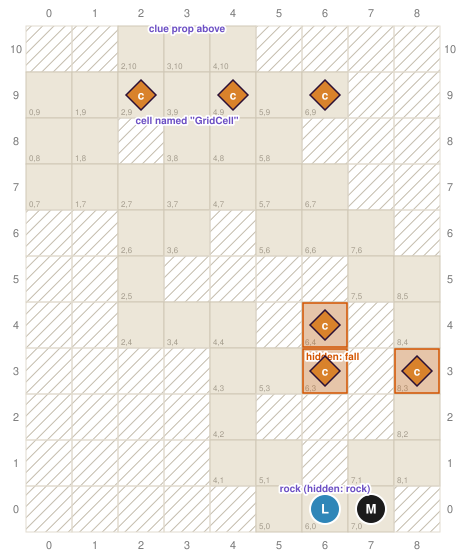
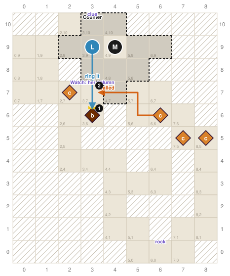
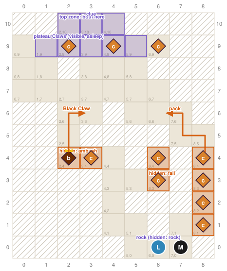
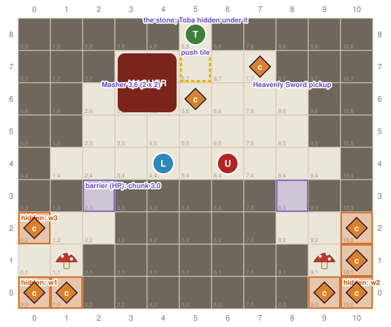

# M1 "The Ridge": the ambush at the clue, the potion page, pocket HP

Size: M    Tier: 3 (level design)    Assigned to: miso-game-designer
Branch: `thj/onboarding-demo`
Status: **approved by THJ (2026-11-24), option A**; Q3 (M3) open with M3's paper level

Inputs: THJ's change requests 2, 4, 5, 6 (`playtests/2026-11-24-m1-redesign-play-check.md`); the approved redesign (`plans/2026-11-24-m1-ridge-redesign.md`, D-662 to D-667) and its build (`plans/2026-11-24-m1-ridge-build-tech.md`, wiring `Features/Onboarding/Editor/MissionWiring.Ridge*.cs`); the text (`design/m1-ridge-redesign-text.md`); the M3 paper level (block `m3-defence` in `plans/2026-11-22-onboarding-d3-paper-levels.md`); the coordinator's HP investigation (section 6). Items 1 and 3 are not in this plan, except the ledge-tile robustness for item 1 (section 6).

## THJ's answers (2026-11-24)

| Q | Answer | What it changes here |
|---|---|---|
| Q1 | **Option A**: keep the plateau sleepers and their fight, then "reach the clue together", then the ambush. THJ fears the walk would take too long and the level become too easy. Option B is **parked**: "if it got too long, we will replace them with one ambush" | Sections 3, 4, 10. B kept in section 3 with what switching takes |
| Q2 | **Black Claw + 4 Dark Claws** | Fourth spawn on west path 3,4 (prefab 2,-1); distances recounted (section 4); grid `m1-ridge-3a` |
| Q3 | Not answered (M3's paper level is still unapproved) | Section 11 stays as the recommendation, **parked** |
| Q4 | Not asked; the recommendation stands: **no turn fallback** on "reach the clue together" | Section 4 |
| Q5 | **Raise their HP.** "The order of their movement can decide their positions relative to Linda. Even if the first Catch & Return did not kill, the second one can. Linda is there with 2 APs. Forcing Mark to reach there before Linda can take control will ensure that." | Pocket pair 0.75 (12 HP), ledge Claw 0.5 (8 HP), ledge stage also accepts prefab 7,-3; second catch checked (section 6) |
| Item 5 | The potion page at the end of the ambush sequence, removed from the pocket-cleared sequence | Section 5 |

Consistency fix: every ambush Dark Claw is **factor 0.6 (10 HP)** (the first draft's section 10 said 0.7).

## Why

THJ played the rebuilt M1 and liked it. He wants an ending with more bite: once the Claws are beaten and the siblings reach the clue at the top, a fresh pack climbs up behind them, led by a Black Claw with its introduction. The Masher, which M1 no longer uses, goes to M3 in place of M3's Black Claw. The potion page moves to this ambush. Two HP intents change (items 2 and 6).

## Goal

A first mission that ends on a short, readable climax: the family is together at the clue, the pack comes from behind, and where the siblings stand when one of them hits the Black Claw decides who the pack goes for.

## Acceptance criteria

- [ ] The ambush plays only when both siblings stand in the top zone (8 tiles, below) after the plateau fight is over, and only once.
- [ ] No ambush unit can attack on the first enemy turn after the reveal while the family stays in the top zone (distances in section 4).
- [ ] The Black Claw's close-up plays the first time it's on screen at a family turn start (built, `EnemyIntroductionController`), and its caption plays in the reveal.
- [ ] FTP is back to full when the ambush starts (the reunion signal fired again).
- [ ] Both Family Roles can fire in the ambush in the usual play: Watch as the pack climbs into Linda's lanes, Counter when she is hit within 2 of Mark.
- [ ] The potion page plays once, at the end of the ambush sequence, before control returns. It no longer plays when the pocket clears.
- [ ] The level is won when every enemy is dead (the rock excluded, as built); the outro on the clue follows.
- [ ] No softlock (see "Fallbacks").
- [ ] Pocket Claws 12 HP (0.75); ledge Claw 8 HP (0.5), killed by one Blitz; the ledge stage completes with Mark on prefab 7,-2 or 7,-3.

## Scope

In: the ambush (trigger, spawn, makeup, Black Claw, win condition, fallbacks), the potion page trigger, the HP for items 2 and 6, what the Masher swap would change in M3's paper level (parked), the lines and pages needed.
Out: items 1 and 3 (except the ledge tile), code (none is needed), final text (`miso-narrative`), M3's build.

## Touches

Systems: `GB_m1-ridge.prefab` (THJ's, the master) through the layout tool; `MissionWiring.Ridge*.cs` (editor tools, not core); stages and sequences in `Resources/Sequences/M1Ridge/`; `HiddenLevelUnits` (one new group); `EnemyAlertSettings.startsAlert` on placed instances (data). Nothing in `tech/core-systems.md`.
USPs: Family Roles, Synergies.
Docs: see "Docs to update".

---

## 1. The level as THJ left it (read back 2026-11-24)

The designer has no shell, so `level_to_grid.py` could not run. The prefab's YAML was read by hand: every GridCell's local position (cell size 0.5, tile = (pos − 0.25) / 0.5), every unit's parent cell, the factors and the alert settings. **The coordinator should confirm this block with the tool** (gate 7).

Found:

- **48 GridCells.** Against the built block `m1-ridge-2`, THJ **removed** prefab 1,3, 5,3, 6,2 and 2,0 (block 2,8, 6,8, 7,7, 3,5) and **added** prefab 3,3 (block 4,8).
- **One cell is unnamed:** the cell at prefab 2,3 (block 3,8; local 1.25, 1.75) is called `GridCell`, not `GridCell - (2, 3)`. The wiring finds cells by name (`SearchWiringRiver.CellAt`), so it should be renamed before any wiring step relies on it. No stage here uses it, but the AI walks through it.
- **Units as built:** Linda and the hidden rock on prefab 5,-5, Mark on 6,-5; plateau Claws 1,4, 3,4, 5,4 (0.7); pocket Claws 5,-2, 5,-1 (0.7) and ledge Claw 7,-2 (0.45), hidden. `alertRangeBonus` -1, `allEnemiesStartAlert` 0.
- **Paths that changed:** the west climb now runs block 2,4 → 2,5 → 2,6 (prefab 2,0 is gone); the east climb 8,4 → 8,5 → 7,5 → 7,6 → 6,6 (prefab 6,2 is gone). Both are one tile wide.

```grid id=m1-ridge-thj-1124 title="Read-back: GB_m1-ridge with THJ's tweaks, 2026-11-24 (offset x+1, y+5; read by hand)"
_ _ . . . _ _ _ _
. . c . c . c _ _
. . _ . . . _ _ _
. . . . . . . _ _
_ _ . . _ . . . _
_ _ . _ _ _ _ . .
_ _ . . . _ c _ .
_ _ _ _ . . c _ c
_ _ _ _ . _ _ _ .
_ _ _ _ . . _ . .
_ _ _ _ _ . L M _
--
cells 6,3 6,4 8,3 enemy hidden: fall
note 6,0 rock (hidden: rock)
note 3,8 cell named "GridCell"
note 3,10 clue prop above
level origin -1,-5
```



**Coordinates below are block coordinates** (block = prefab + (1, 5)) unless marked "prefab".

---

## 2. Problem and evidence

**Symptom (THJ, item 4):** the level ends on a clean-up. He wants a final turn of pressure at the clue, with the Black Claw met here.

**Root problem:** the mission has no climax. Its peak is family turn 1 (the catch), and everything after is a smaller version of what came before. A first mission also has to teach one enemy rule beyond "Claws bite" before M2 to M4 lean on enemy rules. The Black Claw's rule fits Linda and Mark well, because **who hits it decides who the pack chases**, and both siblings' Roles answer to where the pack goes.

**Evidence and facts used** (V = verified in code or assets, A = assumed):

| Fact | V/A | Where |
|---|---|---|
| Black Claw: 40 HP before factor, Leader tag, Pact Leader (EN-1): hitting it sends every Dark Claw within 5 at the hitter, and the call wakes them (EN-15) | V | `Unit_BlackClaw.prefab`, GDD `enemies.md` |
| Black Claw walks 1 less than a Dark Claw (walk preset `baseFactor` 2 vs 3; the catalogue reads a Claw's walk as 4, so 3) | V (preset), A (the +1) | `BlackClaw_Ability_Walk.asset`, `DarkClaw_Ability_Walk.asset` |
| Black Claw damage ≈ 7.5 at Early (the Trail: Claw 6, Black Claw 10 at Standard; Early Claw 4.5) | A (derived) | D-516 |
| Enemy HP = round(base × factor) at this tier; Linda's arrow pierces at 6, then 4, then 2; a catch is the outbound arrow plus the return, each with a fresh ledger | V (coordinator's investigation) | Section 6 |
| Linda's bow has no cooldown (`coolDownV` constant 0) | V | `Linda_Ability_PrimaryAttack.asset` |
| The enemy close-up plays at a family turn start for any on-screen enemy whose name hasn't been seen (saved per save) | V | `PlayerController.StartTurn` → `EnemyIntroductionController.PlayPending`; `EnemyIntroductionTracker` |
| `deactivateUnitIntroductions` is 0 in THJ's `GlobalSettings.asset` (intro/outro sequences are off there for testing) | V | `Resources/GlobalSettings.asset` |
| The Trail already has a Black Claw caption line: "Black Claw. Hit it, and the pack comes for you." (narrator) | V | `SearchWiring.Trail.cs` `BlackClawCaption` |
| Hidden units are off their tile until revealed (not on the cell, not counted by objectives, not seen by the alert); a reveal onto a taken cell moves to the nearest free one | V | `HiddenLevelUnits.cs` |
| A revealed unit is registered as born; the alert tracker reads the instance's `startsAlert` flag at that first registration | V (code path), not played | `EnemyAlertTracker.Register` |
| `TilesOccupiedLOCondition` counts the faction's units on a tile list with `AtLeast` and a target count | V | `LevelObjectiveConditions.cs`, `AggregationMode` |
| With enemies first, a `TurnReached` stage completes at an **enemy** turn start (the ledge fallback does) | V | `MissionWiring.Ridge.cs` comment, review note 4 |
| Linda 20 HP, Mark 15; Claw 4.5 at Early; bow 6, Blitz 8, Counter 8 | V (plan values) | redesign plan §5 |

---

## 3. Options compared

Both options use the same ambush (section 4). They differ in what comes before it.

| | **A. Keep the plateau, then the ambush (THJ's pick)** | B. The ambush replaces the plateau sleepers (**parked**) |
|---|---|---|
| What happens | As built to the end of the plateau fight (3 sleepers, "together or apart", the Counter line). Then "reach the clue together", then the ambush | The pocket clears, the reunion, a quiet climb (empty plateau), "reach the clue together", then the ambush |
| Enemies | 11 (3 pocket, 3 plateau, Black Claw + 4 ambush) | 8 |
| Time, cold player | About 10 min | About 7 to 8 min |
| Player experience | Two plateau fights in a row; the second adds the Black Claw and comes from behind | One climax after a quiet climb |
| Risk | Length; HP attrition in a first mission (the potion and the FTP top-up help) | Two empty climb turns; a level that may feel easy (THJ's concern) |
| USP | Roles ++ (Counter taught on the plateau, used again in the ambush), Synergies + | Roles ++, Synergies + |

**THJ chose A.** B stays here as the fallback if the play check shows A running long.

**What switching A → B later takes** (no new pieces, all in the existing wiring):
1. Prefab: remove the three plateau Claws (prefab 1,4, 3,4, 5,4); the layout tool's plateau check and its 5,2 → 5,4 move go with them.
2. Stages: drop the plateau stage (S3 below); "reach the clue together" queues straight after the pocket stage.
3. Sequences: move the plateau camera, the sleepers line and the Counter line out of the reunion; the Counter line moves into the ambush sequence; the second FTP top-up in the ambush sequence becomes unneeded (harmless if left).
4. Text: N1 (a line pointing up to the clue) replaces the sleepers line.
5. Tests: `M1RidgeTests` drops the plateau checks. The ambush itself doesn't change.

---

## 4. The ambush

### Where the family stands when it triggers

**Both siblings in the top zone**: the eight tiles in front of the clue, block **2,10, 3,10, 4,10** and **1,9, 2,9, 3,9, 4,9, 5,9** (prefab 1..3,5 and 0..4,4). One rule: "reach the clue together". It also puts them within reach of each other, which is what Counter needs. The plateau Claws start on 2,9, 4,9 and 6,9, but they are dead before this stage can begin (it is queued after them).

Trigger, built pieces only: a queued stage with one objective, `TilesOccupiedLOCondition` (faction Bergsons, `AtLeast`, target **2**, those eight tiles). Shown text: "Reach the clue together." (placeholder). **No turn fallback** (Q4, below).

### Where the wave comes from ("from behind")

Up the two paths the siblings climbed, so the camera turns round to look back down the ridge:

| Unit | Start (block) | Prefab | HP factor | Path up (first enemy turn, usual play) |
|---|---|---|---|---|
| **Black Claw**, in front on the west path | **2,4** | 1,-1 | **0.45 → 18** | 2,5, 2,6, 3,6 (walk 3) |
| Dark Claw W1, behind it | **3,4** | 2,-1 | **0.6 → 10** | 2,4, 2,5, 2,6, 2,7 (once the Black Claw has moved on) |
| Dark Claw E1 | **8,4** | 7,-1 | 0.6 | 8,5, 7,5, 7,6, 6,6 |
| Dark Claw E2 | **8,2** | 7,-3 | 0.6 | 8,3, 8,4, 8,5, 7,5 |
| Dark Claw E3 | **8,1** | 7,-4 | 0.6 | 8,2, 8,3, 8,4, 8,5 |

- Hidden group **`ambush`** (all five), revealed by `RevealUnitsSequence` in the ambush sequence. Every tile is off the top zone and free at that moment (the family is up top, every earlier enemy is dead). 8,3 is avoided because the ledge Claw starts hidden there. 8,2 is the ledge stage's second tile (section 6); a hidden unit is off its tile until revealed, so it doesn't get in the way.
- **`startsAlert` on each placed instance** (`EnemyAlertSettings`, data). Without it they'd come in Unaware (out of sight of the family). Fallback if the flag doesn't take on a reveal: they wake when the family comes within 3 or hits them; the level still finishes.
- **Black Claw in front, slower than its pack** (walk 3): the player meets its rule on the leading target, and "deal with the pack first, the leader last" is a real plan. W1 sits behind it in a one-tile path, so it can't overtake it on the first enemy turn.
- **Black Claw at 0.45 (18 HP):** a catch with it alone on the line (12) plus a Blitz (8) kills it with 2 to spare. Two plain shots and a Blitz (20) also do it.
- **Claws at 0.6 (10 HP):** one catch kills even with two Claws on its line (6 + 4 each); Watch + Counter (6 + 8) kills; one Blitz plus any hit kills. Four Claws at 10 instead of three at 11: about the same total HP as the 3-Claw draft (40 vs 33), with one more body for the call.

### Distances (counted on the axes, block coordinates)

| Claim | Count |
|---|---|
| No hit on the first enemy turn: Black Claw | 2,4 to the nearest tile beside the zone (3,8 or 1,8): 5 steps; it walks 3, reach 4 |
| W1 | 3,4 to 3,8: 3,4 → 2,4 → 2,5 → 2,6 → 3,6 → 3,7 → 3,8 = 6; to 1,8: 3,4 → 2,4 → 2,5 → 2,6 → 2,7 → 1,7 → 1,8 = 6. A Claw's reach is 5 (walk 4 + 1). And 2,4 is the Black Claw's tile until it moves |
| E1 | 8,4 to 5,8 (beside 5,9): 8,5, 7,5, 7,6, 6,6, 5,6, 5,7, 5,8 = 7; to 4,8: 8 |
| E2, E3 | 2 and 3 tiles further back than E1 |
| Linda can't hit them as they appear | The nearest, the Black Claw on 2,4, is 5 down column 2 from 2,9 (her bow reaches 4); W1 on 3,4 is 5 from 3,9 down column 3 |
| Watch on the first enemy turn | The Black Claw ends on 3,6 (column 3: 3 from Linda on 3,9); W1 on 2,7 (column 2: 2 from 2,9, the arrow crosses the gap 2,8) |
| The call reaches the pack | Black Claw on 3,6 to W1 on 2,7: 2; E1 on 6,6: 3; E2 on 7,5: 5; E3 on 8,5: 6 (Manhattan; 5 counted in eight directions, as EN-15 counts the call). Three or four answer |
| Together: every hit on Linda draws Counter | Linda 3,9, Mark 4,9. Her attack tiles 3,8, 2,9, 3,10 are each 2 from Mark |
| A called Claw climbs into her column | E1 6,6 → 5,6 → 5,7 → 4,7 → 3,7: 4 steps, ends in column 3, 2 from her: Watch |
| Apart: the catch line on row 7 | Linda 1,7, Mark 5,7: 4 apart (bow 4, catch minimum 2); Claws stopping on 2,7, 3,7 or 4,7 are between |

Arrival is staggered by the paths: on the second enemy turn the Black Claw and W1 can reach Linda; the east three need a third turn to reach her (they can reach Mark on 4,9 from 5,9 or 4,8 sooner). Worst case if Linda rings it alone: Black Claw + W1 on enemy turn 2 (7.5 + 4.5 = 12), then up to three more Claws.

### The moment (family turn after the reveal, usual play)

```grid id=m1-ridge-3-ambush title="M1 · The Ridge: the bell at the top (offset x+1, y+5; drawing only)"
_ _ . . . _ _ _ _
. . . L M . . _ _
. . _ . . . _ _ _
. . c . . . . _ _
_ _ . b _ . c . _
_ _ . _ _ _ _ c c
_ _ . . . _ . _ .
_ _ _ _ . . . _ .
_ _ _ _ . _ _ _ .
_ _ _ _ . . _ . .
_ _ _ _ _ . . . _
--
range 4,9 2 mark Counter
arrow 3,9 3,6 linda ring it
arrow 6,6 5,6 5,7 4,7 3,7 enemy called
note 3,7 Watch: her column
note 6,0 rock
note 3,10 clue
step 3,6 1
step 3,7 2
```



Step 1: Linda hits the Black Claw down column 3 (3 away), beside Mark. Step 2: the called Claws climb to her; each one that ends in her column or row draws Watch, and each hit on her draws Mark's Counter. W1 on 2,7 is already in column 2, 2 from the zone's 2,9.

### Answers

| Answer | How | |
|---|---|---|
| **Together: she rings it at his side** | Linda on 3,9, Mark on 4,9. Her arrow down column 3 hits the Black Claw (3 away). The pack comes for her through her column and row (Watch), and every tile from which they can hit her is 2 from Mark (Counter) | ★ |
| **Apart: the catch line** | Linda on 1,7, Mark on 5,7 (4 apart on row 7). The climbing Claws stop between them; one catch deals 12 to a lone Claw, 10 each to two (both kill at 10 HP) | ★ |
| **The bell as a shield: Mark rings it** | Mark Blitzes the Black Claw; the pack turns on him and crosses Linda's lanes to get there (Watch). Counter doesn't answer hits on Mark himself (T-17), so he pays in HP (15). Right when Linda is low | ● |
| **Pack first, leader last** | Ignore the slow Black Claw; kill the Claws with Watch, Counter, the catch and Blitz (Continuous Attack chains Claw to Claw); finish it (18 HP) with a catch and a Blitz | ● |
| **She rings it alone** | Linda hits it far from Mark: every called Claw comes for her with no Counter | ✗ (the potion moment) |

A note on Watch: if Linda stands in the Black Claw's column on the first enemy turn, her Watch prompt on it **is** a ring. The reveal prepares it (the caption, then Mark's line). A player who doesn't want to ring it can let the prompt pass (FR-2: a miss costs nothing). Play-check signal below.

### Win condition

A last queued stage, shown: **"Drive them off the ridge. {alive_0} remaining."** (placeholder), `LivingUnitsLOCondition` Enemy, `Exist`, `≤ 0`: the built "Clear the ridge" condition, new text. The rock is Neutral and excluded (built, tested). The outro on the clue follows the win.

### Stages (option A)

| # | Shown | Completes when | On complete |
|---|---|---|---|
| S1 | "Mark: reach the ledge." | Mark on prefab 7,-2 **or 7,-3** (new), or the turn fallback (as built) | As built |
| S2 | hidden | As built (the three pocket Claws dead) | As built, **minus the potion page** |
| S3 | "Clear the ridge. {alive_0} remaining." | As built: every enemy dead. The hidden `ambush` units aren't registered until revealed (V, `HiddenLevelUnits`), so this completes when the plateau Claws die. If the build prefers it, `EntitiesDestroyedLOCondition` on the three plateau Claws does the same | **New:** camera up to the clue, one line (N1), then the S4 objective |
| S4 | "Reach the clue together." | Both siblings in the top zone (`TilesOccupied`, `AtLeast` 2). No turn fallback | `M1Ridge_Ambush_SequentialSequence` (below) |
| S5 | "Drive them off the ridge. {alive_0} remaining." | Every enemy dead | Last stage: the level's outro |

Between S3 and S4 the Enemy faction has no living unit for about one round (the short walk from the plateau to the zone). To check in the build: an enemy turn with no living enemy only shows its banner and ends (EN-12 describes this for an all-Unaware turn), and nothing ends the level early while S4 and S5 are pending.

**The ambush sequence** (S4 complete; every step is a built sequence type): input off, HUD off → camera on the clue → discovery lines (N3) → one line: something behind them (N4) → camera down the west path → reveal `ambush` → narrator caption (N5, the Trail's Black Claw line) → camera on the east path → Mark's bell line (N6) and Linda's reply (N7) → **`SignalSequence` `M1Ridge_Reunion`** (the existing signal: FTP back to full; it also switches Continuous Attack on, already on, harmless) → **potion page** (`TutorialSequence`, the existing `M1Ridge_Potion_Panels`) → camera back on the family → input on, HUD on. The family keeps whatever AP it had left; the enemy turn follows; the Black Claw's close-up plays at the next family turn start (built, automatic).

**No turn reset.** A reset (Memory 4's `ResetTurn` call) would give a fresh turn and an immediate close-up, but the spawn distances already guarantee the family acts before any hit. Lever if the close-up after the pack's first climb reads late: add the reset at the sequence's end.

### Fallbacks (no softlock)

| Case | Answer |
|---|---|
| The family never goes up | **No turn fallback on S4** (THJ took the recommendation). Nothing can block it: no enemy is alive, both paths are open, the rock sits at the bottom (6,0). A `TurnReached` fallback would complete at an enemy turn start and play the reveal and the potion page mid-enemy-turn, possibly onto a family still in the paths. The shown objective and the camera on the clue carry it |
| Only one sibling goes up | Same: S4 waits for both; the objective says "together" |
| `startsAlert` doesn't take on reveal | The pack sleeps on its tiles until the family comes within 3 or hits it; S5 still completes |
| A spawn tile is taken | Built: the nearest free cell (`HiddenLevelUnits`) |
| A sibling falls in the ambush | Loss as built (family down). Levers: ambush Claws 0.5 (8 HP), drop W1, Black Claw 0.4 |
| The Black Claw doesn't advance (AI) | It's in a dead-end path below them; Linda reaches it from 2,7 or 2,6 down column 2. S5 still completes |

### FTP

The plateau fight spends 2 to 4 FTP (Watch, Counter, Continuous Attack). The ambush sequence fires the existing reunion signal again, so the ambush starts at 5. Data only, no new asset.

---

## 5. Item 5: the potion page

**Trigger: the last step of the ambush sequence** (after the FTP top-up), before control returns. It is guaranteed to play (S4 has one path), it plays outside the enemy turn, and it comes at the start of the hardest fight of the mission, after the plateau has worn the family down. It is **removed from S2's sequence**. The 50% low-HP bark (D-667) stays as the in-fight nudge. The page text exists (`design/m1-ridge-redesign-text.md` §7.2c).

---

## 6. Items 2 and 6: pocket and ledge HP (THJ's answer to Q5)

**The numbers (coordinator's investigation).** Dark Claw HP = round(16 × factor). Linda's arrow pierces at 6, then 4, then 2. Catch & Return along prefab row -2 (Linda 3,-2, Mark 7,-2) is the outbound arrow plus the return, each with a fresh ledger: **one Claw alone on the line takes 6 + 6 = 12; two Claws on the line take 6 + 4 = 10 each.** In the build only the Claw on prefab 5,-2 was on the line; the one on 5,-1 was off it. That's why one survived: its position, not its HP. Fist Blitz deals 8; at 8 HP or less the hit is predicted lethal and Mark hops onto the tile every time.

**Values (THJ):**

| Claws | Factor → HP | Why |
|---|---|---|
| Pocket A, B (prefab 5,-2, 5,-1) | **0.75 → 12** | Item 6. Linda's second catch finishes what the first leaves |
| Ledge C (prefab 7,-2) | **0.5 → 8** | Item 6, still one Blitz (8 ≥ 8, predicted lethal, so Mark lands on the ledge) |
| Ledge stage | Also accepts **prefab 7,-3** | Item 1 robustness: 7,-2's only neighbours are 7,-1 and 7,-3; a Mark who lands one short still completes it |

**A second catch in the same turn: possible.**
- **AP:** Linda has 2 AP; a bow shot costs 1 (a catch is a bow shot that Mark returns), so two shots fit in one turn. Her bow has **no cooldown** (`coolDownV` 0, V).
- **Arrows:** each catch returns her arrow (CR-56, built); Mark's pickup on 7,-2 has refilled the quiver after the two Watch shots (redesign §5). So the second shot has an arrow.
- **Mark:** stays on 7,-2 (his 2 AP went on Move + Blitz). Nothing moves him, so the line holds for both shots.
- **Order is guaranteed:** Linda's bar is locked until S1 completes (Mark on the ledge), so Mark always reaches 7,-2 before Linda can act (THJ's point). By then enemy turn 1 has already moved the pocket Claws.
- **To check in play:** that Mark's catch (the QTE) can be offered twice in one turn. Nothing read suggests a once-per-turn limit; not verified.

**What the two catches do (12 HP each, Watch hits not counted):**

| Case after enemy turn 1 | Catch 1 | Catch 2 | Result |
|---|---|---|---|
| Both on the line (4,-2 and 5,-2) | 10 each → 2 left each | 10 each | **Both dead.** With any Watch hit from enemy turn 1, catch 1 already kills one |
| One on the line, the other on 5,-1 | The one on the line takes 12 → dead (a kill at exactly 0, no margin: an arrow change could break it) | Can't reach 5,-1: it isn't in row -2 or column 3 | **One survives.** Linda's second AP: move to 3,-1 and shoot along row -1 over the gap 4,-1 (5,-1 is 2 away) for 6, or keep it and let it walk to her next enemy turn (Watch). It reaches her on enemy turn 2; no softlock, the potion's there |
| One on the line, the other beside her off the line (3,-1 or 3,-3) | As above, 12 → dead | The other is next to her: a plain shot (6), or Mark's later Blitz | Same as above |

Lever if the "one off the line" case is common in play and feels bad: start the pocket pair on 4,-2 and 5,-2 (both on the line; the one beside Linda then attacks without walking, so one Watch is lost).

---

## 7. Lens notes

### Creative

**Target experience.** "We found it, together, and they found us." The family that was torn apart in beat 2 now stands side by side at the top, after winning the plateau, and the dread comes up behind them. The memorable moment: the camera turns round to look down the ridge they just climbed, a Black Claw at the head of the path, and the player chooses who rings it.

**Moment designed for:** Linda's arrow hits the Black Claw, the pack turns on her, and every Claw that reaches her is answered by her brother's fist. The family protects the one the danger targets: warmth against dread, played as positioning. With option A, the plateau is where the player learns that standing together turns on Counter; the ambush is where that knowledge pays off under a new threat.

### Systems

Rules added for the player: **one**, the Black Claw's, said in one sentence on screen ("Hit it, and the pack comes for you."). Everything else is built: the alert flag, a hidden group, a tile-count stage, defeat-all, the reunion signal.

Levers and starting values:

| Lever | Value | Why |
|---|---|---|
| Ambush makeup | Black Claw + 4 Claws (THJ) | Section 4 |
| Black Claw factor | 0.45 (18 HP) | Catch + Blitz = 20 kills it in one family turn |
| Ambush Claw factor | 0.6 (10 HP) | One catch kills two on its line; Watch + Counter kills |
| Spawn distance | ≥ 5 steps from the zone's neighbours for the Black Claw, ≥ 6 for the Claws | No hit before the family acts |
| `startsAlert` | On, per placed ambush instance | They must climb |
| Top zone | 8 tiles, `AtLeast` 2 | Together, within reach of each other |
| FTP at the ambush | Back to full (reunion signal again) | The plateau spent it; Counter fails silently on an empty pool |
| Pocket A, B | 0.75 (12 HP) | THJ (Q5) |
| Ledge C | 0.5 (8 HP) | THJ (Q5) |
| Turn reset | Off | Lever if the close-up reads late |

Interactions checked: Pact Leader calls only Dark Claws (EN-1), so the rock is untouched; the rock is a Neutral ally of the Enemy faction (D-672), never a target. Continuous Attack is back on after S2, so a Blitz kill can chain onto the next Claw within 2 (1 FTP, escalating). Catch & Return's copy is Linda's, so a catch through the Black Claw rings it on her.

Failure cases:

| Case | Fix |
|---|---|
| Watch rings the bell before the player has chosen | The caption and Mark's line come first. If it feels unfair in play, accept it or move the Black Claw back one tile (weak lever) |
| The pack ignores the call and goes for Mark anyway | Linda's Watch handles the paths; still a win. Note only |
| Everyone stands apart and the catch never lines up | Fine: "together" is the main answer |
| The ambush is a difficulty spike after the plateau | FTP top-up, the potion page right before it; levers in "Fallbacks" |
| The level runs long (over 10 min) | Switch to option B (section 3) |

### UX

| Moment | Shown | Player clicks | Likeliest misread → fix |
|---|---|---|---|
| Plateau cleared | Camera up to the clue, one line, objective "Reach the clue together." | Move both | "Is the level over?" → the objective panel changes, no outro; "Is one enough?" → the word "together" |
| Arrival | Clue lines, the turn-round camera, the pack, the caption | Nothing (sequence) | — |
| Potion page | One page | Close | — |
| Enemy turn | The pack climbs; a Watch prompt may come on the Black Claw or W1 | One press or none | **"Pressing Watch rang it"**: the caption just said hitting it calls the pack |
| Next family turn | The Black Claw close-up (name), then control | Position, then ring or not | "Why are they all on Linda?" → the caption; the pack's next-targets display (EN-10) |

No new on-screen element. New text: lines, two objective strings, the reused caption, the moved page.

### Where the lenses disagree

Creative wants the pack to burst in next to them. Systems and UX want one family action before any hit, so the close-up lands before the damage. **I lean to systems/UX:** the dread is the pack climbing in plain view for one turn; the crisis comes on the second enemy turn.

---

## 8. USP check

- **Family Roles:** strengthened. The plateau teaches Counter; the ambush is built around both Roles at once (Watch on the pack climbing into Linda's lanes, Counter on every hit on her within 2 of Mark). The Black Claw turns "who stands where" into a Roles decision.
- **Synergies:** strengthened. Catch & Return now has a planned second catch on family turn 1, is offered again on row 7 in the ambush, and a catch through the Black Claw rings it.
- **Duos:** neutral on purpose (first Duo in Memory 4).
- **Managing the Home as a Family:** neutral on purpose.

## 9. Critics

Not run: sized M (one encounter inside an approved level, built pieces only). THJ has answered the questions.

---

## 10. Recommendation (approved: option A)

The plateau stays as built. When it's clear, "reach the clue together" (both siblings in the top zone). Then a hidden, starts-alert pack comes from behind: a Black Claw (0.45) leading W1 up the west path, and three Claws up the east path, every Claw 0.6. FTP back to full, then the potion page, then "Drive them off the ridge" (defeat all) to win. No turn fallback on "reach the clue together". Pocket Claws 0.75, ledge Claw 0.5, ledge stage also accepts prefab 7,-3.

Final state, option A (drawing of the change; the prefab is the master, D-665, so apply the change list to THJ's prefab instead of rebuilding from this block):

```grid id=m1-ridge-3a title="M1 · The Ridge with the ambush, option A (offset x+1, y+5; origin -1,-5)"
_ _ . . . _ _ _ _
. . c . c . c _ _
. . _ . . . _ _ _
. . . . . . . _ _
_ _ . . _ . . . _
_ _ . _ _ _ _ . .
_ _ b c . _ c _ c
_ _ _ _ . . c _ c
_ _ _ _ . _ _ _ c
_ _ _ _ . . _ . c
_ _ _ _ _ . L M _
--
cells 6,3 6,4 8,3 enemy hidden: fall
cells 2,4 3,4 8,4 8,2 8,1 enemy hidden: ambush
cells 2,10 3,10 4,10 1,9 2,9 3,9 4,9 5,9 note top zone: both here
arrow 2,4 2,5 2,6 3,6 enemy Black Claw
arrow 8,4 8,5 7,5 7,6 6,6 enemy dx=4 pack
note 2,9 plateau Claws (visible, asleep)
note 6,0 rock (hidden: rock)
note 3,10 clue
level name The Ridge
level tier early
level origin -1,-5
level hidden fall 6,3 6,4 8,3
level hidden ambush 2,4 3,4 8,4 8,2 8,1
```



Rows checked against the read-back: every unit stands on a cell of `m1-ridge-thj-1124`; walk arrows are 4-way steps on cells (2,4 → 2,5 → 2,6 → 3,6; 8,4 → 8,5 → 7,5 → 7,6 → 6,6).

**Change list for the implementer (prefab coordinates, on THJ's prefab):**

| Change | Prefab |
|---|---|
| Plateau Claws | Unchanged: 1,4, 3,4, 5,4 (0.7, visible) |
| Pocket Claws factor | 5,-2 and 5,-1: 0.7 → **0.75** |
| Ledge Claw factor | 7,-2: 0.45 → **0.5** |
| Add a Black Claw (`Features/Enemy/Dark Claw/Prefabs/Unit_BlackClaw.prefab`), factor **0.45**, `startsAlert` on | **1,-1** |
| Add Dark Claws (`Unit_DarkClaw`), factor **0.6**, `startsAlert` on | **2,-1**, **7,-1**, **7,-3**, **7,-4** |
| Hidden group `ambush` | Those five units, inactive in the prefab |
| Rename the unnamed cell | `GridCell` at 2,3 → `GridCell - (2, 3)` |
| Ledge stage tiles | 7,-2 **and 7,-3** (`UnitTileOccupiedLOCondition` already takes a tile list) |
| Stages S3 to S5 and the ambush sequence | Section 4 (S3's on-complete is new; S4 and S5 are new stages) |
| Potion page | Out of S2's sequence, last step of the ambush sequence |
| FTP | The ambush sequence fires `M1Ridge_Reunion` again |
| Layout tool | `MissionWiringRidgeLayout` sets health by tile (`SetClawHealth`: ledge, pocket, otherwise plateau factor): the new units need their own factors so it doesn't overwrite them with 0.7. It never deletes cells, so THJ's cell edits survive a re-run (read in code); `EnsureRockPrefab` keeps his rock scale (it only syncs the title) |

**Playtest signals:**

| Watch for | Worked | Failed |
|---|---|---|
| Family turn 1 | The second catch finishes the pocket pair | The player stops after one catch, or the second catch isn't offered |
| The trigger | Both climb without being told twice; the turn-round camera lands | One sibling waits below; players think the level is over |
| The Black Claw | The player says who should hit it, or positions before ringing it | The pack piles on Linda and the player can't say why |
| Watch on the Black Claw | Pressed knowingly, or skipped | "The game rang it for me" |
| Roles | Watch and Counter both fire in the ambush | Counter never fires there |
| Difficulty | Won on the first try by most; the potion used in the ambush | A lost run in the ambush, or the potion unused |
| Pace | About 10 minutes | Well over: switch to option B |

---

## 11. The Masher in M3 (Q3: unanswered, parked with M3's paper level)

**Recommendation (a), parked until THJ reviews M3:** the Masher fits M3 only in the yard, not in a wave. M3's lanes have no 2 × 2 space (west: the mushroom on 1,1 and the gaps on row 3; east: the mushroom on 9,1 and the gaps on row 3; an anchor on 10,0 would reach x 11, off the map), and the necks 2,3 and 8,3 are one tile wide, so a 2 × 2 could never enter the yard. As a wave it would stand stuck in its lane: the thing THJ rejected in M1.

Change list for block `m3-defence` (M3 block coordinates; M3 isn't approved or built):

| Item | Was | Becomes |
|---|---|---|
| w2 (east) | Black Claw 10,0 (×0.5) + Claws 9,0, 10,1 | Three Dark Claws 10,0, 9,0, 10,1 (×0.8) |
| Opening (yard) | Claws 3,7, 7,7, 5,6 | **Masher, anchor 3,6** (footprint 3..4 × 6..7, all cells exist), factor 0.45 (36 HP at Early) + Claws 7,7, 5,6 |
| Teaches | Barriers; the Black Claw | Barriers; **the Masher: never stand next to it** (its first appearance in the demo: its close-up plays at M3's start, EN-10, with its X-05 name) |
| Answers | "The bell" ★ from the bulge 9,4 | Masher: ★ Lucy's Cyclone hits it and never provokes the counter (EN-2; Lucy is fixed in M3); ● shots from 2 or more tiles away (it walks 1 and slams only if it ends next to you); ✗ ending a turn on 2,6, 3,5, 4,5 or 5,7 beside it |
| Stages | S1 the opening three dead | Unchanged: S1 includes the Masher, so it is dead before anyone takes the push tile 5,7 (next to its cell 4,7) |
| Distances | | Linda 4,4 → nearest Masher cell 4,6: 2; the pick 5,4 → 4,6: 3; Lucy 6,4 → 4,6: 4. Family first in M3, so nobody starts next to it. In the yard it has room to step |
| Chunk | 18 "the bell as a shield" | Not used in M3; the bell is now taught in M1 |

```grid id=m3-defence-2 title="M3 · Defence with the Masher in the yard (change from m3-defence; parked)"
# # # # # T # # # # #
# # # O O @ . c # # #
# # . O O c . . . # #
# # . . . . . . . # #
# . . . L . U . . . #
# # . # # # # # . # #
c . . # # # # # . . c
. * # # # # # # # * c
c c # # # # # # # c c
--
cells 2,3 8,3 note barrier (HP): chunk 3.0
note 5,8 the stone; Toba hidden under it
note 5,7 push tile
note 3,6 Masher 3,6 (2 x 2)
note 8,6 Heavenly Sword pickup
cells 0,0 1,0 enemy hidden: w1
cells 10,0 9,0 10,1 enemy hidden: w2
cells 0,2 10,2 enemy hidden: w3
level name Defence
level tier early
level alert all
level deploy 5,4
level hidden toba 5,8
level hidden w1 0,0 1,0
level hidden w2 10,0 9,0 10,1
level hidden w3 0,2 10,2
```



Other options for when THJ reviews M3: (b) widen M3's east lane and neck to 2 tiles (bigger layout change, a 2-wide barrier); (c) keep a Black Claw in M3 too and add no Masher. Cost of (a): the opening gets harder (36 HP plus two Claws); lever: factor 0.35.

---

## 12. Lines and pages for `miso-narrative` (option A, 5-unit ambush)

Sides as built: Mark Left, Linda Right. Under ~55 characters. Placeholders until THJ approves. Item 3's note applies to everything said with enemies on the board: short, mid-fight.

| # | Where | Need | Replaces / keeps |
|---|---|---|---|
| — | S2 reunion and plateau | **Keep** 5.1 to 5.7 (and the optional 5.8/5.9) as written: the plateau and its Counter line stay | Kept |
| N1 | S3 complete (plateau cleared), camera on the clue | One line pointing up to the clue: they climb the last stretch together | New |
| N2 | S4 objective | "Reach the clue together." | New |
| N3 | Ambush, camera on the clue | 2 or 3 discovery lines carrying the clue's facts the Home recap quotes (a man's deep tracks, carrying something; fresh healing herbs, a leaf wrapper) | Moved from the outro 8.2 to 8.4 |
| N4 | Ambush, before the turn-round camera | One line: something behind them (a sibling hears or sees them climbing) | New |
| N5 | Ambush, after the reveal | The Black Claw caption: reuse the Trail's narrator line "Black Claw. Hit it, and the pack comes for you." (approve it for M1) | Reused |
| N6 | Ambush, after the east-path camera | Mark's one line on the bell and standing together. Counter was already taught on the plateau (5.7), so this one ties the two: whoever it hits draws the pack, so stay close to me. Five of them, so the tone is tense | New |
| N7 | Ambush, optional | Linda's short reply | New |
| N8 | Ambush, just before the top-up | Optional: a breath line that frames the refill (as 5.4 did), or none | New, optional |
| N9 | Potion page | Existing `M1Ridge_Potion_Panels` text (§7.2c). Check the wording still fits the start of a fight | Kept, moved |
| N10 | S5 objective | "Drive them off the ridge. {alive_0} remaining." | New |
| N11 | Outro, after the win | 2 or 3 closing lines. 8.1 and the facts moved to N3; "Next time, we climb together" no longer fits (they did). A close on standing together | Replaces 8.1, 8.5 to 8.7 |
| — | Black Claw close-up | Name only, built; X-05 keeps "Black Claw" | — |
| — | Low-HP bark | Unchanged (D-667) | Kept |
| — | M3 (parked) | The Masher's close-up name (X-05, already on the list); drop any Black Claw caption planned for M3 | — |

---

## 13. Questions for THJ

All answered on 2026-11-24 except Q3; see "THJ's answers" at the top. Q3 (where the Masher goes in M3) waits for THJ's review of M3's paper level, with (a) the yard as the recommendation (section 11).

## Risks

- **AI paths:** the pocket pair's enemy-turn-1 positions, the pack's climb and the call's targets are by reading, not play. Play check.
- **Two catches in one turn:** AP and cooldown allow it (V); the QTE being offered twice in a turn is not verified.
- **A lone-Claw catch kills at exactly 0** (12 vs 12 HP): any change to arrow damage breaks it. Linda's second action is the backup.
- **`startsAlert` on a revealed unit:** read in code, not played. Fallback: they sleep until approached (no softlock).
- **An enemy faction with no living unit** between S3 and S4: to check that enemy turns pass cleanly and the level doesn't end early.
- **The Black Claw's walk 3 and damage 7.5** are derived; the numbers check should confirm.
- **The unnamed cell** at prefab 2,3 can trip name-based wiring helpers.
- **Hand-read prefab:** the coordinator confirms block `m1-ridge-thj-1124` with `level_to_grid.py` before anything is built.
- **Length:** about 10 minutes. Option B is the documented fallback.

## Gates

Design approved. The coordinator renders and checks four grids (gate 7): `m1-ridge-thj-1124` (also against the tool's read-back), `m1-ridge-3-ambush`, `m1-ridge-3a`, `m3-defence-2` (parked). Then: `miso-narrative` for section 12, a wiring chunk (editor tools and data, no core), review, THJ's play check from a cleared save.

## Docs to update (once built and played)

- GDD `missions-structure.md`: the M1 row (the ambush, the Black Claw, the potion page's place). The M3 row only once Q3 is answered.
- GDD `enemies.md`: no rule change. EN-10's "first appearance" note can name where each demo enemy is first met (Black Claw: M1), if THJ wants that tracked.
- `plans/2026-11-24-m1-ridge-redesign.md`: a pointer from beat 9 to this plan (the ambush follows it).
- `plans/2026-11-22-onboarding-d3-paper-levels.md`: block `m3-defence` → `m3-defence-2` only once Q3 is answered.
- `design/level-chunks.md`: a combination chunk "the bell at the top" (the Black Claw rung from beside Mark: Watch + Counter).
- `design/m1-ridge-redesign-text.md`: section 12's lines (owner `miso-narrative`).
