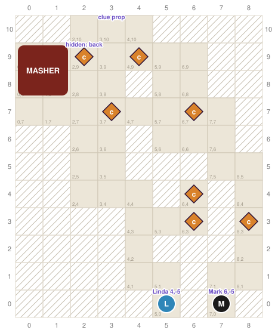
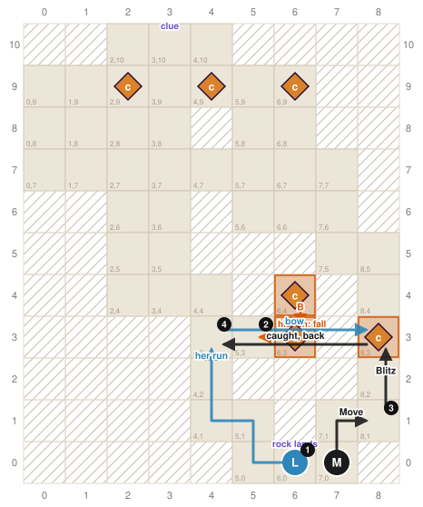
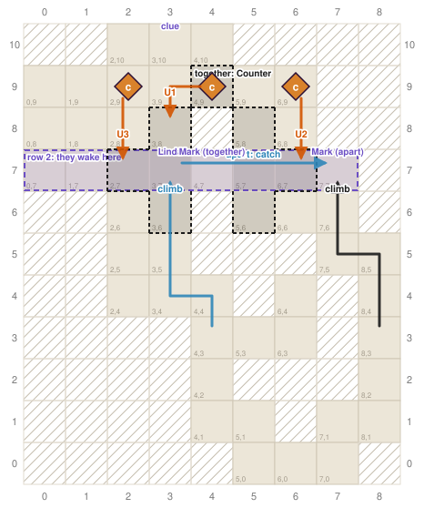

# M1 "The Ridge" redesign: from THJ's beats

Size: L    Tier: 3 (level design; new code pieces flagged)    Assigned to: miso-game-designer
Branch: `thj/onboarding-demo`
Status: waiting on THJ

Inputs: THJ's play check and beat order (`playtests/2026-11-23-m1-play-check.md`), his rework of `GB_m1-ridge.prefab` (commit `f20f9a5ab`), D-641 (Masher optional), D-632 (they may start apart), D-633 (M1 kit: attacks + Command, no Vault), D-643 (agents leave M1 alone while THJ tweaks), D-638 (Mark on 3,2; superseded here). Old paper level: block `m1-ridge` in `plans/2026-11-22-onboarding-d3-paper-levels.md` › M1. How 3.1b built it: `reports/onboarding-3-1b-m1-ridge.md`.

## Why

THJ rejected the built M1: its Masher sat stuck in an alcove with nothing to do. He wrote a new beat order (1 to 8: the split, Watch, Mark alone, Catch & Return, potions) and roughed a new map. This plan turns that into a level the builder can make, closes the open points in his note, and designs beat 9 (the rest of the level).

## Goal

A 6-minute M1 where the siblings are torn apart, save each other across a gap with Catch & Return, then reunite and choose between standing together (Mark's Counter) and standing apart (the catch line).

## Acceptance criteria

- [ ] The level matches block `m1-ridge-2` below, read back with `level_to_grid.py`.
- [ ] Beats 1 to 8 play as THJ wrote them, with the changes marked "suggestion" only if THJ takes them.
- [ ] On family turn 1, Mark can't reach Linda's side (no Continuous Attack jump to 5,-2), and the turn ends with Mark on 7,-2 in the usual play.
- [ ] Linda's first bow shot along row -2 offers the catch (an enemy between, Mark 4 away).
- [ ] Both Family Roles fire at least once in a usual play (M1-03): Watch on enemy turn 1, Counter on the plateau if Mark stands by Linda.
- [ ] The mission starts with 1 HP potion; the potion cue plays once, the first time a sibling's HP falls to 50% or less (or its fallback).
- [ ] No softlock: every stage that waits on the player also completes on a turn fallback.

## Scope

In: the paper level, its stages and cues, the beat-to-tool map, the data values, THJ's questions.
Out: code (the new triggers get a tech plan from the coordinator if THJ approves them), final lines (`miso-narrative`), art, M2 to M4.

## Touches

Systems: level prefab and wiring (`MissionWiring.Ridge.cs` gets rewritten), sequences in `Resources/Sequences/M1Ridge/`, the mission asset `MS2 - The Ridge.asset` (potion). Nothing in `tech/core-systems.md` unless THJ picks the code options in Q4 or Q5 (both are planned outside core).
USPs: Family Roles, Synergies (see USP check).
Docs: see "Docs to update".

---

## 1. The source as read (THJ's rework, `f20f9a5ab`)

Read with `level_to_grid.py` by a helper agent (the designer has no shell); the YAML was also read cell by cell. **Coordinates in this plan are the prefab's own** (`GridCell - (x, y)`, with negative rows), as THJ wrote his beats. The grid blocks count from 0,0 at the bottom left, so **block tile = prefab tile + (1, 5)**: prefab 3,-2 is block 4,3. Every block keeps that offset in its title.

```grid id=m1-ridge-src title="Source: GB_m1-ridge as THJ left it, f20f9a5ab (offset x+1, y+5)"
_ _ . . . _ _ _ _
O O c . c . . _ _
O O . . _ . . _ _
. . . c . . c . _
_ _ . . _ . . . _
_ _ . . _ _ _ . .
_ _ . . . _ c _ .
_ _ _ _ . . c _ c
_ _ _ _ . _ _ _ .
_ _ _ _ . . _ . .
_ _ _ _ _ L _ M _
--
note 5,0 Linda 4,-5
note 7,0 Mark 6,-5
note 2,9 hidden: back
note 3,10 clue prop
level hidden back 2,9
```



What the read found (verified in the prefab):

| Item | Value |
|---|---|
| Tiles | 50, x -1..7, y -5..5. No GridCell has a height field: there are no levels or jumps on this map, only gaps |
| Roster | **Linda on 4,-5, Mark on 6,-5.** No John: beat 2's "between John and Mark" means Linda (open point 1, closed) |
| Enemies | Masher anchor -1,3 (factor 0.45), its footprint -1..0 × 3..4. Claws on 5,-1 (turn order 1, factor 0.8), 5,-2, 7,-2 (factor 0.8), 2,2, 5,2 (0.8), 3,4, and a hidden 1,4 (group `back`, factor 0.8) |
| Alert | `allEnemiesStartAlert` 0, **`alertRangeBonus` -1** (noise and spread reach 1 instead of 2), `sightBonus` 0 |
| Locks | Cleanse locked for both (D-614) |
| Scenery | Search Scenery › Clue (Herbs, Wrapper, Tracks 1 and 2) at about prefab 2,6, just above 2,5. `TestLevel` cave art, four light stands. Rock props are sprites only |
| Wiring left over | 3.1b's four stages and sequences (Masher setup, arrival), hidden group `back` with one empty entry |

**Units against tiles.** Every unit stands on a GridCell. Linda (4,-5) and Mark (6,-5) **are already cut off from each other**: 5,-5 and 5,-4 have no cell, so the rockfall in beat 2 would seal a gap that's already there. The two halves meet only at row 1 to 2 (Linda's side by 3,-1 → 2,-1 → 2,0 → 2,1; Mark's by 7,-1 → 7,0 → 6,0 → 6,1).

**Mark's reach from his start, FP and all** (Fist Blitz radius 2 with `allowRangedReach` 1, read in `Mark_Ability_Attack_Primary.asset`; walk 3; 2 AP):

| Target | From 6,-5 | How |
|---|---|---|
| 7,-2 | Not in one action: 4 away. **Move 2 (6,-4, 7,-4), then Blitz** (7,-4 → 7,-2 is 2). A kill steps him into 7,-2. 2 AP spent | Verified (asset values; walk path on the tiles) |
| 5,-2 | No path on foot (the pocket 4,-2 / 5,-2 / 5,-1 opens only to 3,-2). **But from 7,-2 it is 2 away across the missing 6,-2, inside Blitz range.** He has no AP left there, so the only way over that turn is **Continuous Attack** | Verified (code) |

**Why "FP 2" doesn't stop the jump** (open point 3). `MarkPassiveAbility_ContinuousAttack` (on `Unit_Mark.prefab`: `requiredFTP` 1, `escalateFTPCostPerUse` 1, `autoAttackNextTarget` 1) opens its QTE after a Blitz kill whenever the family can pay 1 FTP and an enemy stands within Blitz range of the dead unit's cell; executed, it swings at the lowest-HP one automatically, without AP. From 7,-2 that is the Claw on 5,-2. With 2 FP the family can pay 1, so the jump happens. Mark's own "FP value" (3, adds to the pool's maximum) isn't a cap either. What does stop it: switching the component off for that turn (Q2).

---

## 2. Problem and evidence

**Symptom (THJ):** the Masher was stuck, the level didn't land.

**Root problem:** the old M1 taught Catch & Return as a puzzle about a wall; nothing in it made the player feel the two siblings needed each other. THJ's beats fix that with a story move (Linda rushes, gets cut off, Mark saves her across the gap). What's left:

1. **The split isn't real on the map** (the gap already exists at the start).
2. **Mark's Family Role never fires in beats 1 to 8.** Counter answers hits on *another* family member within 2 of Mark (T-17, `MarkFactionRoleHandler.PrepareTargets`); the siblings are walled apart for all of it. M1-03 asks for both Roles.
3. **Beat 5 rests on a lever that doesn't work** (FP 2, above).
4. **Beats 4, 7 and 8 need triggers the game doesn't have** (a tutorial on the first Watch prompt, a cue on Catch & Return, a cue at first low HP; section 6).
5. **Beat 9 is empty**, and the map's upper half is THJ's placeholder (the stuck Masher again, at -1,3).

---

## 3. Critique of THJ's beats 1 to 8 (suggestions are marked)

The beat order is strong. It turns the tutorial into a family story: an impulsive older sister, a younger brother who has to save her, and a combo that only works across the gap that separates them. Catch & Return is far better taught this way than at the Masher.

| Beat | What works | Suggestion |
|---|---|---|
| 1. Arrival | The tracks in the distance give the level a goal from second one | **S1.** Start them side by side: Linda on a new tile **5,-5** next to Mark on 6,-5. The camera shows the clue at the top (about 2,6) |
| 2. Linda rushes, rockfall | Character first, mechanics second | **S2.** The rock lands **on the tile they shared**, 5,-5, after Linda leaves it, so the separation happens on screen. Her scripted walk is 5,-5 → 4,-5 → 4,-4 → 3,-4 → 3,-3 → 3,-2 (5 steps). The Claws come out of the pocket by her (5,-2, 5,-1) and one wakes at 7,-2 later, so they read as woken by the noise |
| 3. Enemy turn first | Shows the danger before the player can act | Needs the level's turn order set to Enemy, Bergsons, Neutral (data; the Queen level does it) |
| 4. Watch tutorial | Her Role is the first thing she learns, at the moment it matters | **S3.** Show the Watch page **at the end of the intro, just before the enemy turn**, not mid-turn. The Watch QTE runs in real time with a 1 s window (FR-2), so a page that opens on the prompt would make the player miss it. The page last, then the first Claw steps into her row and the prompt comes |
| 5. Mark alone | The player meets Mark's Blitz with one clear target | **S4.** The "wounded Claw" gets wounded by Linda: her Watch arrows pierce down row -2 and hit the Claw on 7,-2 (4 away, in range). Mark finishes a Claw his sister hurt, and stepping onto 7,-2 he picks up her arrows lying there (LI-7: a hand-back toss and "+N"). Her quiver is full again before the catch. **S5.** Lock Mark's Command for this turn too, so his bar is Move and Blitz only. **S6.** Instead of FP 2, switch off Continuous Attack for this turn (Q2) |
| 6. Catch & Return | The aim preview (CR-56) shows the return path and its damage before she fires: the best teacher in the game | **S7.** Mark's call comes first, then her bar unlocks, then the pulse on her bow (`GuidedAbilityHint`). One thing at a time |
| 7. Reaction | Short, earned | Needs a trigger (section 6). The fallback lines must be true whether or not the catch happened |
| 8. Potion | Taught when it's needed | The page waits for the next family turn start, never mid-enemy-turn. **S8.** Threshold 50% of max HP |

**The gap:** nothing in 1 to 8 shows Mark's Counter. Beat 9 has to carry it (section 5).

---

## 4. Beat 9: options compared

| | A. Together or apart (leaning) | B. Mirror | C. Masher finale | D. Clean-up |
|---|---|---|---|---|
| What happens | The siblings climb their own paths (one turn each) to the plateau's row 2. Three sleeping Claws on row 4 wake when a sibling steps onto row 2 and rush Linda. Two answers: stand together (Counter guards her) or apart (the catch line through the Claws) | A second split: Mark is cut off and rushed, Linda sets up the line. Optional Archer Goblin on a perch | A Masher (mobile this time) guards the clue; the catch through its 2 × 2 hits it out and back | Three Claws, walk to the clue |
| Player experience | A real choice between two family systems, both ★. Reunion after the split | Repeats beat 2's surprise; the second time feels scripted | A boss moment, but the enemy THJ just rejected | Flat ending |
| New rules | Counter (already owed by M1-03) | Archer (new enemy card) or none | The Masher's slam and counter | None |
| On-screen elements | None new: Counter's zone exists (FR-9) | Archer card | Masher counter preview | None |
| Cost | Data and sequences only | A second rockfall and a second scripted turn | Masher wiring, preview check, HP tuning | Smallest |
| Risk | AI target choice on the plateau (to check in play) | Fatigue; scripting cost | Stuck again, or a difficulty spike at the end of a tutorial | M1-03 fails (no Counter) |
| USP | Roles ++, Synergies ++ | Synergies + | Synergies + | Roles − |

**Leaning: A.** It is the same pattern as beats 2 to 6 (two siblings, a line, enemies between), now as the player's choice, and it adds the one thing the level still owes: Counter. It also closes the story: the family that was torn apart ends the level standing together, or trusting each other from across the plateau.

The Masher goes (D-641). The Archer Goblin doesn't fit: Web Throw was removed from its prefab (D-644; read in `Unit_ArcherGoblin.prefab`: walk and attack only), so it would only be a range-3 shooter, and a new enemy card goes against the budget.

---

## 5. Lens notes

### Creative

**Target experience.** "I left her alone and she paid for it, and then I saved her from the other side of the rocks." Then: "we're together again; do I stay at her side or trust her line?" Warmth against dread, played as positioning.

**The moments we design for.**
1. The rock falls on the tile they shared (beat 2).
2. Mark lands on 7,-2 and catches up her arrows: the hand-back toss is the first time they touch across the gap (beat 5).
3. One arrow goes out through two Claws, Mark catches it, and it comes back through them (beat 6). This is the over-the-bar moment.
4. On the plateau, a Claw lunges at Linda and Mark's fist answers (Counter); or the catch fires a second time, this time the player's own idea (beat 9).

**What the critic changed** (section 8): no Role page for Counter. A single line at the reunion, then Counter teaches itself in play. The FP top-up is framed as the reunion beat (two lines), not as a resource refill.

### Systems

**Stages** (queued win groups; all conditions exist, `LevelObjectiveConditions.cs`):

| # | Shown text (placeholder) | Completes when | On complete (sequence) |
|---|---|---|---|
| S1 | hidden | `TurnReached` 1, counted from level start: the first family turn (to check, T-14) | Camera on Mark → Mark: "Hold on, Linda!" → `SelectUnitSequence` Mark → camera pan to 7,-2 and back |
| S2 | "Mark: reach the ledge." | `UnitTileOccupiedLOCondition` Mark on 7,-2, **or** `TurnReached` 1 (fallback, aggregation "any", as 3.1b's Masher stage did) | Mark: "Linda! Shoot through them. I'll send it back." → `UnlockAbilitiesSequence` (Linda's bar, Mark's Command) → `SelectUnitSequence` Linda → `GuidedAbilityHint` on her bow |
| S3 | hidden | `EntitiesDestroyedLOCondition` on the three pocket Claws (A, B, C) | Beat 7 lines (fallback version, Q4) → FTP top-up (second filler, see levers) → Continuous Attack back on → camera up to the plateau and its sleeping Claws → Mark: "They're asleep up there. Get set before they wake." → Mark's Counter line: "Stay near me. Anything that touches you answers to me." |
| S4 | "Clear the ridge. {alive_0} remaining." | Defeat every Enemy-faction unit | (last stage: the level's outro plays: camera on the clue, the clue lines, as 3.1b built) |

Loss: default (the family is down).

**Turn by turn (the usual play)**

| Turn | What happens | Numbers |
|---|---|---|
| Intro | Walk, shake, rock on 5,-5, Claws A 5,-2, B 5,-1, C 7,-2 revealed, Watch page | A sees Linda (2 away), B (3): both start alert. C is 4 from Linda and 4 from Mark: Unaware. Spread from A/B reaches 1 (THJ's -1 bonus): C stays asleep |
| Enemy 1 | A walks to 4,-2 (next to Linda, in her row) → **Watch**: the arrow pierces A, then C on 7,-2. A hits Linda (4.5). B can only reach 5,-2 (4,-2 is taken; the pocket opens nowhere else) → in her row, 2 away → **Watch**: A, B, C | C is hit, so it wakes, but during its own faction's turn: it doesn't act (`EnemyAlertRules.CloseActionPointsOnWake`). Both Watch arrows land on C's tile, 7,-2 (LI-6) |
| Family 1 | Mark: Move 6,-5 → 6,-4 → 7,-4, Blitz C (2 away) → it dies → he stands on 7,-2 and picks up both arrows (quiver 3 again). S2 completes. Linda fires east: 4,-2 (A), 5,-2 (B), past the missing 6,-2, to Mark on 7,-2 (4 away): **catch offered** (enemy between, ≥ 2 away) → return hits B then A. 1 AP left: a second catch if one survived | Blitz 8 vs C's 7.2 HP (+ the Watch hits) |
| Family 1, S3 | Pocket cleared: the reunion lines, FTP back to 5, Continuous back on, the plateau shown | |
| Family 2 | Both climb (5 steps each, 2 Moves): Linda 3,-2 → 3,-1 → 2,-1 → 2,0 → 2,1 → 2,2; Mark 7,-2 → 7,-1 → 7,0 → 6,0 → 6,1 → 6,2 (or 3,2, "together") | U1 3,4 and U3 1,4 see Linda on 2,2 (3 away); U2 5,4 sees Mark on 6,2 (3); with Mark on 3,2 it is 4 away and stays asleep for now. On 2,1 / 6,1 nobody wakes: a cautious player gets a setup turn |
| Enemy 2 | U3 → 1,3 → 1,2, U1 → 2,4 → 2,3: both next to Linda and in her lanes → **Watch** ×2. U2 (if awake) → 5,3 → 5,2 (next to Mark on 6,2, between them on row 2); with Mark on 3,2 it sleeps on and comes later as a second wave, landing on 4,2 next to Mark, in Linda's row (Watch) | **Together** (Mark on 3,2): 1,2, 2,3 and 2,1 are each 2 from him: every hit on Linda draws **Counter** (8). **Apart** (Mark on 6,2): next turn Linda fires along row 2 through 5,2 to Mark (4 away): **catch** |
| Family 3 to 4 | Finish; potion cue when someone fell to 50% | |

**Answers on the plateau**

| Answer | How | Grade |
|---|---|---|
| Together | Mark on 3,2 beside Linda on 2,2. Counter answers U1 and U3 from 2 away; Watch shoots them as they land; U2 wakes later and comes to Mark on 4,2, in her row | ★ |
| Apart | Mark on 6,2, Linda on 2,2. U2 stops on 5,2 between them; one caught arrow hits it twice (6 + 6 = 12 ≥ 11.2). Watch handles U1 and U3 | ★ |
| Command | Mark Commands a Claw into Linda's row or column (Command moves count for Watch, D-039) | ★ (for players who explore) |
| Each alone | Plain shots and Blitzes; Linda takes 2 or 3 hits | ● (the potion moment) |
| Linda ahead, Mark far behind | She takes every hit (3 × 4.5 = 13.5 of 20) with no answer | ✗ |

**Levers and starting values**

| Lever | Value | Why |
|---|---|---|
| Claws A, B (pocket) | factor 0.7 → 11.2 HP | Two Watches + one catch kill both, with margin; a missed Watch leaves one for her second catch |
| Claw C (7,-2) | **factor 0.45 → 7.2 HP** | Blitz 8 kills it even if no Watch touched it (the critic: 0.5 = 8 HP is a kill on equality) |
| Plateau U1, U2, U3 | factor 0.7 → 11.2 HP | One catch (12) kills; Watch + Counter (6 + 8) kills |
| `alertRangeBonus` | **keep -1** (THJ's value) | Keeps C asleep beside A at reveal. At 0, A (2 from C) would wake C at once and it would walk to Mark on enemy turn 1 |
| Tier | Early (Claw damage 4.5; Linda 20 HP, Mark 15) | As built |
| FTP | Full at start (5); **topped up to full at S3** | Enemy 1 spends 2 (Watch × 2); the plateau needs up to 4 (Watch × 2, Counter × 2) plus 1 for Continuous Attack. Without the top-up, Counter silently fails to offer when the pool is empty |
| Potion | `MS2 - The Ridge.asset` › `initialItemsAvailability`: `Bergsons_Ability_HealthPotion` × 1 (it's `[]` today) | THJ's beat 8 |
| Low-HP cue threshold | 50% of max HP | Linda reaches it on the plateau after 2 hits (20 → 15.5 → 11 → 6.5) |
| Turn order | Enemy, Bergsons, Neutral | Beat 3 |

FTP spend in a usual play: 5 → 3 (enemy 1) → 5 (S3) → 1 to 2 (plateau). Quiver: 3 → 1 (Watch × 2) → 3 (Mark's pickup on 7,-2) → 3 (each catch returns her arrow) → about 1 after the plateau Watches, with Encore and pickups to refill.

**Failure cases and their fixes**

| Case | Fix |
|---|---|
| Continuous Attack jumps Mark to 5,-2 | Component off from level start to S3 (Q2) |
| The player walks Mark elsewhere and never reaches 7,-2 | S2's turn fallback unlocks Linda next turn; she kills the pocket with plain shots and Watch, slower |
| B doesn't step to 5,-2 (stays on 5,-1) | Only A is in line; the catch still fires through A; B walks into the row on enemy 2 and draws Watch |
| C is woken early and walks to Mark | Mark Blitzes it where it stands (6,-4) and walks 3 to 7,-2: same end, one less elegant step. Guarded by keeping the -1 bonus |
| Plateau Claws all go for Mark (no Counter) | U3 can't reach Mark on 3,2 or 6,2 in one move, so at least one Claw hits Linda. To check in play |
| The rock is counted by "defeat all" or targeted | The rock is in the Neutral faction: the objective counts the Enemy faction only. Test it (edit-mode) |
| An enemy blocks Linda's scripted walk | Nothing stands on her path at that time (the Claws are revealed after the walk) |

### UX

| Moment | What the player sees | What they click | Likeliest misread → fix |
|---|---|---|---|
| Intro | Camera, two lines, the rock, the Claws, the Watch page | Close the page | — |
| Enemy 1 | The first Claw steps next to Linda; "Activate Passive" | One press | "What do I press?" The page just said it; a missed press costs nothing (FR-2) |
| Family 1, Mark | Mark selected, his bar has 2 abilities, objective "Mark: reach the ledge.", camera pans to 7,-2 | Move, Blitz | **Linda's empty bar looks like a bug** (UX critic) → Mark's line and the selection come first; the objective names him |
| Family 1, Linda | Mark's call, then her bar returns with a pulse on the bow | Aim east | **The return segment read as damage to Mark** → it's the built preview (CR-56); Mark's line says what will happen before she aims |
| Reunion | Camera to the sleeping Claws, two lines | — | **The Claws look awake** (the Unaware tag is hidden, D-645) → Mark says they're asleep; they don't move on enemy turns |
| Plateau | Counter's zone around Mark when shown (FR-9) | Positioning | "Where is safe?" → the zone already draws |
| Low HP | At the next family turn start: the potion page | Item bag | — |

No new on-screen element. The only new text is lines and two tutorial pages that already have a container (`TutorialSequence`).

---

## 6. Beat → tool map (exists or needs code)

Checked by a read-only search of the code on 2026-11-24. Paths under `miso/Assets/_Project/`.

| Beat | Piece | Tool | Status |
|---|---|---|---|
| 1 | Camera to the clue and back, two lines | The camera and `DialogNodeSequence` steps of 3.1b's `M1Ridge_Start_*` | Exists |
| 2 | Linda's scripted walk to 3,-2 | `MoveUnitSequence` (`Core/Levels/Runtime/MoveUnitSequence.cs`): walks a real path, any tile, no AP | Exists |
| 2 | Camera shake | `CFXSequence` + a `ShakeCameraEffect` asset (`Core/FX/Runtime/CFX/`). **Set `durationOverride` to -1**, or the step waits 0 s | Exists |
| 2 | The rock seals 5,-5 | No sequence removes or blocks a cell (`GridCell.IsWalkable`: only an occupant, a stash or a `disallowWalk` planted entity). **Workable with built pieces:** a neutral "rock" GUnit (a prefab variant like the Deer: Neutral faction, Unmovable, no abilities) placed on 5,-5 in a hidden group and revealed by `RevealUnitsSequence`. An occupant blocks walking | Exists (reveal); **new data asset** (the rock unit). To check: a neutral unit in `HiddenLevelUnits`, no HP bar or hover clutter. Cosmetic fallback in Q3 |
| 2 | The 3 Claws appear | `HiddenLevelUnits` + `RevealUnitsSequence` (`Features/Onboarding/`); a revealed unit joins the next enemy turn, alert if it sees a hostile | Exists. To check: reveals inside the intro, before turn 1 |
| 3 | Enemies act first | The level's turn order override (the Queen level has it; the builder strips it, the wiring sets it) | Exists (data) |
| 4 | Watch page before the enemy turn | `TutorialSequence` (`Core/Levels/Runtime/TutorialSequence.cs`) + a new `TutorialDataSO` page | Exists (page text: narrative) |
| 4 | Page *on* the first Watch prompt (THJ's literal order) | `onFamilyRolePrompt` is raised (`PlayerController.cs:1738`) but nothing plays a sequence on it, and the prompt's timer keeps running | **Needs code** (Q4) |
| 5 | Only Mark acts | `SelectUnitSequence` selects only; `LevelAbilityLock` hides Linda's abilities (and Mark's Command) from the bar; `UnlockAbilitiesSequence` gives them back | Exists. To check: locking her Move this way; Watch still fires with her bar locked (the lock only hides bar entries) |
| 5 | No jump to 5,-2 | Turn off `MarkPassiveAbility_ContinuousAttack` with `SignalSequence` → `SignalAction` (`Core/Levels/Runtime/`) setting `enabled`, at level start and back on at S3 | Exists (glue). To check: the Mark placed in the level is the one the mission plays. A level switch on the passive would be new code |
| 5 | "FP 2" (if THJ still wants a start value) | `LevelStartFPFiller` with a negative amount (Memory 1 drains with -99); the pool is full when it runs | Exists (data) |
| 5 | Mark ends on 7,-2 | `UnitTileOccupiedLOCondition` + `TurnReachedLOCondition`, stage `onCompleteSequence` | Exists |
| 6 | Catch & Return | Built (`ProjectileCatchAndReturn`); open by default (`SearchRidgeTests.CatchAndReturnIsOpenByDefault`); the arrow crosses the missing 6,-2 (`Projectile.Initialize`, `travelEntireRadius`); the catch distance counts the gap | Exists. Not played across a gap yet |
| 6 | Pulse on her bow | `GuidedAbilityHint` | Exists |
| 7 | Lines when the catch fires | `GlobalEventBus.RaiseSynergy(..., "Catch & Return", ...)` fires, but no sequence trigger filters it by id. Wiring the bus event directly would fire on every synergy | **Needs code** (Q5). Fallback: S3's lines, on the pocket being cleared |
| 8 | 1 potion at start | `Mission.initialItemsAvailability` on `MS2 - The Ridge.asset`, potion `Features/Player/Shared/Items/HealthPotion/Bergsons_Ability_HealthPotion.asset` | Exists (data) |
| 8 | Cue at first low HP | No HP-threshold trigger. The bark graph has `HPBelowPercent` (barks only); `LowHealthPresenter` is a vignette | **Needs code** (Q5). Fallback: an `HPBelowPercent` bark ("Linda, drink something!") |
| 9 | Sleeping plateau Claws | The alert system (`EnemyAlertTracker`; sight 3, THJ's -1 range bonus) | Exists |
| 9 | FTP back to full at S3 | A second `LevelStartFPFiller` (+99), not wired to `levelStarted`, called from S3's sequence through `SignalSequence` → `SignalAction` | Exists (glue) |
| 9 | Counter line, outro on the clue | `DialogNodeSequence`; 3.1b's `M1Ridge_End_*` | Exists |

The pieces THJ expected to need code, settled: rockfall and shake: **exist** (plus a rock unit asset). Mid-level Claw spawn: **exists**. Selection locked to Mark: **exists** with the ability lock. Level FP cap or start value: **exists** but isn't the right lever; the passive switch-off **exists** as glue. Trigger on Catch & Return: **needs code**. First-low-HP potion prompt: **needs code**. Also needs code if THJ wants his literal beat 4: the page on the first Watch prompt.

---

## 7. The paper level

| Item | Plan |
|---|---|
| Source | THJ's `GB_m1-ridge` (`f20f9a5ab`). Changes: **+1 tile 5,-5**; Linda 4,-5 → 5,-5; the Masher out; Claws on 2,2 and 5,2 out; Claws 1,4 (visible now), 3,4, 5,4 on the plateau; the pocket Claws 5,-2, 5,-1, 7,-2 hidden in group `fall`; the old `back` group and 3.1b's stages out |
| Teaches | Watch (beat 4), Catch & Return (beat 6), Counter (beat 9), the potion (beat 8) |
| Twist | Torn apart by the rock; on the plateau, together or apart is the player's call |
| Squad | Linda 5,-5, Mark 6,-5 (replaces D-638). Kit: Mark Move, Fist Blitz, Command (locked until S2), Duos as built; Linda as built; Cleanse locked for both |
| Enemies | 6 Dark Claws, Early. Pocket A 5,-2, B 5,-1 (0.7), C 7,-2 (0.45), hidden `fall`. Plateau U3 1,4, U1 3,4, U2 5,4 (0.7), visible and Unaware |
| Turn budget | 4 to 5 family turns, no cap |
| First trigger | Watch on enemy turn 1 (the pocket opens only into her row); the catch on family turn 1 (Mark on 7,-2 is 4 from her down row -2); Counter on enemy turn 2 if he stands by her |
| Win / loss | S1 to S4 above; loss: family down |
| Cues | Intro: arrival lines, Linda's "I'll check it out", Mark's warning, the rock, Linda's "Mark?!", the Watch page. S1, S2, S3 lines. The potion page. Outro: the clue |
| Alert | Not "all start alert". `alertRangeBonus` -1 |
| FTP, drops, clue | FTP full; top-up at S3; potion × 1; drops as built (Gold 20, Steel 2, XP 30); clue prop as THJ placed it |
| Fallback | S2 completes on the turn fallback; a missed catch leaves Watch and plain shots; the potion |
| Time | About 6 minutes cold (intro 1, family turn 1 2, climb 1, plateau 2) |

Build block (block coordinates; the `level origin` line maps them back to THJ's prefab coordinates, so tile 4,3 is `GridCell - (3, -2)`). Coordinates in `level` lines are block coordinates, as the source read's own `level hidden` line is.

```grid id=m1-ridge-2 title="M1 · The Ridge, beats 1 to 8 (offset x+1, y+5; origin -1,-5)"
_ _ . . . _ _ _ _
. . c . c . c _ _
. . . . _ . . _ _
. . . . . . . . _
_ _ . . _ . . . _
_ _ . . _ _ _ . .
_ _ . . . _ c _ .
_ _ _ _ . . c _ c
_ _ _ _ . _ _ _ .
_ _ _ _ . . _ . .
_ _ _ _ _ . L M _
--
cells 6,3 6,4 8,3 enemy hidden: fall
arrow 6,0 5,0 5,1 4,1 4,2 4,3 linda her run
note 6,0 rock lands
arrow 6,3 5,3 enemy dx=-6 A
arrow 6,4 6,3 enemy dx=6 B
arrow 7,0 7,1 8,1 mark Move
arrow 8,1 8,3 mark dx=8 Blitz
arrow 4,3 8,3 linda dy=-8 bow
arrow 8,3 4,3 mark dy=8 caught, back
step 6,0 1
step 5,3 2
step 8,1 3
step 4,3 4
note 3,10 clue
level name The Ridge
level tier early
level origin -1,-5
level camera 6,0
level hidden fall 6,3 6,4 8,3
```



Steps: 1 the rock (beat 2), 2 enemy turn 1 and Watch (beats 3 and 4), 3 Mark alone (beat 5), 4 the catch from Linda's tile (beat 6). The bow and catch arrows cross block 7,3 (prefab 6,-2), a gap, on purpose: arrows fly over missing cells.

Checked in the drawings (by a helper script over the block text and the SVG text, not by eye): 11 rows of 9 cells in all three blocks; every unit, badge and note on a tile; every walk arrow made of 4-way steps; the only lines over a gap are the bow and the catch. The coordinator should still look at the drawings.

Beat 9 on the same map (a drawing only: **don't build this block**):

```grid id=m1-ridge-2-top title="M1 · The Ridge, beat 9: together or apart (offset x+1, y+5; drawing only)"
_ _ . . . _ _ _ _
. . c . c . c _ _
. . . . _ . . _ _
. . . . . . . . _
_ _ . . _ . . . _
_ _ . . _ _ _ . .
_ _ . . . _ . _ .
_ _ _ _ . . . _ .
_ _ _ _ . _ _ _ .
_ _ _ _ . . _ . .
_ _ _ _ _ . . . _
--
arrow 4,3 4,4 3,4 3,5 3,6 3,7 linda climb
arrow 8,3 8,4 8,5 7,5 7,6 7,7 mark climb
zone 0,7 7,7 note row 2: they wake here
range 4,7 2 mark together: Counter
arrow 3,7 7,7 linda dy=-8 apart: catch
arrow 2,9 2,8 2,7 enemy dx=-6 U3
arrow 4,9 3,9 3,8 enemy U1
arrow 6,9 6,8 6,7 enemy dx=6 U2
note 3,7 Linda
note 4,7 Mark (together)
note 7,7 Mark (apart)
note 3,10 clue
```



**Distances counted on the axes** (prefab coordinates; block = +1, +5):

| Claim | Count |
|---|---|
| Mark 6,-5 → 7,-4 | 2 steps (6,-4, 7,-4): one Move |
| Blitz 7,-4 → 7,-2 | 2 (radius 2) |
| Continuous range 7,-2 → 5,-2 | 2: in range, hence the switch-off |
| Bow 3,-2 → 7,-2 | 4 (range 4); catch minimum 2 |
| C asleep | 7,-2 to Linda 3,-2: 4; to Mark 6,-5: 4 (sight 3). To A 5,-2: 2, B 5,-1: 3 (spread 1 with the -1 bonus) |
| Linda's climb 3,-2 → 2,2 | 5 steps; Mark's 7,-2 → 6,2: 5 steps |
| Wake on row 2 | 2,2 → 1,4: 3; 2,2 → 3,4: 3; 6,2 → 5,4: 3. From 3,2 → 5,4 is 4 and from 2,2 it is 5: in "together", U2 stays asleep until someone comes within 3 (4,2 or 5,2, for instance) |
| Counter from 3,2 | to 1,2: 2; 2,3: 2; 2,1: 2 |
| Apart line 2,2 → 6,2 | 4 |
| Claw moves | U3 1,4 → 1,3 → 1,2 (2); U1 3,4 → 2,4 → 2,3 (2); U2 5,4 → 5,3 → 5,2 (2) |

Correction found while counting: in "together", U2 on 5,4 is 4 from Mark on 3,2 and 5 from Linda, so it may stay asleep on enemy 2 and come later (or be woken by the fight's noise, range 1). That is fine: it becomes the plateau's second wave, and an "apart" Mark still meets it on 6,2.

**Build route.** THJ's prefab has hand-placed art (`TestLevel`, light stands, the clue) and his alert value; a rebuild from the block loses both (the builder keeps the template's scenery and strips `LevelAlertSettings` without `level alert all`). So either apply the change list above to his prefab by hand, or build `GB_m1-ridge-2` and copy the art over (Q6). The block stays the master either way: read the result back with `level_to_grid.py` and compare.

**Wiring not in the block:** the rock unit (hidden group `rock` on 5,-5), the turn order, the HP factors, the four stages and their sequences, the two ability locks, the Continuous Attack switch, the second FTP filler, the `alertRangeBonus` -1, the Cleanse lock, the potion on the mission. `M1RidgeTests` is rewritten to match.

---

## 8. Critics

Three critics, one lens each, given the problem, the options and the leaning.

| Critic | Strongest point | What I did |
|---|---|---|
| Creative | Beat 5 to 6 is the family moment; don't explain Counter with a page after the fact. Let it fire in play, with one line | **Taken.** No Counter page: one reunion line, the zone, and the fight. The FTP top-up is framed as the reunion. The idea of a different outro for "together" or "apart" is rejected: it needs new code for one line |
| Creative | The wound on C must be visible | Taken: her grounded arrows show on 7,-2 (dark-tinted while locked, LI table) and Mark's pickup line names her ("Your arrows, Linda.") |
| Systems | C at 8 HP vs Blitz 8 is a kill on equality | **Taken:** factor 0.45 (7.2 HP) |
| Systems | Plateau Claws may all choose Mark, and Counter never fires | Partly: U3 can't reach Mark in one move, so at least one hit lands on Linda in the usual play. Kept as a play check, no target override (that would be new AI code) |
| Systems | A neutral rock may break "defeat all" | Taken: the rock is Neutral, the objective counts the Enemy faction; an edit-mode test is listed |
| Systems | Arrow starvation; Mark has 1 AP left after the kill; Watch must be "set up" | Rejected after a check: Watch is a reaction with no setup (FR table); Move + Blitz spends both of Mark's AP; Mark's pickup on 7,-2 refills the quiver before the catch, and caught arrows return |
| UX | The first Watch QTE comes as a surprise in real time | Partly: the page plays right before the enemy turn (S3), and a miss costs nothing. A longer first window would be new code; not proposed |
| UX | Linda's empty bar looks like a bug | Taken: Mark's line, his selection and the objective naming him come first; her bar comes back with a line and a pulse |
| UX | The sleeping Claws give no sign | Taken: Mark says they're asleep at the reunion (a line, not a new element) |

---

## 9. USP check

- **Family Roles:** strengthened. Watch is the first thing the player does; Counter is the plateau's answer when they stand together. Both fire in a usual play (M1-03).
- **Synergies:** strengthened. Catch & Return is taught as the way Mark saves Linda across the gap, then offered again as a choice.
- **Duos:** neutral on purpose. M1's Duo stays on the bar as built; the first Duo is taught in Memory 4.
- **Managing the Home as a Family:** neutral on purpose.

---

## 10. Recommendation

**Option A, with suggestions S1 to S8**, on the block `m1-ridge-2`. Starting values as in section 5's levers table. Build the two small triggers (catch, low HP) as one non-core component if THJ agrees (Q5); otherwise ship the fallbacks.

**Playtest signals:**

| Watch for | Worked | Failed |
|---|---|---|
| Family turn 1 | Mark ends on 7,-2 in one turn; the catch is fired without help after the line | The player clicks Linda first and stalls; Mark ends elsewhere |
| The catch | The player says "he caught it" or presses the QTE on the first try | The return segment is read as damage to Mark |
| The plateau | Players pick a side and can say why (together to protect her, apart for the line) | Everyone clusters on one answer without a reason (a dead choice), or Counter never fires |
| Pace | About 6 minutes, no softlock | Over 9 minutes or a stuck stage |

---

## 11. Questions for THJ

**Q1. Beat 9: which option?**
- Context: section 4. The level still owes Mark's Counter (M1-03).
- Options: A "together or apart" (Counter vs the catch line, 3 sleeping Claws on the plateau); B a mirrored second split; C a mobile Masher at the clue; D clean-up only.
- Recommendation: **A**. No new enemy or on-screen element, and both Roles plus the Synergy fire.
- Blocked: the plateau enemies, stage S3 and S4, the build.

**Q2. Beat 5: switch off Continuous Attack instead of "FP 2"?**
- Context: with any FP ≥ 1 his Continuous Attack (1 FTP) auto-swings from 7,-2 at the Claw on 5,-2, across the gap. FP 2 doesn't prevent it; FP 0 would, but then Watch and Counter can't fire either.
- Options: (a) turn the passive off from level start to the end of the pocket fight, with built glue (`SignalAction`); (b) start FTP at 2 as you wrote (doesn't stop the jump); (c) a new level switch for passives (code).
- Recommendation: **(a)**, with full FTP.
- Blocked: beat 5's wiring.

**Q3. The rockfall: a real blocker or a cosmetic one?**
- Context: in your prefab Linda and Mark already start cut off (no 5,-5). Nothing in the game removes a cell mid-level.
- Options: (a) add tile 5,-5, start them side by side, and reveal a neutral "rock" unit there after Linda leaves (a new prefab variant, no code); (b) keep the gap and just show a falling rock sprite with the shake (built: GameObject on).
- Recommendation: **(a)**: the separation happens on screen. Fall back to (b) if the neutral unit misbehaves (HP bar, hover, targeting).
- Blocked: the start tiles and the intro sequence.

**Q4. Beat 4: the Watch page before the enemy turn, or on the first Watch prompt?**
- Context: the Watch prompt is real time with a 1 s window (FR-2); nothing plays a sequence on it today, and a page there would run over the timer.
- Options: (a) page at the end of the intro, right before the enemy turn (built); (b) page on the first prompt, with the prompt paused (new code, and a pause the QTE system doesn't have).
- Recommendation: **(a)**.
- Blocked: the intro sequence.

**Q5. Build the two small triggers (Catch & Return → lines; first HP ≤ 50% → potion page at the next family turn)?**
- Context: neither exists. They are the same kind of piece as the "ability used → play a sequence" trigger the demo already wants (H-19, H-21), outside core.
- Options: (a) one small trigger component for all three (synergy by id, ability used, HP threshold), with its own tech plan; (b) fallbacks only: S3's lines when the pocket is cleared, and a low-HP bark instead of a page.
- Recommendation: **(a)**. It serves H-19 and H-21 too, and beats 7 and 8 land at the right moment.
- Blocked: beats 7 and 8 at the exact moment (the fallbacks can ship first).

**Q6. Who changes the prefab, and how?**
- Context: D-643 keeps agents off M1 while you tweak it. A rebuild from the block loses your art and your alert value.
- Options: (a) the implementer applies section 7's change list to your `GB_m1-ridge` (keeps your art), once you hand M1 back; (b) build a new `GB_m1-ridge-2` from the block, copy your art across, and point the mission at it (D-621 style); (c) you make the tile and unit changes yourself, then the implementer wires it.
- Recommendation: **(a)**, after you say M1 is free.
- Blocked: the build and the wiring.

## Open points from the play check, closed

| Point | Answer |
|---|---|
| "Between John and Mark" | The roster is Linda + Mark (prefab and the mission's fixed roster). Read as Linda |
| D-638 (Mark on 3,2) | Superseded: Mark 6,-5, Linda 5,-5 (block `m1-ridge-2`). The coordinator logs it |
| FP cap for beat 5 | No cap needed; FP 2 wouldn't work anyway (Q2). A start value is possible as data (`LevelStartFPFiller`, negative amount) |
| Sequences for beats 2, 4, 5, 7 | Section 6 |

## Risks

- AI paths (B's step to 5,-2, the plateau targets): play check.
- The catch across a missing cell is right by code (`Projectile`, `GetFootprintDistanceTo`), not yet played.
- Reveals during the intro, before turn 1: to check.
- `TurnReached` 1 completing at the first family turn start with enemies first (T-14): to check; S1 can move into S2's sequence if not.
- Arrow falloff (T-1): numbers assume ×0.6 (LI table). With no falloff every Claw takes more, so kills come sooner: the safe direction.

## Gates

Design only. The coordinator renders and checks the three grids (`m1-ridge-src`, `m1-ridge-2`, `m1-ridge-2-top`). THJ answers Q1 to Q6. Then: a tech plan for Q5 if approved, the wiring chunk, review, THJ's play check.

## Docs to update (if approved)

- GDD `missions-structure.md`: the M1 row (layout, beats, the potion), Source line.
- `plans/2026-11-22-onboarding-d3-paper-levels.md`: block `m1-ridge` marked superseded by `m1-ridge-2` (this plan).
- `design/level-chunks.md`: a chunk "torn apart, one line" (two heroes across a gap, enemies between, the catch); the knob "who starts asleep" used as a setup turn.
- `decisions.md`: D-638 superseded (coordinator).
- `design/demo-tweaks-snapshot.md` is a snapshot: M1-01 (Masher) dropped by D-641; the live Claude Doc is the coordinator's.
