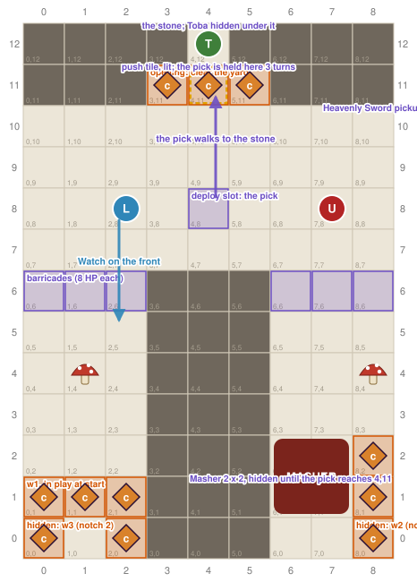

# M3 "Hold the yard": the opening and the squad pick, on the round-two layout

Size: M    Tier: 3 (changes an approved level; the roster; Family Roles and Duos on a held unit)    Assigned to: miso-game-designer
Branch: all (`main`)
Status: **waiting on THJ**

Inputs: D-741 and D-739 (`decisions.md`); the round-two plan [`plans/2026-11-26-m3-redesign.md`](2026-11-26-m3-redesign.md) (block `m3-defence-3`) and its build report [`reports/onboarding-m3-round-two.md`](../reports/onboarding-m3-round-two.md) (read-back, T-M1, T-M3, T-M4, T-M6); the old greybox [`plans/2026-11-22-onboarding-d3-paper-levels.md`](2026-11-22-onboarding-d3-paper-levels.md) § M3 and its report [`reports/onboarding-m3-defence.md`](../reports/onboarding-m3-defence.md); THJ's play check [`playtests/2026-11-25-m3-play-check.md`](../playtests/2026-11-25-m3-play-check.md); lines [`design/m3-text.md`](../design/m3-text.md); GDD [`family-systems.md`](../design/gdd/family-systems.md) (FR, DU, SY, PB).

## Why

THJ (D-741): keep the round-two layout as built, and bring back from the old greybox the opening fight, the squad pick (John or Mark) and the pick walking to a lit push tile. His one change: once on the push tile, the pick is held there, out of combat, for **3** hold turns, then rejoins for "Finish them.". The pick falling loses.

**The misreading not to repeat:** THJ's note "Mark should stay pushing the stone and be taken out of the squad as a playable character" meant *whoever pushes stays pushing and is out of combat*. It did not mean Mark is placed on the stone from level start. Here nobody starts on the stone; the pick walks there.

## Goal

A paper level a builder can wire without a design question: the round-two map, plus a short opening at the stone, the pick's walk, a 3-turn hold with the pick held, and a finish with all three.

## Acceptance criteria

- [x] The opening: enemies, the family's start tiles, the pick's deploy slot, what "Clear the yard." means here (the Masher stays out of it).
- [x] The push tile and the walk.
- [x] The stage list for 3 hold turns, the wave timing and the countdown text.
- [x] What "out of combat" must cover for a pick known only at runtime (needs, not code).
- [x] Mark's place in the level.
- [x] A new grid block, `m3-defence-4`.
- [x] Questions for THJ; the `m3-text.md` lines that no longer fit; layout changes flagged, not made.

## Scope

In: the opening, the deploy slot, the push stage, the hold timing, the held pick's rules, the defeat, the Masher's arrival time, text impact.
Out: the layout (kept as built: lanes, 3-wide necks, the six barricades, the mushrooms, the Sword, the stone); the barricade rules and values (round two, D-731); code and wiring (the coordinator's tech plan); final lines (`miso-narrative`).

## Touches

Systems: the Trail roster (`freeSlotsCount` back to 1); the deploy slot; the built pick conditions (`PickOnTilesLOCondition`, `PickFallenLOCondition`, kept since 7.1); the goal-tile highlight (`TilesOccupiedLOCondition` inside the shown objective, as in the old greybox); `HoldUnitsUntilSignal` (now on a unit known only at runtime); hidden groups (the Masher, a 2 × 2); `TurnReachedLOCondition` (3 stages, not 4). No core system is required by the design; whether the held pick's Role, Duos and Synergies can be switched off without core code is for the tech plan.
USPs: Family Roles, Duos, Synergies (the pick's showcase in the opening and the finish), Home neutral.
Docs: see [Docs to update](#docs-to-update).

---

## Problem and evidence

**The symptom** (THJ's play check, then D-739 and D-741): the pusher must stay pushing and be out of combat, and the round-two build took the pick and the opening away to get there.

**The root problem in this amendment:** with the pick walking to the stone and a hold of 3 turns, **the hold's timing decides whether the held pick is ever in danger.** I counted it on the round-two map:

- A barricade has 8 HP and one attack cell; a Claw hits for 4 at Early (T-M6, verified in 7.1). **The earliest a wall breaks is the second enemy turn after its wave arrives.**
- From a front cell (0,5, 2,5, 6,5) to a cell beside the push tile (3,11, 5,11, 4,10) is 7 steps; a Claw moves 4 and hits a neighbour, so it reaches 5. **A breacher attacks the pusher two enemy turns after it breaks the wall.**
- So a held pick is first attacked **3 enemy turns after the first wave reaches the wall.**
- If the waves start when the pick reaches the stone (the old flow), those 3 enemy turns are exactly the hold. The pick is released at the third notch, at the start of the family turn before that attack: **the held pick is never in reach.** That is the "hold too easy" THJ played on 2026-11-25, back again.

**Evidence:** the distances above (counted on block `m3-defence-3`, 4-way), the T-M6 damage read, the old flow's stage order (§ M3 Stages), THJ's "Enemies can still target the held pick, so the sisters protect them" (D-741).

**What follows:** the wall clock has to start before the hold does. Round two already has it: **w1 is in play in the west lane from level start** (as built). Keeping that, and putting the opening in front of the push, makes the opening the fuse: the longer the yard takes, the more cracked the wall is when the pick takes the stone.

---

## The level: `m3-defence-4`

```grid id=m3-defence-4 title="M3 · Defence: hold the yard (round-two layout, opening and the pick)"
# # # # T # # # #
# # # c c@ c # # #
. . . . . . . . .
. . . . . . . . .
. . L . . . . U .
. . . . . . . . .
. . . # # # . . .
. . . # # # . . .
. * . # # # . . *
. . . # # # . . .
. . . # # # O O c
c c c # # # O O c
c . c # # # . . c
--
cells 0,6 1,6 2,6 6,6 7,6 8,6 note barricades (8 HP each)
cells 3,11 4,11 5,11 enemy opening: clear the yard
cells 4,8 note deploy slot: the pick
arrow 4,8 4,11 note dx=8 the pick walks to the stone
note 4,11 push tile, lit; the pick is held here 3 turns
note 4,12 the stone; Toba hidden under it
note 6,1 Masher 2 x 2, hidden until the pick reaches 4,11
cells 0,1 1,1 2,1 enemy w1, in play at start
cells 8,0 8,1 enemy hidden: w2 (notch 1)
cells 0,0 2,0 8,2 enemy hidden: w3 (notch 2)
note 8,10 Heavenly Sword pickup
arrow 2,8 2,5 linda dx=-8 Watch on the front
level name Defence
level tier early
level alert all
level fp full
level camera 4,6
level deploy 4,8
level hidden toba 4,12
level hidden masher 6,1
level hidden w2 8,0 8,1
level hidden w3 0,0 2,0 8,2
```



*(To render: the coordinator, gate 7. Not checked in a drawing; every distance below is counted on the text.)*

**What changed from the built level** (read-back `src-gb_m3-defence` in the round-two report). Nothing in the map itself: same 82 tiles, barricades, mushrooms, Sword and stone.

| Tile | Built (round two) | `m3-defence-4` |
|---|---|---|
| 4,11 | `Unit_Mark`, held all level | No unit at start. A Dark Claw stands there (opening); after the opening, the push tile, lit as a goal |
| 3,11, 5,11 | Floor | A Dark Claw each (opening) |
| 4,8 | Floor | **Deploy slot** for the pick (`level deploy 4,8`) |
| 6,1 (Masher) | In play at start | **Hidden** in group `masher`, revealed when the pick reaches 4,11 |
| w1 on 0,1, 1,1, 2,1 | In play at start | **Unchanged** |
| w2, w3, the Sword, Linda 2,8, Lucy 7,8 | — | **Unchanged** (w3's east Claw on 8,2, as built) |

**Grid notes for the builder.**
- `#` is no GridCell. `@` on 4,11 is a drawing aid for the push tile; `c@` is a Claw standing on it. The build reads it as a Claw on floor.
- The barricades and the stone variants are placed by the wiring, as in round two (the grid has no character for them).
- **Layout flag: none.** Nothing here adds, removes or moves a tile or a barricade.
- Whether to rebuild from this block or edit the built prefab is the tech plan's call. The level was built by the builder and wired by idempotent menus.

### Level table

| Item | Plan |
|---|---|
| Source | The built `GB_m3-defence` (block `m3-defence-3`), edited as the table above says. Mission `M2 - The Trail`, one node, as now |
| Teaches | The barricade, "they break walls, and the wall is your clock" (round two). New in this version: **the pusher gives up the fight to move the stone** |
| Twist | The pick shows what they bring in the opening (Role, Duos), then gives it all up at the stone. The sisters hold the walls alone and protect a family member who can't fight back |
| Squad | **Linda 2,8, Lucy 7,8 (fixed); the pick (John or Mark) on the deploy slot 4,8**, chosen on the Trail's roster screen (one free seat). Linda–Lucy Duo locked (D-470). No Cleanse |
| Enemies | Early. **Opening:** 3 Dark Claws on 3,11, 4,11 and 5,11, factor 1.0 (16 HP each). **w1:** 3 Claws on 0,1, 1,1, 2,1, in play at start (as built). **Masher:** anchor 6,1, factor 0.6 (48 HP), hidden until the push. **w2:** 8,0, 8,1 (notch 1). **w3:** 0,0, 2,0, 8,2 (notch 2). Claws at 1.0. Total: 11 Claws and the Masher (224 HP; round two 176) |
| Barricades | As round two: six, 8 HP, no repair, the family walks through but can't stop on them |
| Turn budget | Opening about 2 rounds; the walk usually in the clearing turn or the next; hold 3; finish about 2. **About 7 rounds** |
| First trigger | **Enemy turn 1, two at once.** Linda's Watch on the w1 Claw that ends on 2,5 (3 down her column, as round two), and the pick's Role in the yard: John's Shield when a Claw targets Linda (2,8 is 2 from 4,8), or Mark's Fist Blitz when a Claw hits someone within 2 of him |
| Win / loss | Stages below. **Loss:** the pick falls (`PickFallenLOCondition`, as built in the old greybox) or no playable Bergson is standing (template; a held pick doesn't count as standing, see [Out of combat](#4-what-out-of-combat-covers)). Aggregation Any |
| Cues | See [Stages](#3-stages-waves-and-the-countdown) |
| Alert | All alert |
| FTP, items, clue | FTP full at start (the filler lists the sisters, as the old greybox). Potion 2, FP Potion 1. Heavenly Sword on 8,10 (3 uses). Clue: Toba |
| Fallback | No caps. A broken wall stays broken. If the pick dies, the mission is lost (one level) |
| Time | About 8 minutes cold |

---

## 1. The opening

**What "Clear the yard." means here:** kill the three Claws at the stone. Only the goblins inside the walls count. w1, outside the west wall, is the wall's problem, and the stage ignores it (`EntitiesDestroyed` listing the three, as the old S1 listed its three).

**Why these tiles.** The goblins are already at Toba's door, clawing at the stone. That gives the player a reason to care about the stone before anyone says a word. It also puts the push tile under a Claw, so "clear the stone" and "clear the yard" are the same act.

**The Masher is not in the opening** (play-check direction): it is hidden at 6,1 and comes in when the pick puts a shoulder to the stone.

**Family start tiles:** Linda 2,8 and Lucy 7,8, as built (Linda's column 2 is her Watch on 2,5). **The pick's deploy slot is 4,8**, in the middle of the yard, 3 steps below the push tile.

**Distances (counted on the text, 4-way):**
- The pick on 4,8 to the Claw on 4,11: 3. To 3,11 and 5,11: 4 each.
- Linda 2,8 to 3,11: 4, but not in a line. From 3,8 (one step) column 3 reaches 3,11 at 3. From 4,7, column 4 reaches 4,11 at 4.
- Lucy 7,8 to 5,11: 5. From 5,8 (2 steps) her embers reach 5,11 at 3.
- The Sword: Lucy 7,8 to 8,10 is 3; from 8,10, aimed at 4,10 (4 away, inside its 5), its 3 × 3 covers 3..5 × 9..11, the whole alcove. 10 to each Claw, not a kill at 16.
- Enemy turn 1: every opening Claw is within 5 of a family member (3,11 to Linda 2,8 is 4), so all three engage. Family first, so turn 1 is a setup turn with targets in reach.
- w1 (as round two): the outer Claws reach 0,5 and 2,5 on enemy 1 (4 steps) and hit 0,6 and 2,6.

**Answers (the opening):**

| Answer | How | Grade |
|---|---|---|
| Chained Assault (Mark–Lucy) on the clump | Lucy on 4,9 has all three alcove Claws within 4 (3,11 and 5,11 at 3, 4,11 at 2). 3 + 8 per target, × up to 1.5 with the mash: a strong mash kills all three. **Range measured from Lucy: assumed**, see T-P5 | ★ (the Mark pick's over-the-bar moment) |
| Hide and Seek (John–Lucy) | Decoys in the yard pull Claws out of the alcove into Linda's lines (Watch) | ★ |
| The pick's Role | John on 4,8 shields Linda (2 away) when the Claws come out; Mark answers with Fist Blitz on a Claw that hits a sister within 2 of him | ★ (automatic) |
| Linda down a column | 3,8 → 3,11 or 4,7 → 4,11; Lucy's follow-up finishes | ★ |
| The Sword on the alcove | 10 to all three; spends one of three uses before the hold | ● |
| Ignore the west wall all opening | Watch fires once on 2,5; unanswered, 0,6 and 2,6 break on enemy 2 | ● (the trade the level is built on) |

**The opening's lever is its length.** It decides how cracked the west wall is when the hold starts. Playtest signal below.

## 2. The push tile and the walk

- **The push tile is 4,11**, under the stone on 4,12. It is the only cell beside the stone (3,12 and 5,12 have no tile).
- When "Clear the yard." completes: the camera goes to the stone, the pick's cave line plays, **4,11 lights as a goal tile**, and the objective reads **"{pick}: push the stone."** This is built in the old greybox: `PickOnTilesLOCondition` plus `TilesOccupiedLOCondition` on 4,11 inside the shown objective, because the highlight skips hidden objectives.
- **The walk:** from the deploy slot it is 3 steps (4,9, 4,10, 4,11), one move. After a fight, the pick is usually 1 to 4 steps away. A sister on 4,11 does nothing; only the pick completes it.
- **The moment the pick ends a move on 4,11, they are held:** any AP left is gone, and the hold stages start. There is no "stay on the tile" rule any more, because the pick can't leave (D-741). That removes the old greybox's second thing to track (the stone waiting while the pusher is off the tile).
- If the pick is already on 4,11 when the yard clears (they killed the Claw there and stepped in), the stage completes at once. That's fine.

## 3. Stages, waves and the countdown

P is the family turn in which the pick reaches 4,11. The usual case is P = 2.

| Stage | Text (narrative to confirm) | Completes when | On complete |
|---|---|---|---|
| **S1** | Clear the yard. | The three opening Claws are dead | Camera on the stone, the pick's cave line, 4,11 lit |
| **S2** | {pick}: push the stone. | The pick stands on 4,11 | **Input off. The pick is held. Camera on the east lane: the Masher revealed (its close-up on first sight, EN-10).** The Masher line, then the pick's "can't push and fight" line, then Linda's "Keep them off him". Camera back, input on |
| **S3** | Hold them off. 3 turns left. | The next family turn start (P+1) | Notch 1; **w2** revealed (east); bark |
| **S4** | Hold them off. 2 turns left. | P+2 | Notch 2; **w3** revealed (both lanes); bark |
| **S5** | Hold them off. Last turn. | P+3 | Notch 3: the stone rolls away. **The pick is released and acts this turn.** The pick's hand-over line |
| **S6** | Finish them. | No living Enemy (barricades are Neutral and don't count) | The end as built: the tally, "Still counting?", Toba, home |

- **Each hold stage** is the built `TurnReachedLOCondition` with `turn = 1`, completing at the next family turn start. That is 7.1's choice, three times instead of four.
- **The stone:** stone0 at the start, then stone1 and stone2 on notches 1 and 2. Notch 3 moves it to stone3 and rolls it away. `Unit_Rock_Stone4` is no longer needed (keep or drop: the tech plan's call).
- **The hold's turn plan** (normal play, P = 2, nothing answered):

| When | In | What happens |
|---|---|---|
| Turn 1 | Opening Claws, w1 | The opening. w1 walks up the west lane |
| Enemy 1 | | Opening Claws engage. w1 hits 0,6 and 2,6 (4 each). Watch fires on 2,5 |
| Turn 2 | | The yard is cleared; the pick reaches 4,11 → held. **The Masher appears** at the bottom of the east lane |
| Enemy 2 | | Unanswered, w1 breaks 0,6 and 2,6. The Masher steps to 6,2 |
| Turn 3 (notch 1) | **w2** east | "Kill the breachers before they reach the stone." |
| Enemy 3 | | Breachers walk into the yard, 3 from the pick. The Masher steps to 6,3; w2 walks up behind it |
| Turn 4 (notch 2) | **w3** both lanes | **The crisis:** breachers one move from a pick who can't hit back |
| Enemy 4 | | **Breachers attack the held pick.** The Masher reaches the east wall (anchor 6,4) if the front cells are clear, else it waits behind its pack |
| Turn 5 (notch 3) | — | The stone rolls; the pick turns round and rejoins. "Finish them." |
| Enemy 5+ | | The Masher slams the east wall (6 a slam, two to break, T-M6) and comes into a yard where all three can fight it |

- **If the opening is slower** (P = 3), the hold covers enemy turns 3 to 5, and breachers reach the pick on enemy 4 or earlier. The hold is harder.
- **If it is faster** (P = 1, a perfect turn 1), the hold covers enemy 1 to 3, the pick is released before any breacher arrives, and the hold is easy. That is the reward for a perfect opening; it's in the playtest signals.
- **The Masher, hidden until the push**, keeps a fixed distance to the hold: it reaches the east wall on the last hold turn and breaks in during "Finish them.". So its big moment lands just as the pick rejoins, whatever the opening's length. The pick's line ("It's open! Now the big one!", D-732) and the Masher's arrival point at the same fight.

## 4. What "out of combat" covers

**The rule the player hears, in one sentence:** *"While {pick} pushes, they're out of the fight: they can't act, but they can be hit."*

**What the design needs from the moment the pick reaches 4,11 until notch 3** (the tech plan works out how; the pick is only known at runtime, so 7.1's data on Mark's instance can't be reused as is):

| Area | Needed | Why / evidence |
|---|---|---|
| Actions and AP | None: can't be selected to act, no AP, and any left on arrival is gone | D-741. `Status.Inactive` through `HoldUnitsUntilSignal` gives this (7.1, verified on Mark) |
| Family Role | **Never fires**, and **its zone is hidden** (no Shift zone, no cover marker, no John tether) | 7.1 T-M1: `Status.Inactive` does **not** stop a Role. A held John would take hits for the sisters at 4,11, and a held Mark would Fist Blitz off the stone. Hiding the zone keeps the Shift view honest (FR-8, FR-12) |
| Duos | **Not offered** with the held pick, from either side | A Duo moves units (Dance, the race) or makes the pick act (Chained Assault's ghost, Family Watchers' shout). 7.1 locked Mark's Duos for the whole level (D-737). Now they must be **open in the opening and the finish** and closed only while held |
| Synergies that make the pick act or prompt | **Off:** Catch & Return (a held Mark would stop Linda's arrow down column 4 and prompt a catch), Command Shield Dash, Shield Flare | Each is an action or a QTE from the pick. Shield Flare and Command Shield Dash already need an action from John or Mark, so they're off by themselves; Catch & Return isn't |
| Synergies that give a buff | **Off:** Papa's Shelter (Lucy next to a held John) | Recommended, for the one-sentence rule. See Q3 for the cheaper option |
| Pass-by | Off | Already built: the pass-by handler excludes `Status.Inactive` (PB-1 source line) |
| Movement | **Unmovable and Unable to Swap** while held | As 7.1 on Mark. Known gap (T-M1): the Masher's counter push has no tag filter. Low odds: the Masher must be in the alcove |
| Being hit | **Yes.** Enemies target and hit the held pick; they show it in next-targets and intent cells (EN-10) | D-741. Nothing extra pulls enemies to them: `PickFallenLOCondition` is a custom type the AI planner skips (old greybox, point 4), unlike 7.1's `EntitiesDestroyed` on Mark (T-M4). The template's defeat group pulls toward every living Bergson, as in any level |
| Their own numbers | **Stay:** HP, Mark's Focus barrier (MA-1), statuses, heals | Things done to the pick still happen. A Mark who built Focus in the opening carries a barrier into the hold. That rewards the opening, and it's no action |
| Template defeat | **A held pick doesn't count as "standing"**: if both sisters fall while the pick is held, the level is lost at once | 7.1's reason for `IgnoreObjective` on Mark (D-738): otherwise the family's turns end empty until the enemies kill the pick |
| Release (notch 3) | Everything comes back: actions, a **full turn's AP that same family turn**, the Role and its zone, Duos, Synergies, movable | "Rejoin the fight for Finish them." (D-741). Whether the hold's release gives AP in the turn it happens is T-P3 |
| UI | The party panel shows the pick greyed (the skip-turn look) with their HP. No new element | One signal, already in the game |

## 5. Mark in this level

- **Mark is a pick option, not placed.** John or Mark takes the one free seat on the Trail's roster screen; **the other isn't in M3.** No `Unit_Mark` on 4,11.
- **7.1's Mark-only data leaves the level:**
  - his instance tags (Unmovable, Unable to Swap, `IgnoreObjective`);
  - his Role switched off;
  - his Duos locked (D-736 to D-738);
  - the "Keep Mark standing." defeat group (D-733).
  
  Each comes back as a rule on **whoever is held** ([§4](#4-what-out-of-combat-covers)).
- **The choice now means something**, and the level shows it without a word:
  - **Mark** is stronger in the opening (Chained Assault on the clump, Fist Blitz) but has about 15 HP on the stone, plus whatever Focus barrier he built.
  - **John** is safer on the stone (about 32 HP) and protects the sisters in the opening.
  - The HP figures come from the round-two plan; they were not re-read for this plan.

---

## Options compared

### The main fork: when does the wall clock start?

| Option | Player experience | Rules | Cost | Risk | USP |
|---|---|---|---|---|---|
| **A. w1 in play from level start (as built); the Masher hidden until the push; w2 and w3 on notches 1 and 2** (rec.) | The opening is a fight at the stone while the west wall is being cracked. The pick takes the stone with breachers coming, and the sisters protect them on the last hold turn. The Masher arrives as the pick sets to the stone and breaks in as they rejoin | No new rule. Waves as built; one hidden group added (the Masher) | Data: the Masher moves into a hidden group | The hold's difficulty depends on how long the opening takes. A perfect opening gets an easy hold (playtest signal) | Roles, Duos + (the pick's showcase), Synergies + (sisters at the wall) |
| B. Old flow: w1 and the Masher revealed when the pick reaches the stone | Clean phases: fight, push, hold, finish | Same | Data | **The held pick is never in reach during a 3-turn hold** (see Problem). The hold goes back to "too easy" | Weak: nobody needs protecting |
| C. w1 and the Masher revealed when the yard is cleared | The walk happens under pressure | Same | Data | The pick is in reach only if they take a full turn to walk. If they reach 4,11 in the clearing turn (the usual case from 4,8), it's as B | Mixed |
| D. As A, but the Masher in play from start (as built) | The Masher is seen from turn 1 (the level-start tour as built) | Same | None | The Masher's timing depends on the opening's length. A slow opening → it breaks the east wall before the hold ends. Crescendo can pull it during the opening (from 7,7 to 7,2 is 5), so the opening gets two lessons | Neutral |

### What "out of combat" covers

| Option | Experience | Rules | Cost | Risk |
|---|---|---|---|---|
| **O1. Everything from the pick off (actions, Role, Duos, Synergies, buffs); things done to them stay** (rec.) | One sentence; the pick is a body to protect | "They can't act, but they can be hit" | Tech: switch the Role, Duos, Catch & Return and Papa's Shelter off on a runtime unit, and back on at release | The most switches to build |
| O2. As O1, but passive buffs stay (Papa's Shelter) | Lucy next to a held John stays Sheltered: a small warm touch | A second clause ("…except Papa still shelters Lucy") | One switch fewer | A rule the player can't see coming; it pulls Lucy to the alcove, away from the walls |
| O3. Actions and Role off only | — | — | Least | Duos would move the held pick off the stone (7.1 finding); a held Mark would prompt Catch & Return |

---

## Lens notes

**Creative.**
- *Target experience:* "The yard is clear, but it cost time: the west wall is splintering. {Pick} sets a shoulder to the stone, and the ground shakes; something huge is coming up the east lane. For three turns the sisters stand between the goblins and the one family member who can't fight back. Then the stone rolls, and {pick} turns round."
- **The moment we design for: turn 5 (notch 3).** The stone rolls away, the pick is released with a full turn, and the Masher is at the east wall. The family is whole again for the fight.
- **Warmth against dread:** the pick giving up their Role and Duos for the family's goal is the warmth. The cracked wall and the Masher's reveal at the instant the pick becomes helpless is the dread.
- **Not the genre default** ("escort stands still for N turns"): the opening sets the hold's difficulty, and the player learns that from the wall.

**Systems.**
- **Rules the player learns:**
  1. Barricades stop goblins until they break (round two).
  2. "While {pick} pushes, they're out of the fight."
  3. "If {pick} falls, we lose."
  
  The third rule is the old greybox's (D-718). The second replaces the old "stay on the tile" rule, so the count doesn't grow.
- **Levers:**

  | Lever | Start | Range |
  |---|---|---|
  | Opening Claws | 3 at the stone | 2 (faster opening, easier hold) or spread one to 0,10 (no Duo sweep) |
  | Masher reveal tile | anchor 6,1 at the push | 6,2: its first slam lands inside the hold |
  | Hold length | 3 (THJ) | — |
  | Barricade HP, Claw factor, Masher factor | 8, 1.0, 0.6 (round two) | as round two |
  | w1 start | in play at start | revealed at the start of turn 2 (a gentler opening; the hold gets one enemy turn easier) |
- **Interactions:**
  - **The pick's choice:** about 15 HP plus Focus for Mark, about 32 for John.
  - **Linda's quiver** is spent on both fronts in the opening (Watch on 2,5 and in the yard): 3 arrows, Encore to refill.
  - **The Sword:** 3 uses for the mission. Spending one on the alcove leaves two for the hold and the Masher.
  - **Sisters' Rivalry:** it runs the whole level; the race lives at the walls.
- **Failure cases:**
  1. **Perfect opening → easy hold.** Accepted as a reward. If it's the normal case, use 3 Claws spread or the Masher on 6,2.
  2. **Slow opening → breachers in the yard before the pick reaches the stone.** The breachers hit the sisters or the walking pick; it is harder, not broken. The fallback lever is w1 revealed at turn 2.
  3. **The pick parks on 4,11 during the opening.** The push completes as soon as the yard clears. Fine.
  4. **Sealing the pick.** The cells beside 4,11 are 3,11, 5,11 and 4,10. Two sisters standing there seal it but leave the walls, so it's a real trade (round two's failure case 4).
  5. **A held pick drinking a potion:** they can't (no action). Whether a sister can hand one over is the item system's rule; not designed here.

**UX.**
- **What's shown, and when:**
  - **Level start:** the camera on the stone with the Claws at it, then the west lane (w1), then the yard. Objective "Clear the yard." and the defeat line "Keep {pick} standing.".
  - **On clear:** the camera on the stone, 4,11 lit, "{pick}: push the stone.".
  - **On the push:** the pick greys in the party panel. The Masher's close-up plays, then the countdown "Hold them off. 3 turns left.".
  - **Each notch:** the stone shifts, and a wave arrival plays on notches 1 and 2.
  - **On release:** the pick un-greys, and "Finish them." shows.
- **What the player clicks:** nothing new. The pick can't be selected while held.
- **Likeliest misreads and the fixes:**
  1. **"I have to kill the w1 Claws to clear the yard."** The stage text names the yard, and S1 completes with w1 alive. The level-start camera shows w1 *outside* the wall.
  2. **"The pick is stunned, or bugged."** The pick's line at the push ("I can't push and fight. Keep them off me.") plus the greyed panel.
  3. **"Is the pick still covering people?"** Their zone disappears while they're held (§4).
  4. **"The stone opened, so we've won."** The hand-over line and the Masher at the wall.
- **New on-screen elements:** none. The goal-tile light, the greyed panel and the countdown all exist.

**Where the lenses pull apart.** Creative wants the Masher seen from turn 1 (dread across the opening, D). Systems and UX want it hidden until the push (B's timing for it, no second lesson in the opening). I lean to hidden: its reveal *at the moment the pick becomes helpless* is the stronger beat, and its timing stops depending on the opening.

## USP check

- **Family Roles: strengthened.** The pick's Role fires in the opening (John's Shield on Linda, Mark's Fist Blitz), Linda's Watch at the wall is the first trigger, and Lucy's follow-up runs all level. Taking the pick's Role away during the hold makes its absence felt.
- **Synergies: strengthened.** Sisters' Rivalry and Tempest Bloom carry the hold, as round two. In the opening the pick brings their own (Papa's Shelter or Catch & Return).
- **Duos: strengthened, compared with round two** (where Mark's were locked all level). John–Lucy, John–Linda, Mark–Lucy and Mark–Linda are live in the opening and the finish. Chained Assault on the alcove clump is the over-the-bar moment.
- **Managing the Home: neutral on purpose.** Same mission asset, unlocks, Toba gate.

| Threat | Linda | Lucy | The pick (opening / finish) |
|---|---|---|---|
| Opening Claws at the stone | Columns 3 and 4; Watch in the yard | Embers; Chained Assault / Hide and Seek; the Sword | Role; Duos; melee |
| w1, w3 west at the wall | Watch on 2,5; bow 1,7 → 1,4 into the mushroom | Cyclone on 1,5 | — (held) |
| w2, w3 east | Bow 8,7 → 8,4 | Embers from 7,7; the Sword | — (held) |
| Breachers at the held pick | Watch on their lines | Embers; standing on 3,11, 5,11 or 4,10 | The target |
| The Masher (finish) | Shots over the wall; Crescendo | Cyclone never provokes it; the Sword | John: Shield Up on its breach. Mark: Fist Blitz at 2 (the counter answers) |

## Critics

Not run: Size M (the coordinator's sizing), and the layout and values come from round two's L pass.

---

## Recommendation

| Point | Recommendation |
|---|---|
| 1. The opening | **Three Dark Claws at the stone (3,11, 4,11, 5,11), factor 1.0.** "Clear the yard." = those three dead. **w1 stays in play in the west lane from level start** (as built). Linda 2,8, Lucy 7,8, **the pick's deploy slot 4,8**. The Masher isn't in it |
| 2. The push tile | **4,11**, lit after S1; the pick walks 3 from the deploy slot; held the moment they stand there |
| 3. Timing | S1 Clear the yard → S2 {pick}: push the stone (**the Masher revealed**) → S3 to S5, three hold turns (**w2 on notch 1, w3 on notch 2**, the stone rolls on notch 3) → S6 Finish them. Countdown "3 turns left", "2 turns left", "Last turn." |
| 4. Out of combat | **O1:** no actions or AP, no Role and no zone, no Duos, no Synergies or buffs from the pick, Unmovable; can be hit; own numbers stay; doesn't count as standing for the template defeat; full turn on release |
| 5. Mark | A pick option; the other one isn't in M3; 7.1's Mark-only data leaves the level |

**Playtest signals.**

| Signal | Worked | Failed → lever |
|---|---|---|
| The turn the pick reaches 4,11 | Turn 2 or 3 | Turn 1 often → spread the opening (one Claw to 0,10). Turn 4 or later → 2 opening Claws, or w1 revealed at turn 2 |
| Attacks aimed at the held pick | At least one in a normal play; the pick survives most plays | None → Masher reveal on 6,2, or a fourth opening Claw. Pick dies most plays → w1 revealed at turn 2 |
| THJ reads "out of the fight" | No "is this a bug?" moment | Confusion → narrative strengthens the push line; no new UI first |
| Pick choice | Both feel viable | Mark always dies on the stone → that's information for THJ, not a lever yet |
| The Masher at release | At or breaking the east wall | Still in the lane → reveal on 6,2 |
| Cold time | Under 9 minutes | Over → 2 opening Claws |

---

## Questions for THJ

### Q1 · When does the wall clock start?

1. **Question:** Does w1 stay in play in the west lane from level start (as built), so the west wall is already being cracked during the opening?
2. **Context:** with a 3-turn hold that starts when the pick reaches the stone, a breacher needs 3 enemy turns from the wave's arrival to reach the pick. If the waves start at the push, the pick is released just before the first attack, and the held pick is never in danger. That is THJ's "hold too easy" again.
3. **Options:**
   - **(a) w1 in play from start, as built** (rec.): the opening's length sets the hold's pressure; breachers reach the held pick on the last hold turn in a normal play.
   - (b) w1 revealed at the push (the old flow): clean phases, but the held pick is never reachable.
   - (c) w1 revealed when the yard is cleared: pressure only if the pick takes an extra turn to walk.
4. **Recommendation:** (a). It keeps the round-two waves exactly as built and makes "protect the held pick" real.
5. **Blocked meanwhile:** the hidden groups and the stage wiring.

### Q2 · When does the Masher appear?

1. **Question:** Is the Masher hidden at 6,1 until the pick reaches the stone, then revealed with its close-up?
2. **Context:** it isn't in the opening (play-check direction). As built, it's in play from turn 1, walking 1 tile a turn. Left that way, its arrival would depend on how long the opening takes.
3. **Options:**
   - **(a) Hidden until the push** (rec.): it reaches the east wall on the last hold turn and breaks in as the pick rejoins, every time. Its close-up lands on the moment the pick becomes helpless.
   - (b) In play from start (as built): the dread is seen from turn 1, but a slow opening lets it break in during the hold, and Crescendo can pull it during the opening.
4. **Recommendation:** (a).
5. **Blocked meanwhile:** the Masher's placement in the wiring.

### Q3 · What does "out of combat" cover?

1. **Question:** While held, is the pick fully out of the fight? That means no actions or AP, no Family Role or role zone, no Duos, no Synergies or buffs from them (Catch & Return, Papa's Shelter), and Unmovable. Enemies can still hit them, their HP and Mark's Focus barrier stay, they don't count as "standing" if both sisters fall, and they get a full turn when released.
2. **Context:** 7.1 found that `Status.Inactive` doesn't stop a Role, and a Duo would move the unit, so Mark's had to be switched off by data on his instance. Here the pick is known only at runtime, and the Role and Duos must come back for the finish.
3. **Options:**
   - **(a) Fully out (O1)** (rec.): one sentence, "they can't act, but they can be hit".
   - (b) As (a), but Papa's Shelter stays (Lucy next to a held John): a small warm touch, a second clause, and it pulls Lucy off the walls.
   - (c) Actions and Role only: Duos would move the pick off the stone; a held Mark would prompt Catch & Return.
4. **Recommendation:** (a).
5. **Blocked meanwhile:** the tech plan for the runtime hold (it may find a part needs core code, which would come back to you).

### Q4 · The opening: three Claws at the stone, the pick on 4,8?

1. **Question:** Is the opening three Dark Claws (16 HP) on 3,11, 4,11 and 5,11, with the pick's deploy slot on 4,8 and the sisters on their built tiles?
2. **Context:** the old opening was the Masher plus two Claws (62 HP), and it was too hard because of the Masher. Three Claws is 48 HP against three heroes, with w1 at the wall as side pressure. The clump invites the pick's Duos, but a perfect Mark–Lucy Chained Assault can clear it on turn 1, which makes the hold easy.
3. **Options:**
   - **(a) Three Claws in the alcove** (rec.): the goblins are at Toba's door, and the push tile is under one of them.
   - (b) Two Claws: a faster opening and an easier hold.
   - (c) Three, one of them on 0,10: no Duo sweep, a slower opening and a harder hold.
4. **Recommendation:** (a), with (c) as the lever if turn-1 clears are common.
5. **Blocked meanwhile:** the opening placements and the S1 condition.

### Q5 · The pick falling: from level start, and how it reads

1. **Question:** Does the pick falling lose the level from level start, including in the opening, as the old greybox built it? And do the loss texts name the pick ("Keep {pick} standing.", "{pick} has fallen."), replacing "Keep Mark standing." and "Mark has fallen." (D-733)?
2. **Context:** D-741 says the pick falling loses. The built `PickFallenLOCondition` watches the pick from the moment it's seen on the board. It needs no unit named in data, so it fits a runtime pick. Whether a defeat objective's text can show `{pick}` is T-P4.
3. **Options:**
   - **(a) From level start; the texts name the pick** (rec.): one rule all level.
   - (b) Only from the push: in the opening a downed pick is just a downed hero (Revenge), but then nobody can push, so the level softlocks unless the stone takes a sister. That adds rules.
   - (c) As (a), with fixed texts with no name ("Keep the pusher standing."): no variable needed, but colder.
4. **Recommendation:** (a), with (c) as the fallback if `{pick}` can't show in a defeat line.
5. **Blocked meanwhile:** the defeat group's text keys (narrative, chunk 7.2).

---

## Text impact: `design/m3-text.md` (for `miso-narrative`)

`m3-text.md` was approved for the Mark-placed version (D-731 to D-735). These no longer fit:

| § / ID | Line today | Why it no longer fits | Direction |
|---|---|---|---|
| Header, Cast, "Mark speaks as himself" | Squad Linda and Lucy; Mark on the stone; four notches; `Who.Mark` | The pick is back; three notches | The pick speaks through the pick slot (`SpeakAsThePick`); John and Mark versions for every pick line |
| §0 order | Masher close-up at level start | The Masher is hidden until the push | The level-start tour shows the stone and w1; the close-up moves to S2's end |
| M3.0.1 Linda, "Every hit brings that one a step closer." | At level start | Same line fits; **the trigger moves** to the Masher reveal at the push | Keep the line, move it |
| M3.0.2 Mark, "A cave behind this stone. I'll shift it." | At level start | Moves to S1's end (the yard cleared), and needs a John version (old 1.1 J "There's a cave behind that stone. I'll move it.") | Pick line ×2 |
| M3.0.3 Mark, "I can't push and fight. Keep them off me." | At level start | **Still the right line**, now at S2's end (the pick takes the stone). It carries the "out of the fight" rule. Needs a John version | Pick line ×2 |
| M3.0.4 / M3.0.5 | Opening | Fit at S2's end ("him" fits John and Mark) | Move |
| New | — | The opening has no line: something at level start for "they're at the stone" | Narrative: one line |
| M3.1.1 to M3.1.4 | Four Mark notch lines | **Three notches.** "Halfway" (M3.1.2) is wrong at notch 2 of 3. M3.1.4 "It's open! Now the big one!" (D-732) fits notch 3 and now is also the pick rejoining | Three lines, John and Mark versions (the old draft's John set exists: "It's giving." / "Halfway…" / "Almost… there.") |
| M3.2.1, M3.2.2 | w2 at notch 1, w3 at notch 2 | Fit as written | Keep |
| M3.3.2, M3.3.3 | "Get away from him!" / Mark "Still pushing." | Fit; M3.3.3 needs a John version | Pick line ×2 |
| M3.5.9 | Mark, "We follow. Stay sharp." (D-734) | Said by the pick: needs a John version (old 5.9 J "Then lead on, Toba.") | Pick line ×2 |
| M3.6.1 to M3.6.4 | "4 turns left" … "Last turn." | Three stages: "3 turns left", "2 turns left", "Last turn." | Drop one |
| M3.6.6, M3.6.7 | "Keep Mark standing." / "Mark has fallen." (D-733) | The pick, not Mark | "Keep {pick} standing." / "{pick} has fallen." (Q5) |
| §6 "Gone" | "Clear the yard." and "{Pick}: push the stone." gone | **Both come back** | Restore |
| §7 line map, §9 glossary | Mark-placed slots; "the pick: no longer used in M3"; "the stone… Mark pushes… 4 notches" | Out of date | Rebuild the map; "the pick" back in M3; the stone row: "the pick pushes, 3 notches" |

Still fine: §2, §4 (tally barks), M3.3.1 (barricade down), M3.5.1 to M3.5.8 (Toba's "You moved the stone. Thank you." works for either pick).

## Docs to update (once approved)

- **GDD `design/gdd/missions-structure.md`:** the M3 row (squad with one free seat; stages S1 to S6; loss when the pick falls), with a Source line once built.
- `design/m3-text.md`: `miso-narrative`, per the table above.
- `glossary.md`: `miso-narrative` ("the pick" back in M3; "the stone" row).
- `design/level-chunks.md`: the palisade chunk's knob "the opening as the wall's fuse" (when the round-two catalogue entry is written).
- **Grids to render (gate 7):** this file only, `plans/2026-11-26-m3-pick-and-opening.md`, block `m3-defence-4`.
- Not edited: the round-two plan and the old paper plan (the coordinator marks `m3-defence-3` superseded by `m3-defence-4` for the opening and squad, per D-741).

## Risks

- **Hold difficulty varies with the opening.** It's intended (the opening is the fuse), but a perfect turn 1 gives an easy hold. Lever: the opening's spread.
- **Total HP is up** (224 against 176), but the pick fights in the opening and the finish. Time lever: two opening Claws.
- **The runtime hold** may need core code for the Role, Duo or Synergy switches. It comes back to THJ if so.
- **The Masher's counter push** can move a held pick (T-M1 gap, carried).
- **Family units in the lanes:** the family can walk through barricades, so a unit standing in 6..7 × 1..2 at the push would sit on the Masher's reveal footprint (T-P2).

## To check (each decides a tile or a rule)

| # | Question | Decides | Owner |
|---|---|---|---|
| T-P1 | The held pick's Role, Duos, Catch & Return and Papa's Shelter can be switched off and back on for a unit known only at runtime, without core code | §4, Q3 | tech plan |
| T-P2 | A hidden 2 × 2 unit reveals cleanly at 6,1, and where it lands if a cell of its footprint is taken | Q2 | implementer read |
| T-P3 | `HoldUnitsUntilSignal`'s release at a family turn start gives the unit its AP that turn | §4 release | implementer read |
| T-P4 | A defeat objective's text can show `{pick}` (does `PickFallenLOCondition` expose it, as `PickOnTilesLOCondition` does?) | Q5 | implementer read |
| T-P5 | Chained Assault's "within 4" is measured from Lucy | The opening's ★ | implementer read |
| T-P6 | The template defeat ignores a held pick (7.1 used `IgnoreObjective` on Mark's instance; now runtime, and removed at release) | §4 | tech plan |
| T-M1, T-M5, T-M7, T-M8, T-M11 | Carried from round two | — | as there |

## Gates

Design only. Gate 7: the coordinator renders `m3-defence-4` and checks it. THJ answers Q1 to Q5 → `miso-narrative` revises `m3-text.md` → the coordinator's tech plan (the runtime hold, the roster, the opening, the hidden Masher, 3 hold stages) → build → THJ plays from a cleared save (play check: yes).
