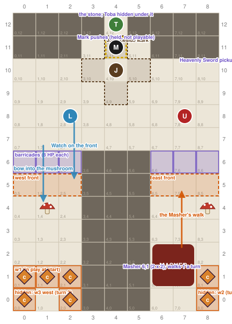

# M3 "Hold the yard" redesign (after THJ's play check)

Size: L    Tier: 3 (changes an approved level; touches Family Roles, the roster and a core AI question)    Assigned to: miso-game-designer
Branch: all (`main`; `thj/onboarding-demo` merged into `main`, D-723)
Status: **waiting on THJ** (critics' pass done, see [Critics](#critics))

Inputs: THJ's play check [`playtests/2026-11-25-m3-play-check.md`](../playtests/2026-11-25-m3-play-check.md) and its direction (D-722); the approved level [`plans/2026-11-22-onboarding-d3-paper-levels.md`](2026-11-22-onboarding-d3-paper-levels.md) § M3 (block `m3-defence`); the greybox as built [`reports/onboarding-m3-defence.md`](../reports/onboarding-m3-defence.md) and its plan [`plans/2026-11-25-onboarding-m3-greybox-tech.md`](2026-11-25-onboarding-m3-greybox-tech.md); the barrier code read [`reports/2026-11-26-m3-barrier-code-read.md`](../reports/2026-11-26-m3-barrier-code-read.md); the Masher's M3 history [`plans/2026-11-24-m1-ridge-ambush-design.md`](2026-11-24-m1-ridge-ambush-design.md) §11; lines [`design/m3-text.md`](../design/m3-text.md).

## Why

THJ played the greybox (D-722). The hold was too easy. The yard opening with the Masher was too hard and too cramped for its counter. Mark should stay on the stone as a target, not a playable unit. He asked for barriers, for the Masher to come from outside the yard through a lane, and for 3-wide corridors.

## Goal

A paper level a builder can greybox without asking a design question. The family holds a walled yard for four turns while Mark pushes the stone. The walls are a real clock: they crack on the first enemy turn and can fall inside the hold. The Masher comes up the east lane behind its own pack. Every open point, (a) to (f), has a recommendation THJ can approve.

## Acceptance criteria

- [x] The problem restated against D-722, with the root cause separated from the symptoms.
- [x] A new tile-addressable paper level, block `m3-defence-3`, drawn to the skill's rules, with the level table.
- [x] Options compared and a recommendation for each of (a) to (f), plus the barrier build options A, B and C.
- [x] USP check, with each sibling's answer to each threat.
- [x] Text impact on `design/m3-text.md`, flagged for `miso-narrative`.
- [x] Barrier requirements (not code), aligned with the code read.
- [x] Critics' pass (L), reconciled.
- [x] Questions for THJ in the five-part format; docs to update.

## Scope

In: the M3 level (layout, squad, Mark, the push, barricades, the Masher, waves, the Heavenly Sword), its stages and defeat, barricade requirements, text impact.
Out: code and assets (the coordinator's tech plan follows THJ's pick); final lines (`miso-narrative`); the M3-07 Home beats; M4.

## Touches

Systems: the grid-to-level builder; `HoldUnitsUntilSignal` (feature-side, a "hold from level start" option); the stone variants (faction change); `EntitiesDestroyedLOCondition` (core, data only); a new barricade unit (a variant of `Unit_Rock`); level faction relations; **(core: AI) only if option C is chosen**; mission roster data (`M2 - The Trail`).
USPs: Family Roles (John's Shield on Mark, Linda's Watch at the wall, Lucy's follow-up), Synergies (Sisters' Rivalry, Tempest Bloom, Shield Flare), Duos (John's two), Home (unchanged).
Docs: see [Docs to update](#docs-to-update).

---

## Problem and evidence

**Symptoms (THJ):**
1. The hold was too easy.
2. The yard opening was too hard and too small for the Masher's reaction.
3. Mark should stay pushing and only be a target.
4. Build barriers.
5. The Masher should come from outside, through a lane, breaking barriers and plowing Claws.
6. Corridors 3 wide.

**Root problems:**

1. **The hold had no pressure point.** The waves were 2, 3 and 2 Claws at 13 HP. They walked through open 1-wide necks, one or two at a time, into two sisters standing at the necks. That is a firing line with no clock, and the only thing at stake was the HP of the pick, who could fight himself. Nothing made the player choose between two bad things.
2. **The Masher was in the wrong phase.** It started at full HP in a 7 × 3 yard, with Linda 2 tiles away. Its counter (every hit drags it a step and slams, EN-2) punished the first thing the player did. It was a cold open with a hard rule and no room to learn it.
3. **The pusher had two jobs.** The pick had to stand on 5,7 *and* fight. The stay-on-tile rule was a second thing to track (`m3-text.md` §6 already flagged players leaving the tile).
4. **The geometry forbade the fix.** 1-wide necks and lanes can't pass a 2 × 2 (ambush design §11), so the Masher could only live in the yard.

**Evidence:**
- THJ's play (above).
- The paper doc's "Greybox first" warning: with open necks, the Cyclone on a lane mouth and the mushrooms carry the hold.
- The code read: no "attack what blocks me" logic exists, and the rock is the natural barrier.

**Verified in code for this plan** (2026-11-26, `main`; read, not played):
- **The hold starts too late for M3.** `HoldUnitsUntilSignal` holds with `Status.Inactive` from the **first end of another faction's turn**, not from level start (`Features/Onboarding/HoldUnitsUntilSignal.cs`). M3 has the family move first, so Mark would be playable on turn 1 without a "hold from level start" option.
- **An Inactive Mark is a target, not a magnet.** In `AIController.prefab`, `Status.Inactive` is in `objectivesIgnoreTagsQuery`, not in the skip or targeting queries. The AI planner doesn't pull enemies toward an Inactive unit, but targeting goes by faction relation only (code read §2). So an Inactive Mark can be attacked when an enemy reaches him, and nothing draws them to him: exactly "only a target".
- **"Mark falls" is data only.** `EntitiesDestroyedLOCondition` (`Core/Levels/Runtime/LevelObjectiveConditions.cs`) checks `!IsAlive` on the listed entities, with no tag filter.
- **The Masher walks 1 tile a turn.** Its walk has cooldown 1 (once a turn) and radius `Stat_SPD` (`MasherGoblin_Ability_Walk.asset`); the catalogue gives SPD 1. Each provoking hit adds one counter step, then a slam on the provoker's tile (code read §4, `TryPlanAnswer`).
- **Who passes what** (code read §1, §3, §4):
  - Claws, the Masher and the family pass allies on walks but can't stop on them.
  - A Neutral unit under Enemy–Neutral = Enemy blocks goblins and can be attacked.
  - The plow treats an Unmovable unit as a Blocker.
  - The counter only answers family hits.

---

## The new paper level: `m3-defence-3`

```grid id=m3-defence-3 title="M3 · Defence: hold the yard (redesign, 3-wide lanes, barricades)"
# # # # T # # # #
# # # . M@ . # # #
. . . . J . . . .
. . . . . . . . .
. . L . . . . U .
. . . . . . . . .
. . . # # # . . .
. . . # # # . . .
. * . # # # . . *
. . . # # # . . .
. . . # # # O O .
c c c # # # O O c
c . c # # # . . c
--
cells 0,6 1,6 2,6 6,6 7,6 8,6 note barricades (8 HP each)
zone 0,5 2,5 enemy west front
zone 6,5 8,5 enemy east front
range 4,10 1 john John beside Mark
note 4,12 the stone; Toba hidden under it
note 4,11 Mark pushes (held, not playable)
note 6,1 Masher 6,1 (2 x 2), walks 1 a turn
note 8,10 Heavenly Sword pickup
cells 0,1 1,1 2,1 enemy w1 (in play at start)
cells 8,0 8,1 enemy hidden: w2 (turn 2)
cells 0,0 2,0 enemy hidden: w3 west (turn 3)
arrow 2,8 2,5 linda dx=8 Watch on the front
arrow 1,7 1,4 linda dx=-8 bow into the mushroom
arrow 7,2 7,5 enemy dx=-6 the Masher's walk
level name Defence
level tier early
level alert all
level fp full
level camera 4,6
level hidden toba 4,12
level hidden w2 8,0 8,1
level hidden w3 0,0 2,0 8,0
```



*(To render: the coordinator, gate 7. Not checked in a drawing yet; every distance below is counted on the text.)*

**Grid notes for the builder.**
- `#` means no GridCell. `@` on 4,11 is a drawing aid (Mark's tile); the build reads it as floor.
- **One tile, two hidden groups:** 8,0 holds a w2 Claw (hidden, turn 2) and a w3 Claw (hidden, turn 3). The grid can draw only one unit per tile, so the builder places a second Dark Claw on 8,0 in group `w3` by hand. It is free by turn 3, because w2 walks up the lane on enemy turn 2. If the builder can't stack two hidden units on one tile, use **8,2** for w3's east Claw.
- **The six barricades** on 0,6, 1,6, 2,6, 6,6, 7,6 and 8,6 are **floor with a barricade unit on each**. The grid has no barricade character yet (see [Tools](#tools-and-legend)), so the wiring or the builder places them.
- **Mark** (`M`) on 4,11 is placed in the level, **not** a roster seat. The wiring holds him, see (b).
- **The stone and Toba** stay on 4,12 as today: stone variants in hidden groups, Toba in group `toba`. One more stone variant is needed (start plus 4 notches).
- **The Heavenly Sword pickup** goes under 8,10. The grid has no relic character, so it is placed as in the greybox.
- **In play at start:** the Masher, anchor 6,1 (footprint 6..7 × 1..2), and w1 on 0,1, 1,1 and 2,1.
- **Free tiles for each reveal:**
  - w2 on 8,0 and 8,1: column 8 is never in the Masher's columns 6..7.
  - w3 west on 0,0 and 2,0: under w1's start row, empty all level.
  - w3 east on 8,0: left by w2 on enemy turn 2.
  - A reveal onto a taken cell falls to a neighbour (see [Risks](#risks)).

### Level table

| Item | Plan |
|---|---|
| Source | **New prefab `GB_m3-defence-3`**, built from this block. `GB_m3-defence` stays as the old greybox (rename it `_legacy` or keep it: coordinator's call, D-621). The mission asset is unchanged: `M2 - The Trail`, one node, the new level. Everything keyed to it stays: the Yard completion sequence, the Map Table clue, the Home state, the station unlocks, Toba's button |
| Teaches | **The barricade:** "they break walls, and the wall is your clock." The Masher, now from outside: **every hit pulls it a step closer**, and shoves whatever stands in its way |
| Twist | Mark can't fight. The father guards the son while the sisters hold the walls and race for kills (M3-04) |
| Squad | **Linda 2,8, Lucy 7,8, John 4,10**: three fixed seats, see (a). **Mark on 4,11**: placed, held, not playable, see (b). Linda–Lucy Duo locked (D-470). No Cleanse |
| Cells | **Yard:** x 0..8, y 7..10 (9 × 4), plus the alcove 3..5 × 11 and the stone on 4,12. **Necks:** two, 3 wide, at y = 6 (x 0..2 and 6..8), each closed by three barricades. **Lanes:** two, 3 wide, y 0..5 (west x 0..2, east x 6..8). **Mushrooms:** 1,4 (west) and 8,4 (east, on the outer column, so the Masher's columns 6..7 stay open). Each sits one row under its wall's front. The centre (x 3..5 under the yard) has no tiles |
| Enemies | Early tier. **Dark Claws at factor 1.0** (16 HP; was 0.8). **Masher Goblin, anchor 6,1, factor 0.6** (48 HP), in play at start. **w1:** 3 Claws west on 0,1, 1,1, 2,1, in play at start. **w2:** 2 Claws east on 8,0, 8,1 (turn 2). **w3:** 2 Claws west on 0,0, 2,0 and 1 Claw east on 8,0 (turn 3). Total: 8 Claws and the Masher (176 HP) |
| Barricades | Six, **8 HP each**, on 0,6, 1,6, 2,6, 6,6, 7,6, 8,6. Each can be hit only from the cell below it (the front, y = 5). Goblins can't pass them and attack them. The family walks through them but can't stop on them. Family attacks don't hurt them. They can't be repaired. See (d) |
| Turn budget | Hold: 4 family turns (notches at the start of turns 2, 3, 4 and 5). Finish: about 2 rounds. About 6 to 7 rounds |
| First trigger | **Enemy turn 1, Linda's Watch.** w1's two outer Claws reach the west front (0,1 → 0,5 and 2,1 → 2,5 are 4 steps each) and attack the barricades. The one on 2,5 ends in Linda's column, 3 from her start on 2,8, inside her 4. The layout forces it: the lane is the only way up, and its front row is in her column from her start tile |
| Win / loss | **S1 to S4**, "Hold them off" (countdown text, see [Text impact](#text-impact-designm3-textmd-for-miso-narrative)). Each stage completes at one family turn start since it began (`FactionTurnLOCondition`, or the built held-turn pattern). On complete, the stone moves a notch and the next wave comes in. After S4 the stone rolls away (the last notch). **S5:** "Finish them." (defeat all; barricades are not enemies). **Loss:** Mark falls (`EntitiesDestroyed`, Mark), or no playable Bergson is standing (template). Level defeat aggregation Any, as built for the pick |
| Cues | **Level start:** the camera moves over the Masher (its close-up plays on first sight, EN-10), then the east wall, then Mark at the stone (his line), then John's line. **Each wave:** the arrival pattern (input off, camera, reveal, bark, camera back). **First barricade broken:** one line. **Each notch:** Mark. **The last notch:** hands over to the threat ("the big one's at the wall"). **End:** as built (the tally, "Still counting?", Toba) |
| Alert | All alert (`level alert all`) |
| FTP, items, clue | FTP full at start (`level fp full`; the filler lists the three fixed seats, not Mark). Items as the mission's (Potion 2, FP Potion 1). Heavenly Sword on 8,10 (3 uses, a 3 × 3 of 10 × within 5; D-625, moved from 8,6). Clue: Toba |
| Fallback | No caps. A broken barricade stays broken, and the yard fight can still be won. John's Shield is the safety net on Mark. A loss is the whole mission (one level) |
| Time | About 7 minutes cold |

### The turn plan (if the player does nothing special)

| When | Stone | In | What happens |
|---|---|---|---|
| Turn 1 | notch 0, "4 turns" | w1 (west, 3 Claws), the Masher (east) | A setup turn. Linda is already on her Watch column (2). Lucy can cross to the west wall for a Cyclone on 1,5 (from 1,7 or 2,7), or fetch the Sword. John stays beside Mark |
| Enemy 1 | | | The w1 outer Claws reach 0,5 and 2,5 and hit 0,6 and 2,6 (4 each, half their HP). Linda's Watch fires on 2,5. The middle Claw has to go round the mushroom and ends on 0,4 or 2,4, inside the mushroom's blast. The Masher steps to anchor 6,2 |
| Turn 2 start | notch 1 | **w2** (2 Claws, east bottom) | The west wall is cracked. **Kill the front Claws or lose a barricade this enemy turn** |
| Enemy 2 | | | Unanswered, w1 breaks 0,6 and 2,6 (the second hit). w2 walks up behind the Masher (walks pass allies) toward the east front. The Masher steps to 6,3 |
| Turn 3 start | notch 2 | **w3** (2 west, 1 east) | Both fronts busy. A Claw through a west breach is 7 to 9 tiles from Mark |
| Enemy 3 | | | Breachers walk into the yard (4). If 6,5 and 7,5 are clear, the Masher reaches anchor 6,4 and slams 7,6 (8 HP, 7 to 8 per slam: the east wall falls in one slam or two). If its own Claws stand there, it waits behind them: **it comes through right behind its pack** |
| Turn 4 start | notch 3 | — | **The crisis:** breachers one move from Mark, the east wall going, the Masher at the neck |
| Enemy 4 | | | Breachers reach Mark (the cells beside him are 3,11, 5,11 and 4,10). John's Shield takes the hits. The Masher breaks through |
| Turn 5 start | notch 4: the stone rolls | — | **"Finish them."** Mark's last line hands over to the threat. The Masher comes into the yard (enemy 5) |

**The Masher's lesson.**
- **Before it reaches the wall, every hit you land on it pulls it a step up the lane** (EN-2's counter step). A Claw standing in its way is shoved one cell onward toward you, if the cell behind that Claw is free (the plow, D-573).
- **Once it stands under the wall,** the barricade blocks the counter step, because the plow refuses an Unmovable unit. Whether its slam can still reach a family member standing behind the barricade is T-M7.
- **At 8 HP, the wall in front of it lasts one or two slams,** so the window to shoot it over the wall is short.
- The counter preview (EN-2 hover) shows the step and the slam.

### Distances (counted on the text, 4-way)

- **Linda's Watch on the west front:**
  - From 2,8 down column 2: 2,5 is 3 away.
  - From 0,7 or 2,7: the front cell in her column is 2 away.
  - Each barricade has one front cell, so Watch covers one of the three per column. That is why the mushroom sits on 1,4.
- **Bow into the mushroom:**
  - From 1,7 down column 1: 1,6 (barricade), 1,5 (front), then 1,4 (mushroom), 3 away.
  - From 8,7 down column 8: 8,6, 8,5, then 8,4, 3 away.
  - If the blast is the 8 cells around the mushroom (T-M5), 1,4 hits 0..2 × 3..5, which is **the whole west front** and the row under it. 8,4 hits 7..8 × 3..5, which is two east front cells and the Masher's column 7 as it passes.
  - If the blast is only the 4 cells next to it, 1,4 hits 1,5, 0,4, 2,4, 1,3, so one front cell. Then the combo is ●.
- **Linda on the Masher:**
  - From 7,7 down column 7 her bow reaches 7,3, so the Masher is in bow reach from anchor 6,2 (rows 2..3) on: turn 2.
  - Explosive Crescendo (within 5) from 7,7 on 7,2, its own cell, hits it on turn 1. That pulls it.
- **The Masher to the wall:** anchor 6,1 to 6,4 is 3 steps, so it arrives on enemy 3 if its cells are clear and nobody pulls it.
- **From a breach to Mark:**
  - A Claw on 2,5 to 3,11: 1 + 6 = 7. From 0,5: 9. From 6,5 to 5,11: 7.
  - The front Claw breaks the barricade on its turn, then needs two more enemy turns (4 + 3, then it attacks).
  - **A breach on enemy 2 reaches Mark on enemy 4, inside the hold.**
- **John on Mark:**
  - 4,10 is next to 4,11, inside his Shield (2).
  - The tiles within 2 of Mark: 3..5 × 10, 4,9, 3,11, 5,11.
- **Lucy:**
  - From 1,7 or 2,7, a Cyclone on 1,5 is 2 away (empty on turn 1). Its four neighbours are 0,5, 2,5, 1,4 (the mushroom) and 1,6 (a barricade).
  - Enemies can't pass the Cyclone's cell, so it seals 1,6's only attack cell, and its Whirl hits whoever stands on 0,5 and 2,5.
  - Cast on turn 1, it lasts enemy turns 1 to 3. Cooldown 4: back on turn 5.
- **Heavenly Sword:**
  - Lucy on 7,8 to 8,10 is 3 (one move).
  - From 2,8 aimed at 1,5 (4 away): its 3 × 3 covers 0..2 × 4..6, the whole west front.

### Answers (the hold)

| Answer | How | Grade |
|---|---|---|
| Linda's Watch on the wall | Linda on 2,8 (start), 2,7 or 0,7: a Claw that ends on the front cell in her column draws a Watch shot (2 to 3 tiles). Watch the quiver: 3 arrows, Encore to refill | ★ |
| Bow through the front into the mushroom | From 1,7 to 1,4, or 8,7 to 8,4 (3 each): pierce the front Claw, then the blast on the whole front (if the blast covers 8 cells). 6 + 7 = 13 on a 16-HP Claw, and Lucy's follow-up (2 × 3) finishes it, so Lucy can steal the kill (the race) | ★ (● if the blast covers 4 cells) |
| Cyclone at the wall | Lucy's Cyclone on 1,5 on turn 1: seals 1,6, Whirls 0,5 and 2,5 every enemy turn until turn 3. Linda's arrow down column 1 through it splits (Tempest Bloom). Then it's down for the east crisis | ★ |
| John beside Mark | John on 4,10: any hit aimed at Mark moves to John at × 0.5. Shield Up cuts it again and stores Wrath | ★ |
| Hide and Seek | John–Lucy decoys in the yard pull breachers off Mark | ★ |
| Shield Flare at the breach | John at a breach with Shield Up; Lucy's ember relaunched along his diagonals into the neck | ● |
| Sword on a clump | The Heavenly Sword's 3 × 3 on the west front, or on the Masher and its pack at the east neck. Fetching it costs Lucy a move on turn 1 | ● |
| Shoot the Masher in the lane | Each hit drags it a step and shoves the Claw in front of it toward you. Good when you're ready for it, a trap when you're not | ● / ✗ |
| Stand on 6,7 or 7,7 while the Masher is under the wall | Its slam on the wall may also hit the yard tile behind it (T-M7) | ✗ |
| John off on a sally | Leaves Mark uncovered while a breach is open | ✗ |

---

## Options compared

### (a) The squad

| Option | Player experience | Rules | Cost | Risk | USP |
|---|---|---|---|---|---|
| **A1. Linda, Lucy and John fixed; Mark placed and held** (rec.) | The father guards the son, the daughters hold the walls. One line says so (John: "The walls are yours, girls. He's mine.") | Roster: 3 fixed, no pick. Simpler than today (no "pick" rule) | Roster data; the pick conditions leave M3 | Before a breach John adds little: his melee can't reach the front (y = 5 is behind the wall) and he can't stop on a barricade. After a breach he fights. Covered by the wall clock | Family Roles + (John's Shield on Mark), Duos + (John's two) |
| A2. Linda and Lucy only; Mark placed | The pure sisters' exam; the hardest version | The fewest pieces | Roster data | Two fighters (35 HP) against 8 Claws, the Masher and a 15-HP target, with nobody to cover Mark | Family Roles − (no John's Shield; the only way to protect Mark is to kill) |
| A3. Keep a pick slot | Nothing: John is the only candidate (Toba joins at the end, Mark is on the stone) | A pick screen with one choice | — | Reads as a bug | — |

### (b) Mark: not playable, still a target

| Option | Player experience | Rules | Cost | Risk |
|---|---|---|---|---|
| **B1. `Status.Inactive` through `HoldUnitsUntilSignal`, from level start, never released, plus Unmovable** (rec.) | Mark can't be selected; enemies hit him if they reach him; nothing draws them to him | One existing status | Feature-side: a "hold from level start" option; the wiring adds `EntityState.Unmovable` for the level | Low; confirm the checks below |
| B2. Mark as an ally-faction NPC (like `Unit_Toba_Ally`) | Same on the board, but he leaves the party panel | New faction relations, in a level that already changes the Neutral relation | New prefab variant, relations, a regression-catalog entry | Medium: relations (D-702's lesson), Toba-style AI turns |
| B3. Locks only (`LevelAbilityLock` on every ability) | He can be selected but does nothing: reads as broken | — | Data | Players click him and get nothing |

**Code checks B1 needs** (the implementer reads, the verifier plays):
1. A "hold from level start" option on `HoldUnitsUntilSignal`. Today the hold starts after another faction's turn ends, and M3 has the family move first. The need is verified.
2. Enemies attack an Inactive unit in reach (targeting goes by relation only: read, not played). A Claw that plans to hit Mark shows him in the next-targets list and the intent cells (EN-10), and the redirect to John reads right.
3. Inactive stops Mark's Family Role. Otherwise an enemy hitting a family member would make him Fist Blitz off the stone. D-712's wording implies it does; confirm. If it doesn't, lock his Role in the level.
4. John's Shield covers an Inactive ally.
5. With `EntityState.Unmovable`, no push or plow moves Mark off 4,11 (the plow refuses Unmovable, code read §4).
6. A placed hero who isn't in the mission roster has no roster, XP or `MissionTracker` side effects. The onboarding memory levels place heroes directly; confirm for a roster mission.
7. The party panel shows Mark with his HP. How it marks him as "not yours" (greyed, the skip-turn look) is shown in play. John's role zone in the Shift view (CR-41) is the "Mark is covered" signal, so no new text is needed.

### (c) Defeat and the push

| Option | Player experience | Rules | Cost | Risk |
|---|---|---|---|---|
| **C1. A notch at the start of every family turn; Mark falls = loss** (rec.) | "Mark pushes. Four turns and it's open. If he falls, we lose." A fixed clock the player counts down | One sentence; drops "stay on the tile" | Data: `FactionTurnLOCondition` per stage, or the built held-turn condition pointed at Mark; `EntitiesDestroyed` (Mark) in the second defeat group. `PickFallenLOCondition` and the two pick conditions leave M3 | Low |
| C2. As C1, but the stone waits while an enemy stands next to Mark | More pressure at the stone; John's guard matters more | A second rule to track | A new feature-side condition | The clock can stall for turns; harder to read. **Kept as the lever** if Mark is never touched in play |
| C3. A notch per wave cleared | The player sets the pace | The hold becomes "clear waves", and the wall clock loses its meaning | Data | Turtling is the best play |

### (d) Barricades

**Design values** (for every build option below):
- Six barricades, three per neck, **8 HP each**. That is two Claw hits at Early (4 to 5 each, whichever way rounding goes, T-M6), and one or two Masher slams (7 to 8 each). A slam on the middle cell hits all three.
- **No repair.**
- Family attacks and the family's relic don't hurt them.
- **Family units walk through them but can't stop on them.** That is what a Neutral ally does today (code read §1).
- Why 8 and not 12: each barricade has a single attack cell, so one Claw at a time hits it. At 12 HP the earliest breach was enemy 4 and nothing reached Mark before the stone opened (systems critic). At 8 a breach can happen on enemy 2 and reach Mark on enemy 4.

**Repair options considered:**

| Repair | Experience | Rules | Verdict |
|---|---|---|---|
| **None** (rec.) | The wall is a clock you spend | "They hold until they break" | One sentence, no new action |
| John braces a barricade (Shield Up beside it halves its damage) | A family job at the wall | A new rule on a Role | Over budget |
| Rebuilt between waves | Resets the clock | A new action or timer | Removes the tension the barricade exists for |

**Family pass-through.** Should the family be stopped by its own walls too? The UX critic's point: a move range that spills into the lanes invites misclicks, and "why can I walk through it and they can't?" goes unexplained. Blocking the family means the barricade can't be the family's ally. Then family attacks that target enemies could target it, which breaks "can't hurt your own wall" and needs code. Recommendation: keep pass-through, which costs no code. If the playtest shows misclicks into the lanes, the fix goes in the tech plan, not the design. The rule the player hears stays one sentence: "goblins can't get past the barricades."

**How they're built: A, B or C** (from the code read; the tech plan follows THJ's pick):

| Option | How it feels in M3 | Cost | Risk |
|---|---|---|---|
| **A. Data only.** `Unit_Barricade`, a variant of `Unit_Rock` (Neutral, Unmovable, 8 HP). Enemy–Neutral goes back to Enemy. The stone moves to a faction allied with Enemy (Stranger, for example), with the relation entries D-702 needs | **Before a breach it plays the same as C.** The yard is closed, so every goblin is blocked and a barricade is the only thing in reach. After a breach, some Claws may keep hacking intact barricades instead of pouring through, because the barricade also attracts unblocked units. That softens a breach; it doesn't break the level | No core code. Rewire the stone's faction and three `M3DefenceTests`. One regression-catalog entry | Low. The breach is the thing to watch |
| B. A plus a feature-side "taunt when blocked" | Same as A before a breach; after it, the taunt pulls blocked units onto the barricades | Feature code | **It overwrites the attacker memory that John's taunt uses, and wakes Unaware units.** It collides with a family mechanic. Rejected |
| C. A core AI rule: barricades are targeted only when the unit is blocked, and optionally never attract | Clean. Claws pour through a breach at once, so a breach is a real crisis | `AIUnitBrain`, `AIBlackboard`, `AIFactionBrain`, maybe `GridActions` (core, Tier 3); review and regression | Medium: core AI on the demo's critical path |

**Recommendation: A for the greybox; C if the play shows the trigger below.**
- M3's geometry does the "only when blocked" work. Until the first barricade falls, no goblin has any other way in, so A and C play the same.
- They differ only after a breach. There, A errs toward an easier level: some goblins keep tearing at the palisade.
- **The trigger for C:** a Claw stands next to an intact barricade for a full enemy turn while an open gap it could walk through is in its reach.
- Settle the barricade HP in the first play before judging C, because A's softer breaches and the HP pull the same way.

**The Masher and the barricades.** No special case is needed (code read §4):
- Its own-turn slam hits a hostile barricade like any target, and the plus shape on the middle cell catches all three.
- Its counter step can't shove an Unmovable barricade.
- A barricade never provokes it.
- "Breaks them easily" is data: 8 HP against a 7 to 8 slam on three cells at once.

### (e) The Masher: lane, arrival, factor

| Option | Experience | Cost | Risk |
|---|---|---|---|
| **E1. East lane, in play from level start at anchor 6,1, factor 0.6** (rec.) | The wall that walks: the player watches it come one tile a turn and decides whether to pull it. Unpulled, it comes through on enemy 3 or 4, behind its own Claws, and is in the yard as the stone opens | Placement and factor | It stalls while its own Claws stand on the front cells (it can't stop on allies). That reads as "it waits for its pack", and the turn plan says so |
| E2. Revealed mid-hold (turn 3) right under the east wall | A surprise beat and a mid-fight close-up | Placement | Its Claws may stand on its reveal cells. Less warning, and the pull choice disappears |
| E3. Its own south lane up the middle | A clean read: "that lane is his" | A 13-wide map and 9 barricades | A bigger, longer level, and no Claws around it to plow |

**Factor:** 0.6, so 48 HP at Early (it was 0.45, 36 HP, in the yard). Levers: 0.5 if the finish drags (systems critic), 0.75 if the last kill should take both sisters and the Sword (creative critic). 0.6 sits between the two; the play decides.
**Speed:** SPD 1 (verified: the walk has cooldown 1; SPD comes from the catalogue). If it arrives too late, a per-instance SPD 2 (T-M9).
**The plow:** as built (D-573), on its counter step only. In this layout that is what THJ described: hit it while its Claws stand between it and you, and it shoves them at you. Its own-turn walk passes its Claws (code read §3) but doesn't shove them. A plow on its own walk would be a core change to the Masher (Q4, option c).
**The creative critic's alternative, for Q4:** "if its step is blocked, it slams what blocks it". Then shooting it under the wall would cost you your own barricade. It is more original, but it is a core change to the Masher's counter, and at 8 HP the window under the wall is already short. Offered, not recommended.

### (f) Tougher waves and the Heavenly Sword

| Option | Experience | Cost | Risk |
|---|---|---|---|
| **F1. Claws to 1.0 (16 HP); 8 Claws in three waves (3 west at start, 2 east on turn 2, 2 west and 1 east on turn 3); the Masher at 0.6** (rec.) | Claws at the wall that one sister can't clear alone. Mushroom plus bow (13) needs the other sister's follow-up, which is the race. Both fronts are live by turn 3, after Lucy's Cyclone has been spent on one of them | Data | Enemy HP 176, against 153 in the old hold (opening included). The difficulty comes from the wall clock, not from more bodies |
| F2. The old factor (0.8), more Claws (11) | More bodies, the same kills per shot | Data | Longer, not harder in kind; the finish becomes clean-up |
| F3. Add an Archer (it shoots over the wall at 3) | A new question at the wall (Linda's 4 outranges it) | Data | A new enemy rule in an exam level; over the budget for M3 |

**The Heavenly Sword:** keep it (D-625), moved to **8,10**, the east top corner. Lucy starts 3 away, so fetching it costs her turn-1 move, and the Cyclone has to wait. Its best uses are a clump at a wall (the 3 × 3 covers a whole front) or the Masher and its pack at the east neck. Three uses, for the mission; Mithra's Rest gives it again before the Queen.

---

## Lens notes

**Creative.**
- **The target experience:** *a family behind a wall that is visibly coming apart. The father is planted beside his son; the daughters race each other at the walls; something huge walks up the other lane behind its pack, one tile at a time.*
- **The moment we design for: turns 4 to 5.**
  - A west breach is one move from Mark, and John stands between them.
  - The Masher and its Claws are at the east neck.
  - The stone grinds its last notch, and Mark's last line ("the big one's at the wall") turns the stone's opening into the start of the real fight.
  - The player decides where the Sword's last use goes.
- **Children of Morta's warmth against dread.** John taking Mark's hits is the warmth; the slow Masher and the splintering barricades are the dread.
- **Original against the genre default.** The defence isn't "kill waves for N turns" but "spend a wall": the barricades' HP is the shared clock, and the Masher turns the player's own damage into its speed.
- **The sisters' arc.** The tally race lives at the walls, where kills need both sisters (13 damage plus the other's follow-up). The Masher's last kill in the yard is likely shared (bow, follow-up, Sword), so "Still counting?" answers something the player just did.

**Systems.**
- **The rules the player learns:**
  - Barricades stop goblins until they break.
  - Mark pushes a notch a turn and must not fall.
  - Every hit pulls the Masher a step.
  - Two of these reuse existing rules (the Masher's counter, a protectee). Only the barricade is new.
- **Levers:**

  | Lever | Start | Range |
  |---|---|---|
  | Barricade HP | 8 | 6 to 12 |
  | Claw factor | 1.0 | 0.85 to 1.1 |
  | Waves | 3/2/3 | add one Claw per lane on turn 4 |
  | Masher factor | 0.6 | 0.5 to 0.75 |
  | Masher SPD | 1 | 2 |
  | Hold length | 4 notches | 3 or 5, one stone variant each |
  | The Sword's tile | 8,10 | — |
  | Mark's clock | C1 | C2 |
- **Interactions:**
  - **John's Shield and Mark:** the safety net. John takes about 2 per Claw hit through the Shield, out of 32 HP, so Mark's loss rarely bites by HP alone. The real pressure is breachers in the yard hitting the sisters.
  - **Linda's Watch and the fronts:** one front cell per column. Watch her quiver: 3 arrows, Encore costs 2 AP.
  - **The Cyclone and the west wall:** on 1,5 it seals the middle barricade and grinds both sides through enemy turn 3, then it's down for the east crisis.
  - **The Masher's slam and the tile behind the wall:** see T-M7.
  - **The mushrooms:** they sit one row under each front.
- **Failure cases:**
  1. **Turtle the west wall.** The Cyclone holds it through turn 3. w3's east Claw, w2 and the Masher still crack the east wall, so the level can't be turtled from one side.
  2. **Kill the Masher in the lane at range.** It is out of bow reach until turn 2, and every hit pulls it closer. That is the trade.
  3. **John never leaves Mark.** Fine and intended: the sisters carry the walls, which is the exam.
  4. **Seal Mark.** John on 4,10 plus bodies or decoys on 3,11 and 5,11 make him unreachable by melee (systems critic). That costs the player its sisters at the walls, so it's a real trade. If play shows Mark is never touched, use C2; don't weaken John's Shield.
  5. **A breach snowballs.** One family turn in hand, John's Shield and decoys.
  6. **A's post-breach idling** makes the level easier, not broken. It is the trigger for C.

**UX.**
- **What's shown, and when:**
  - **Level start:** the camera moves over the Masher (its close-up), then the east wall, then Mark and the stone (one line).
  - **The objective counts down,** "Hold them off: 4 turns." and so on (narrative's wording).
  - **The barricades** show the unit HP bar the game already draws. Which colour it uses is a play check: no GDD rule defines a non-family bar colour, so the plan doesn't rely on one.
  - **Area previews** (the Sword's 3 × 3, Crescendo, the Cyclone) show no damage on barricades (requirement 4).
  - **The stone** shifts each notch (the built art offset). Each wave plays the arrival camera. "Finish them." comes with Mark's hand-over line.
- **What the player clicks:** the same as in any fight. Mark can't be selected.
- **Likeliest misreads and the fixes:**
  1. **"Mark is mine."** His opening line, plus John's role zone over him in the Shift view.
  2. **"I should hit the barricade."** Family enemy-targeting can't pick it, and previews show no damage on it.
  3. **"Shooting the Masher in the lane is free."** The counter preview shows the step. The Masher line becomes "every hit brings it closer"; the old "keep your distance" taught the old rule. The preview must fire when an area hit (Crescendo) catches the Masher without being aimed at it: T-M11.
  4. **"(1/4) means one done."** The countdown text fixes it.
  5. **"The stone opened, we won."** Mark's last notch line points at the Masher.
- **New on-screen elements:** one, the barricade. **Removed:** the push-tile goal light and the "{pick}" text.

**Where the lenses disagreed, and where I landed.**
- **When the Masher arrives.** Creative first wanted a surprise mid-hold reveal; systems and UX wanted it on the board from the start. The creative critic also came down for "visible from the start", and asked for it to arrive earlier so the big moment falls inside the hold. Done: anchor 6,1 (was 6,0), and the walls at 8 HP.
- **Blocking the family's walk.** UX wanted the family stopped too; systems and cost say keep pass-through. I keep pass-through, and it's flagged in Q3.

## USP check

- **Family Roles: strengthened.**
  - John's Shield is the answer to "keep Mark alive", standing beside the stone.
  - Linda's Watch fires on the Claw at the front in her column, the level's first trigger.
  - Lucy's follow-up turns the 13-damage bow and blast into a kill.
  - Mark's Role is off on purpose (he's busy).
- **Synergies: strengthened.**
  - Sisters' Rivalry: kills at the wall need both sisters, and either can steal one.
  - Tempest Bloom: an arrow through the Cyclone at the wall.
  - Shield Flare: John at a breach, Lucy's ember.
- **Duos: strengthened.** John brings two: Hide and Seek with Lucy (decoys pull a breach off Mark) and the Dance with Linda. The sisters' Duo stays locked until M4 (D-470).
- **Managing the Home: neutral on purpose.** The same mission asset, the same unlocks and Toba gate.

**Each sibling's answer to each threat:**

| Threat | Linda | Lucy | John | Mark |
|---|---|---|---|---|
| w1 and w3 west (Claws at the west front) | Watch on column 2 from her start; bow 1,7 → 1,4 into the mushroom; Crescendo on the front | Cyclone on 1,5 (turn 1); follow-up embers | Hide and Seek if they breach | — |
| w2 and w3 east (Claws ahead of the Masher) | Bow 8,7 → 8,4 into the east mushroom | Embers from 7,7 (8,5 is 3 away); the Sword from 8,10 | — | — |
| The Masher | Crescendo to pull it early (a choice); shots over the wall while it's under it | Cyclone hits never provoke it; the Sword at the neck | Shield Up on its breach; Wrath | — |
| A breach toward Mark | Watch on whoever crosses her lines | Decoys (with John), embers | Shield redirects every hit on Mark | The target |

## Critics

Three critics, one lens each, given the draft (the critic agent type wasn't available, so the same briefs ran on read-only agents). What each found and what I did with it:

| Lens | Strongest point | What changed |
|---|---|---|
| **Systems** | **The wall couldn't run out of time inside the hold.** Each barricade has one attack cell. At 12 HP and with w1 starting on row 0, the earliest breach was enemy 4, and a breacher reached Mark only after the stone opened. Also two wrong claims: w1 doesn't reach Linda's column on enemy 1 (the first trigger), and the mushroom on 1,3 never hits the front row | **Adopted.** Barricades **12 → 8 HP**; w1 starts on row 1 (reaches the front on enemy 1); Linda starts on **2,8** so her Watch on 2,5 is the real first trigger; mushrooms moved to **1,4 and 8,4** (one row under each front); breach distances corrected (7, not 6) |
| Systems | The Masher stalls behind its own Claws on the front cells | **Adopted as the lesson:** "it comes through right behind its pack". The turn plan says so; the plow (hit it and it shoves them at you) is THJ's "plows Claws" |
| Systems | Two effective fighters before a breach, so 208 HP ran long | **Adopted:** w4 dropped (8 Claws, 176 HP). Masher kept at 0.6 (creative wanted 0.75, systems 0.5) |
| Systems | A Cyclone on 1,5 holds the west for the whole hold | **Adopted in part:** w3 split (2 west, 1 east) so both fronts are live on turn 3, after the Cyclone's 3 turns |
| Systems | Mark can be sealed (John plus two bodies) | **Kept as a known trade**, with C2 as the lever. Not weakening John's Shield |
| **Creative** | **The big moment landed after the clock ran out** (the Masher breaking in during "Finish them") | **Adopted:** anchor 6,0 → **6,1** and 8-HP walls, so the east neck goes on enemy 3 or 4. Mark's last notch line hands over to the threat |
| Creative | A Masher whose blocked counter slams its own blocker | **Offered to THJ** (Q4, option c), not recommended: a core change, and at 8 HP the window under the wall is short |
| Creative | John fixed needs a line to keep "the sisters' exam" | **Adopted:** John starts on **4,10** (beside Mark); his line "The walls are yours, girls. He's mine." and one bark the first time his Shield takes a hit for Mark ("Not him."): flagged for narrative |
| Creative | Move the close-up to when the rule matters | **Partly:** the close-up stays automatic on first sight (EN-10). With anchor 6,1 the Masher can be reached on turn 1 (Crescendo), so the rule matters from the start. The Masher line now states the pull |
| **UX** | **The Masher's lesson depends on a preview that may not show it.** Crescendo was aimed off its tile, and "free shots" rests on T-M7 | **Adopted:** Crescendo now targets its own cell 7,2; "free" softened to "the step is blocked; the slam is T-M7"; new **T-M11** (the preview fires on an area hit) |
| UX | Walking through your own wall will cause misclicks | **Considered, not adopted:** blocking the family needs a non-ally barricade, which family attacks could then target. Flagged in Q3; the fix goes to the tech plan if play shows misclicks |
| UX | "Can I hit it?" before anyone says | **Adopted:** the opening camera includes the wall; requirement: area previews show no damage on barricades; the "neutral colour" claim dropped |
| UX | "(1/4)" reads as one done; the win feels premature | **Adopted:** countdown objective text, Mark's hand-over line (narrative) |
| UX | "Is Mark mine / about to be hit?" | **Adopted:** T-M1 now checks next-targets and intent cells on Mark; John's Shift zone is the "covered" signal |

## Recommendation

Build `m3-defence-3` as drawn:

| Point | Recommendation |
|---|---|
| (a) Squad | **A1:** Linda, Lucy and John fixed (three seats, no pick); Mark placed on the stone |
| (b) Mark | **B1:** `Status.Inactive` from level start, never released (a feature-side option on `HoldUnitsUntilSignal`), plus Unmovable for the level |
| (c) Defeat and push | **C1:** a notch at every family turn start for 4 turns; the level is lost if Mark falls (`EntitiesDestroyed`) or no playable Bergson stands |
| (d) Barricades | **Six, 3 per neck, 8 HP, no repair, family passes through.** Build with **option A** (data only); **C** if the trigger shows |
| (e) The Masher | **E1:** east lane, in play at start, anchor 6,1, factor 0.6; the plow as built |
| (f) Waves and the Sword | **F1:** Claws at 1.0; waves 3 / 2 / 2 + 1; the Heavenly Sword on 8,10 |

**Playtest signals.**

| Signal | Worked | Failed → lever |
|---|---|---|
| A barricade falls by enemy 3 in a normal play | The wall is a clock | Never falls → 6 HP. Falls on enemy 1 → 10 |
| Mark's lowest HP or John's Shield redirects | John redirects 2 or more hits for Mark | Mark untouched → C2. Mark dies before turn 4 → drop w3's east Claw |
| The Masher's position at turn 5 | At or through the east neck | Still in the lane → SPD 2. In the yard by turn 3 → anchor 6,0 |
| Finish length | 2 rounds or fewer | 4 or more → Masher 0.5 |
| Tally at the end | Within 2 kills of each other | — |
| Cold time | Under 8 minutes | Over → hold 3 notches |
| Option A after a breach | Claws walk through gaps | Claws idle at intact walls → C |

## Barrier requirements (for the tech plan; not code)

1. **What it is:** a unit with HP on one cell (a `Unit_Rock` variant fits, code read §1), Unmovable and Unable to Swap, 8 HP at Early, with the unit HP bar. It is not an enemy for objectives: "Finish them" (living Enemy units ≤ 0) must complete with barricades standing.
2. **Who it blocks:** goblins (Claws and the Masher) can't pass it or stop on it. The family may pass but not stop, as Neutral allies do today. That is an accepted design choice, not a requirement.
3. **Who hurts it:** goblin attacks (the Claw's melee, the Masher's slam and its area). Not family attacks, Duos, Roles, the Heavenly Sword or Lucy's Whirl. The mushroom blast: either way is fine, since no barricade is inside a mushroom's 8-cell ring (1,4's ring is y 3..5; 8,4's is y 3..5).
4. **Family shots and previews:** Linda's arrow and Watch lanes pass it, Crescendo can target cells beyond it, embers and Shield Flare's diagonals pass it. Area previews show no damage on it.
5. **The AI when blocked:** an enemy with no path to the family walks up to the barricade and attacks it. Option A gets this from relations, because the barricade is the only reachable target; option C makes it the rule. After a breach, enemies should prefer the opening (C); under A they may keep hitting it, which is accepted for the greybox.
6. **The Masher:** its slam damages a barricade like any hostile target. Its counter step treats it as a Blocker (no shove). A barricade never provokes the counter. No other special case.
7. **Death:** at 0 HP it's removed and its cell becomes plain floor; the AI replans.
8. **Faction:** hostile to Enemy, allied to the family, not counted by objectives. The stone must not become a target, so it moves to a faction allied with Enemy, with the relation entries `GetFactionEnemies` needs (D-702).
9. **Intent preview:** a Claw that will hit a barricade shows that in the enemy's next-targets view, like any other target (EN-10).
10. **Name and look:** placeholder title "Barricade" (narrative to confirm); a palisade sprite later.

## Tools and legend

The grid has no barricade character, so `m3-defence-3` marks the six cells with a `cells` tint. Proposal for the tool owner (THJ's call, a tool change, Q6): add `=` (barricade, a 1-cell unit) to `grid_render.py` and `level_to_grid.py` (`UNIT_CHARS`) and to Build Level From Grid, so the next defence level can draw and build them from the block.

## Text impact (`design/m3-text.md`, for `miso-narrative`)

| § | Line | Change |
|---|---|---|
| 0 | 0.1 Linda, the Masher close-up | Same beat, new rule: "every hit brings it closer" (the UX critic: "keep your distance" taught the old rule) |
| 0 | 0.2 the pick (John or Mark) | Becomes John only, and states the exam: proposed "The walls are yours, girls. He's mine." (creative critic) |
| 1 | 1.1 the pick, S1 complete, the cave | S1 is gone. Becomes Mark at level start: the cave and "I'll shift it" (the Mark version exists) |
| 2 | 2.1 and 2.2, w1 arrival | w1 is on the board at start. "Keep them off him" becomes part of the opening, naming Mark |
| 3.1 | 3.1, 3.2 arrival barks | New counts and sides: w2 is two Claws east, behind the Masher; w3 is two west and one east ("both sides now" still fits w3) |
| 3.2 | 3.3 to 3.5 notch lines | Mark only (John's versions drop). **Four notches**, so one more line. **The last one hands over to the threat** ("The big one's at the wall!") |
| New | John's Shield bark | Once, the first time his Shield takes a hit aimed at Mark: proposed "Not him." |
| New | First barricade broken | "They break walls", one line (§7 said it would return with the barriers) |
| 4 | Tally barks | Unchanged |
| 5 | 5.9 the pick's reaction | Mark (he's there) or John: narrative's choice |
| 6 | Objectives | "Clear the yard." and "{Pick}: push the stone." go. The hold becomes a **countdown** ("Hold them off: 4 turns." down to "1 turn."). "Finish them." stays |
| New | Defeat text | "Mark fell." or similar, for the loss panel |
| New | Unit title | "Barricade" (placeholder) |
| 9 | Glossary | "the pick" no longer used in M3; "barricade" proposed |

---

## Questions for THJ

### Q1 · Who is in M3's squad now that Mark is on the stone?

1. **Question:** Is M3's squad Linda, Lucy and John, all three fixed, with Mark placed on the stone and not in the roster?
2. **Context:** D-722 takes Mark out of play. That reverses D-622's "the pick pushes" and leaves the pick slot with one candidate (Toba arrives at the end). It affects the roster data, the pick conditions, and the M3 lines that have John and Mark versions.
3. **Options:**
   - **(a) Linda, Lucy, John fixed** (rec.): John guards Mark with his Shield, and brings two Duos. Roster data only.
   - (b) Linda and Lucy only: the pure sisters' exam. Nobody can cover Mark, so this is likely too hard, or the waves shrink back to "easy".
   - (c) Keep a pick slot: one candidate, which reads as a bug.
4. **Recommendation:** (a). Family Roles gets its clearest showcase in the demo: the father covering the son. Before a breach John can't reach the wall, so the sisters still carry the hold; one line from John says so.
5. **Blocked meanwhile:** the roster data, line rewrites (§0.2, §5.9). Everything else in the plan stands either way.

### Q2 · How is Mark "not playable but a target", and when does the level end?

1. **Question:** Is Mark held with `Status.Inactive` from level start, with the stone moving one notch at every family turn start for 4 turns, and the level lost if Mark falls?
2. **Context:** D-718's "the pick falls" becomes "Mark falls". The built hold starts only after the enemy's first turn, so a small feature-side option is needed. Mark's Family Role must be off, or he would dash off the stone.
3. **Options:**
   - **(a) Inactive from start plus Unmovable; a notch per turn; Mark falls = loss** (rec.): one sentence; data plus a small feature option.
   - (b) As (a), but the stone waits while an enemy stands next to Mark: more pressure at the stone, a second rule, a new condition.
   - (c) A notch per wave cleared: the player sets the pace, so turtling wins.
   - (d) Mark as an ally-faction NPC instead of Inactive: more data and relation risk, and he leaves the party panel.
4. **Recommendation:** (a), with (b) kept as the lever if play shows Mark is never touched.
5. **Blocked meanwhile:** the stage and defeat wiring. The layout and barricades can be planned without it.

### Q3 · Barricades: values, the family's walk, and how they're built

1. **Question:** Do we build six barricades (3 per neck, 8 HP, no repair, the family walks through them), with option A (data only) for the greybox and the core AI rule (C) only if the play shows the trigger?
2. **Context:** D-722 says build them. The code read shows no "attack what blocks me" logic. M3's closed yard makes every goblin "blocked" until a breach, so data-only behaves the same as the core rule until then. Option B collides with John's taunt.
3. **Options:**
   - **(a) Option A now, C on the trigger** (rec.): no core code first. The trigger is a Claw idling next to an intact barricade with a gap in reach.
   - (b) C now: clean breaches from the first play; core AI (Tier 3), review and regression before M3 can be played.
   - (c) As (a), but the family is blocked by the walls too: fewer misclicks, but needs code so family attacks can't target the barricade.
4. **Recommendation:** (a). It gets a playable M3 soonest, and the only difference shows after a breach, on the safe (easier) side.
5. **Blocked meanwhile:** the coordinator's barricade tech plan. The layout and numbers are ready.

### Q4 · The Masher: where, when, and does its plow change?

1. **Question:** Does the Masher start in play at the bottom of the east lane (anchor 6,1, factor 0.6), walking 1 tile a turn, with the plow as built (on its counter step only)?
2. **Context:** D-722 moves it out of the yard (reverses D-688). It walks 1 tile a turn (verified), and every hit pulls it a step. It stalls behind its own Claws at the front, so it comes through right behind its pack. As built, it shoves Claws only when the family hits it.
3. **Options:**
   - **(a) As above** (rec.): a visible, slow threat whose speed the player controls; no Masher code.
   - (b) Revealed under the east wall on turn 3: a surprise beat, but its Claws may stand on its reveal cells, and the pull choice is gone.
   - (c) As (a), plus a core Masher change: it shoves Claws on its own walk too, or its blocked counter slams what blocks it (the creative critic's idea: shooting it under the wall costs your barricade). Core, Tier 3, an AI regression.
4. **Recommendation:** (a). It already does what THJ described (it breaks walls easily at 8 HP, and plows its Claws at you when hit) without touching the Masher.
5. **Blocked meanwhile:** the placement and factor in the build. Option (c) would need its own core tech plan.

### Q5 · How much tougher are the waves?

1. **Question:** Are Claws at factor 1.0 (16 HP) in three waves (3 west at start, 2 east on turn 2, 2 west and 1 east on turn 3), with the Heavenly Sword moved to 8,10?
2. **Context:** D-722 asks for tougher enemies. The difficulty now comes mainly from 8-HP walls that can fall inside the hold. Bodies grow a little: 176 HP against 153. A 16-HP Claw needs both sisters (bow plus blast is 13, plus Lucy's follow-up), which feeds the tally race.
3. **Options:**
   - **(a) As above** (rec.).
   - (b) The old factor 0.8, with 11 Claws: longer, not harder in kind.
   - (c) Add an Archer to turn 3: a new question at the wall, over the complexity budget for an exam level.
4. **Recommendation:** (a), with the levers in [Recommendation](#recommendation).
5. **Blocked meanwhile:** the enemy data in the build. Nothing else.

### Q6 · A barricade character in the grid tools?

1. **Question:** Do we add `=` (barricade) to the grid renderer, the level reader and Build Level From Grid?
2. **Context:** today the barricades are marked with a tint, and the builder places them by hand. The skill says to extend the tools rather than work around them, but a tool change is your call.
3. **Options:**
   - (a) Add it now: about an hour, and the next defence level is drawn and built from text.
   - **(b) Hand-place for M3, add it if a second level uses barricades** (rec.).
4. **Recommendation:** (b). One level doesn't pay for the tool change yet.
5. **Blocked meanwhile:** nothing. The M3 build can place the barricades in its wiring.

## Docs to update (once approved)

- `plans/2026-11-22-onboarding-d3-paper-levels.md` § M3: mark `m3-defence` superseded by `m3-defence-3` (link here), and keep the old block as history.
- GDD `design/gdd/missions-structure.md`: the M3 (onboarding) mission and level row (squad, stages, defeat), with a Source line once built.
- GDD `design/gdd/enemies.md`: the Masher's first appearance (M3, from a lane). The barricade as a level object if it becomes reusable; a new EN rule only if option C is built.
- `design/level-chunks.md`:
  - a "palisade" chunk (the wall as a clock: one attack cell per barricade);
  - knobs: barricade HP, hold length, the pull;
  - an object reference row for the barricade;
  - the to-check rows below.
- `design/m3-text.md`: `miso-narrative`, per the table above.
- `glossary.md`: `miso-narrative` ("barricade" in; "the pick" out of M3).

## Risks

- **Reveal onto a taken cell** (w3's east Claw on 8,0, stacked with w2's start tile): picked to be free, and the fallback is 8,2. A reveal that lands on a neighbour is cosmetic. Check it in play.
- **A's post-breach behaviour** (goblins keep hitting walls): easier, not broken; it's the trigger for C.
- **Mark sealed by John and decoys:** a known trade; the lever is C2.
- **The Masher's stall** behind its Claws makes its arrival depend on the player. That is intended, but the turn plan's "enemy 3 or 4" is a range, not a promise.
- **Time:** about 7 rounds; over 8 minutes → hold 3 notches.

## To check (each decides a tile or a number)

| # | Question | Decides | Owner |
|---|---|---|---|
| T-M1 | Inactive Mark: attacked in reach; shown in next-targets and intent cells; his Role off; John's Shield covers him and the redirect reads right; Unmovable keeps him on 4,11 | (b) | implementer read + play |
| T-M2 | "Hold from level start" on `HoldUnitsUntilSignal` | (b) | implementer |
| T-M3 | A placed hero outside the roster in a roster mission: no side effects | (a), (b) | implementer |
| T-M4 | Does the AI planner read the family's defeat group (`EntitiesDestroyed` Mark)? If yes, every enemy beelines for Mark: decide whether that's wanted | (c) | implementer read |
| T-M5 | The mushroom blast's shape (8 or 4 around) | The bow-and-blast ★ or ● | play |
| T-M6 | Damage rounding at Early (Claw 4.5, Masher 7.5) | Barricade HP 8 holds two Claw hits and one or two slams | implementer read |
| T-M7 | The Masher's counter or own-turn slam on a barricade cell: does it also hit an attacker on the tile behind it (6,7 or 7,7)? | The ✗ on 6,7 and 7,7, and "shots over the wall" | play |
| T-M8 | Linda's pierce and Watch pass a Neutral unit; Crescendo can target beyond it | Answers | play |
| T-M9 | A per-instance SPD override on a placed Masher | Lever | implementer read |
| T-M10 | The Masher's slam reach from anchor 6,3 (top row y 4) to the wall (y 6): none expected | The stall behind its pack | implementer read |
| T-M11 | The counter preview fires when an area ability (Crescendo) catches the Masher without being aimed at its tile | The pull lesson | play |
| T-M12 | Two hidden units of different groups on one tile (8,0: w2 and w3) | w3's east tile, else 8,2 | implementer |

## Gates

Design only. Gate 7: the coordinator renders `m3-defence-3` and checks it. THJ approves → the coordinator's tech plan (barricade option A or C, the Mark hold, the stone's faction, stages) → build → THJ plays from a cleared save.
