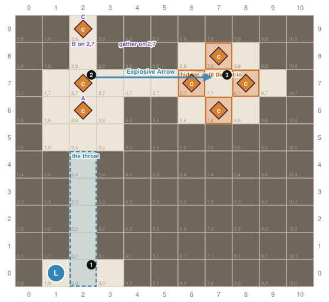
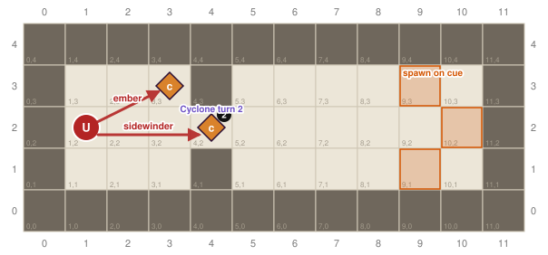
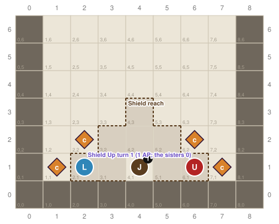
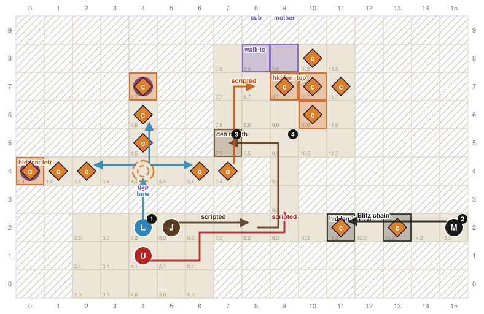
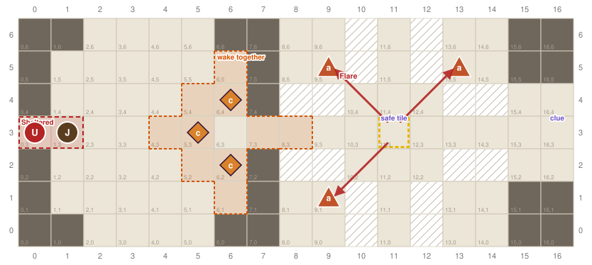
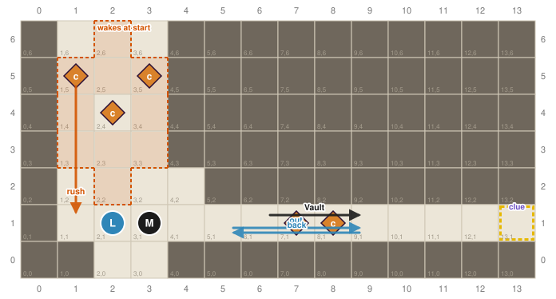
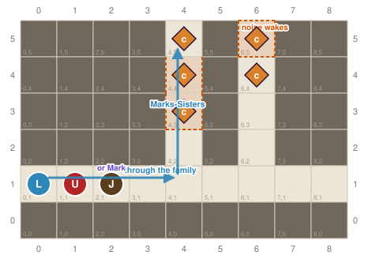
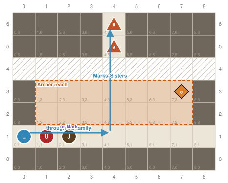
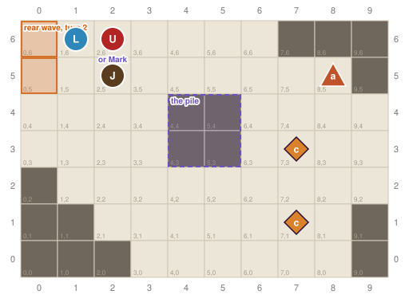

# Onboarding: paper level plans (step A2)

Size: L    Tier: 3 (level content and dramatic moments; one Family-tree node change)    Assigned to: miso-game-designer
Branch: all (built on `thj/onboarding`, cut from `main` @ `dc64f974a`); nothing here differs on `thj/home-test`. **The plan's base is pre-quiver:** `thj/onboarding` does not have Linda's Quiver (on `main` since D-326) and needs `main` merged in (or the branch recut) before any chunk is built from this plan (THJ's yes needed)
Status: answered by THJ 2026-10-26: Q1 Return to Sender (D-228, since reversed by D-332: Q5 reopens the node), Q2 Mark's weapon slot, Tunic fallback (D-229), Q3 punchlines + trailhead (D-226), Q4 roles keep 1 FTP, data stopgap only if needed (D-225). Quiver folded in 2026-10-30 (D-331 to D-334; findings in `reports/onboarding-quiver-impact.md`): segment 1, the Ridge, Catch & Return's node, M2 route B, play checks for segments 3 and 4. Grids rendered in `onboarding-levels/` (`index.html`); **segment 1's grid changed 2026-10-30 and needs a re-render**. The levels are created by the implementer from this plan and edited by THJ (D-235)

Feeds: [`2026-10-25-onboarding-first-hour-design.md`](2026-10-25-onboarding-first-hour-design.md) (D-168 to D-176) and its [work plan](2026-10-25-onboarding-first-hour-workplan.md) (step A2; D-177 to D-180). This file does not change that design; where it has to bend it, the [contradictions](#where-this-bends-the-design) say so.

## Why

The design is approved as a direction; the greybox (B2 to B4) needs each level on paper first: map, the one thing taught, the twist, enemies, turns, where the first Role, Synergy and Duo fire, interruptions, alert setting, FTP, drops, clues, and a time budget that lands Hearth → M4 in 45–60 minutes.

## Goal

Ten paper levels that a builder can greybox without asking a design question, each teaching one thing, with a total time inside the target.

## Acceptance criteria

- [ ] Every level below has a grid, the thing taught, a separate twist, squad, enemies and tier, a turn budget, first-trigger placement with the layout reason, cues, alert setting, FTP, drops, clue, and fallback.
- [ ] The time table lands the Hearth at 12–15 minutes and Hearth → M4 send-off inside 45–60 (cold player).
- [ ] A cold player meets a Family Role QTE by ~5 min, a Synergy by ~10, a Duo by ~15 (design acceptance criteria).
- [ ] Every new-tech or core-system touch is flagged.
- [ ] D-177's Family-tree node has 2–3 options and a recommendation.

## Scope

In: Hearth memory segments 1–4, The River, The Ridge, M2 The Trail (trailhead, two route levels, the pile), the grid-fade rule (D-131), the Catch & Return node (D-177).
Out: Home visits, the world map, Bond Lite, the framed beat, the tally (their own plans); final text (narrative, placeholder lines only here); M4.

## Touches

Systems: level prefabs and their objectives, sequences and spawns (`LevelObjectives` stages, `SequentialSequence`, `LSBExecutionSequence` + `GUnitSpawn`, `MoveUnitSequence`, `SignalSequence` + `SignalAction`), `LevelAlertSettings`, `LevelStartFPFiller`, Mission assets (rosters, rewards, items), `ProjectileCatchAndReturn` (Mark), `UnlockableSet` (Catch & Return default), bark graphs. Core: none required; two flagged options touch Missions core (avoided).
USPs: Family Roles, Synergies, Duos (Home: neutral here, see USP check).
Docs: see [Docs to update](#docs-to-update).

---

## Problem and evidence

**Symptom (playtests S1, S8, Q1, Q2):** over 2 hours to M4, nothing family-specific until M2, the first combo late, two competing hooks.

**Root problem for this step:** the approved flow has no levels yet. The risk is not ideas but **time and focus**: each level must teach exactly one thing and end before it drags. Evidence from the assets read for this plan:

| Fact (verified) | Where | Consequence |
|---|---|---|
| The source maps are small: Level1-C1-2 is 16 tiles (Linda + 4 Dark Claws), LevelLucyJohn-C1 20, LevelLindaJohn-C1 27, LevelLucyJohn-C3 34, Level1-C2 36 | level prefabs (cells and placed units read; rock props not placed) | Segment 1 reworks its source; the River and the Ridge are new levels on those environments; segment 4 is new |
| A mission has **one** initial level; the mission map opens only after a won level | `Mission.cs` (`isInitialLevel`), `CombatLevelUIManager.cs:311` | M2 can't open on its route choice: it needs a level first (see [M2](#m2-the-trail)) |
| Win objectives can be queued as stages, each with an `OnCompleteSequence` played mid-level | `LevelObjectives.cs:206-231`, `CombatLevelRunHandler.cs:640-645` | Narrator interruptions and the mother's scene are data |
| "All enemies start alert" also makes later spawns start alert | `LevelAlertSettings.cs` tooltip | Interruption spawns in the memory arrive awake |
| `FamilyTimePoints.Produce(n)` clamps to 0…cap, so a negative `fpAmountToFill` drains | `FamilyTimePoints.cs:51,71`, `LevelStartFPFiller.cs` | M2's low start is data |
| `SignalSequence` → `SignalAction` invokes any UnityEvent | `SignalSequence.cs`, `SignalAction.cs` | A refill on cue (memory) is data: the event calls `LevelStartFPFiller.OnLevelStarted()` |
| Family Roles still cost 1 FTP (`requiredFTP` constant 1 on all four) | `Unit_Linda.prefab:2439` and the other three | The Ridge (FTP max 5) runs dry by turn 2; see Q4 |
| Catch & Return is gated by `_MarkLindaSynergy`, mode BounceBack, min distance 2. Read 2026-10-26 it had no QTE; since the quiver merge (D-326) the arrow stops at Mark and a **press QTE** offers the catch, and a caught arrow goes back into her quiver (GDD Mark MA-3, Linda LI-9) | `ProjectileCatchAndReturn.cs`, `Unit_Mark.prefab:2962-2976` | Open by default is data. The code's Refund mode is not used: no AP refund, ever (D-332) |
| Vault moves by jump (`moveMode` 2, `ignorePathCost` 1) | `Mark_Ability_Attack_Vault_Effect_UnitTransport.asset` | Likely leaps over units (the Ridge uses it); to confirm in play |
| `LevelSequenceTrigger` locks the enemy faction until a family unit walks into its collider | `LevelSequenceTrigger.cs` | Level1-C1-2 has one: remove it for segment 1 |
| A new game starts with an empty wallet; the first XP gives 1 SP | GDD PR-2, PR-6 | The pair missions must pay ≥ 20 Gold; the memory's kill XP must be off |
| Mark's Wrist Wrap can't be equipped on `main` (no weapon slot) | GDD Mark Q3 | "Fabric for Mark's weapon" (design) has nothing to buy; see Q2 |

## Options compared

Two real choices shape every level; the rest is detail inside the recommended shape.

| | A. Full fights (every level ends on "defeat all") | **B. Punchline endings (recommended)** | C. Cut a memory segment (3 tellings) |
|---|---|---|---|
| Player experience | Clean-up turns after the lesson; the memory drags | Each memory segment ends on its joke, with a turn cap ("the narrator skips ahead"); real missions end on defeat all | Loses a narrator; Mark's late entrance or John's loop moves to the search |
| Rules complexity | None | Stage objectives with an any-group (event or turn cap): data | None |
| Implementation | Least | Small (objective data per segment) | Least |
| Risk | Hearth runs 18+ min (estimate below) | A player who wants to finish the fight is cut off; it must read as the telling moving on | Breaks D-171 (one narrator per segment) |
| USP effect | Neutral | + Roles, Synergy, Duo all fire inside 12 min | − one Role or the Duo moves later |

## Recommendation (summary)

Option B. The memory is 4 short tellings that end on their punchline, with a visible turn cap. It runs at Tutorial tier, with a few per-unit HP values tuned so that each boast comes true. Segment 4 is slimmed after the critics: Tempest Bloom is scripted, there are 7 enemies, and the Duo is the one guided act. The pair missions are full fights at Tutorial tier, and their enemies start Unaware. M2 starts its FTP at 0 behind an enemy-free trailhead. It teaches Pass-by first, then items.

**Estimated total at cold-player rates** (after the systems critic): **Hearth ≈ 17 min, Hearth → M4 send-off ≈ 55 min (range 48–65).** The Hearth is over its 12–15 target. The [cut list](#time-budget-hearth--m4-send-off) and option C (drop a segment) are the levers if the timed run confirms that. Starting values follow, level by level.

---

## Conventions for the grids

Grids use [`tools/grid_render.py`](../../tools/grid_render.py) (x from the left, y from the **bottom**; legend in [`design/level-chunks.md`](../../design/level-chunks.md)). Draw them with:

`python claude-handoff/tools/grid_render.py claude-handoff/plans/onboarding/2026-10-26-onboarding-levels.md --out claude-handoff/plans/onboarding/onboarding-levels`

(Not run in this session: the designer has no shell. The coordinator runs it once; the image links below point to its output.)

HP values are **in-play HP** (after the tier), Dark Claw damage at Tutorial ≈ 3, at Early ≈ 4–5. Family numbers are the GDD's: Linda arrow 6 (×0.6 per next enemy, range 4; each bow, Watch or Duo arrow spends one of her 3 arrows and lands on the last enemy it hit, GDD Linda LI-3 to LI-6; Watch pierces like her bow shot and units in between don't block its lane), Lucy main ember 4 + 1 sidewinder 3 (range 3), Cyclone 7 on contact, John sword 8, Wrath +35% a stack (max 3), Mark Fist Blitz 8 within 2, Chained Assault 3 + 8 per target, Marks-Sisters 12 × (QTE 0.7–1.5).

## Source maps, as read (2026-10-26)

Read from the prefabs on `thj/onboarding`: grid cells (`GridCell - (x, y)`), placed units and their parent cells. Rock props (`Cave_Obstacle_Rock_01`, `BecStatue`) sit on some cells; their positions were not read, so `.` here can hold a rock. Coordinates are shifted so the grid starts at 0,0 (offset given).

```grid id=src-level1-c1-2 title="Source: Level1-C1-2 (offset x-11, y+10)"
. c .
c . c
. c .
. . _
. . _
. . _
_ L _
--
note 1,0 Linda
```

```grid id=src-level1-c2 title="Source: Level1-C2 (offset x-7, y+5)"
_ _ _ . . . a _ _
_ _ . . c . . c _
. . J . . c . . _
. U . . _ _ . c .
_ _ _ _ _ _ . . .
_ _ _ _ _ _ . . .
_ _ _ _ _ . . . _
_ _ _ _ _ L . _ _
```

```grid id=src-lucyjohn-c1 title="Source: LevelLucyJohn-C1 (offset x-6, y+3)"
_ . . . _ _ . a
J . . a . . . .
_ _ _ _ _ . _ _
_ _ U . . c . .
```

```grid id=src-lindajohn-c1 title="Source: LevelLindaJohn-C1 (offset x-7, y+3)"
_ . . _ _ _ _ _
. . . c _ _ _ _
. c . . . _ _ _
c . . c c _ J .
_ . c . . . . L
_ _ _ . . _ _ _
```

```grid id=src-lucyjohn-c3 title="Source: LevelLucyJohn-C3 (offset x-7, y+5)"
_ _ U . a . . _
. J . . . c . _
_ _ . _ . _ _ _
. . . _ . c . .
. . . . . . c .
a . _ _ _ . . a
```

| Source | What's there | Used for | Change |
|---|---|---|---|
| Level1-C1-2 | 16 tiles, cave, Linda alone vs 4 Dark Claws, a `LevelSequenceTrigger` that holds the enemies, the D-131 end sequence | Segment 1 | Reworked: the 2-wide corridor becomes a 1-wide throat with a den above and a small room below; trigger lock removed; since 2026-11-04 a side room with 4 hidden Claws (3 + 4) |
| Level1-C2 | 36 tiles, cave, John, Lucy, Linda (arrives from the south), 4 Claws, 1 Archer | Segment 3's cast and cave | New layout (open arena); Archer dropped (the River introduces Archers) |
| Showcase A, chunk 1 | Lucy's throat | Segment 2 | Lengthened room 2 so spawns arrive a turn later |
| Chunks 13, 21 | The prism, the summoner screen | Segment 4 | Prism kept; Chained Assault on Dark Claws (no Shaman: a new enemy rule) |
| LevelLucyJohn-C1 | 20 tiles, forest strip, 2 Archers, 1 Claw | The River's environment | New level from chunks 5 (lite) and 6 |
| LevelLindaJohn-C1 | 27 tiles, cave pocket, 6 Claws, enemies first | The Ridge's environment | New level from chunks 24 (lite) and 14 |
| LevelLucyJohn-C3 | 34 tiles, 3 Claws, 3 Archers | The pile | Footprint kept, centre becomes the pile, one Archer and one Claw out, a rear wave added |

---

## The Hearth memory (one mission, four levels)

**Mission rules (all four segments).** Roster: John, Linda, Lucy, Mark fixed (FTP maximum 13; levels place their own heroes). Tier: Tutorial. **All enemies start alert** (`LevelAlertSettings.allEnemiesStartAlert` on every segment except segment 1, whose enemies start Unaware, D-384; no spawns, D-345: cue enemies are placed hidden and come in alert when revealed). FTP: `LevelStartFPFiller` +13 at each segment start (clamped to full). No XP: completion XP 0 **and** kill XP suppressed (A3 to check how; otherwise every Bergson gets its first SP in the memory, PR-6). Abilities used here don't count as seen (D-175, A3). Each segment's win is a **punchline stage** in an any-group with a turn cap, so it can't drag. Each segment's end sequence ends with `OutroCutsceneKeepGridHidden` (see [grid fade](#the-grid-fade-rule-d-131-re-placed)), then the Hearth cutaway (painted still + 2–4 lines).

### Segment 1 · Linda's telling: "Seven Claws. One arrow."



```grid id=m1-linda title="Memory 1 · Linda: seven Claws, one arrow (as built, GB_m1-linda)"
# # c # # # # # # # #
# # . # # # . c . # #
# . c . . . c . c . #
# . c . # # . c . # #
# . . . # # # # # # #
# # . # # # # # # # #
# # . # # # # # # # #
# # . # # # # # # # #
# # . # # # # # # # #
# L . . # # # # # # #
--
zone 2,0 2,4 linda the throat
cells 6,7 7,6 7,8 8,7 enemy hidden until the cut-in
arrow 2,7 7,7 linda dy=-10 Explosive Arrow
step 2,0 1
step 2,7 2
step 7,7 3
note 2,6 A
note 2,8 B on 2,7
note 2,9 C
note 4,8 gather on 2,7
level name Memory 1 · Linda
level tier tutorial
level xp none
level fp full
level hidden hidden 6,7 7,6 7,8 8,7
```

History: designed 2026-10-26 as 3 Claws and a turn-2 "last arrow" (D-331, D-333); THJ rebuilt it on 2026-11-04 with the side room, three win stages and the ability unlock (D-372 to D-384; [review](../../reports/linda-memory-rework-review.md), [tuning plan](2026-11-04-linda-memory-tuning.md)).

The block is read from the prefab at HEAD (`aff7dabec`); its coordinates are the prefab's `GridCell - (x, y)` indices, no offset. **Don't rebuild from it:** `GB_m1-linda` has been edited by hand and is the master (skill rebuild rule), and **Tools › Onboarding › Wire Memory 1 (Linda)** (`HearthMemoryWiring.Linda.cs`) re-applies its stages, sequences, hidden claws, XP, ability lock, hint and the Reset call. The camera start is as THJ placed it, not from a `level camera` line. No `level alert all`: this segment's enemies start Unaware (D-384).

Layout: the den and throat of D-331 (throat 2,1 to 2,4, den 1..3 × 5..7, niche 2,8 to 2,9), plus a 12-cell side room east of the den: a corridor 3,7 → 5,7, a 3 × 3 room 6..8 × 6..8, and a stub at 9,7. Claw letters: **A** 2,6, **B** 2,7, **C** 2,9; the four hidden Claws stand on the four tiles next to the empty 7,7.

| Item | Plan |
|---|---|
| Source | Level1-C1-2, reworked (D-331), then THJ's rework of 2026-11-04 (side room, hidden Claws, three stages, ability unlock). Master: `Content/Levels/Greybox/GB_m1-linda.prefab`, wired by `HearthMemoryWiring.Linda.cs` |
| Teaches | Basics (select, move, attack, 2 AP, end turn), the pierce, **Linda's Family Role** (Watch), **each shot spends an arrow** and **walking onto arrows picks them up** (stage 2, LI-7), then **Explosive Arrow** (Explosive Crescendo, GDD Linda) on a packed group |
| Twist | The tall tale grows: once she has "gathered her arrows", the telling remembers four more Claws in the side room and hands her the tool to brag with |
| Squad | Linda on 1,0 (quiver 3, full at level start, LI-3, LI-10). **Explosive Arrow and Encore start locked** (`LevelAbilityLock`, hidden from her bar, D-373) and unlock in the cut-in |
| Enemies | 7 Dark Claws, Tutorial, no XP (D-376). In play: **A 2,6 ≈ 14, B 2,7 ≈ 6, C 2,9 ≈ 2** (HP factor overrides 1.4583 / 0.625 / 0.2083 on the default 10). Hidden group `hidden`, saved inactive (D-377): **6,7 / 7,6 / 7,8 / 8,7**, the four tiles next to the empty 7,7, default HP 10 |
| Turn order | Per-enemy `turnOrder`, as THJ set it (D-374, D-380); lower acts first (`AIFactionBrain` sorts by `TurnOrder`, verified). **B 0, C 1, A 2.** Hidden: 8,7 not overridden (prefab default, assumed 0), 7,6 and 7,8 both 1 (tie, order not fixed until G5), 6,7 2 |
| Turn budget | Caps 2 / 3 / 4, one per stage (D-377) |
| Win / loss | Three queued stages (`queueWinGroups`), each "objective **or** its cap", every objective with a condition of its own (D-375): **(1)** "Eliminate all dark claws." or cap 2 (cap hidden). **(2)** "Gather your arrows.": Linda stands on **2,7** (`UnitTileOccupiedLOCondition`) or cap 3 (hidden); completing it plays the cut-in. **(3)** "Eliminate remaining claws. {alive_0} left." or cap 4, shown as "Turns left in the memory: {remaining_0}." Loss: the template's (family down) |
| The cut-in (stage 2 done) | `Memory1Linda_Interruption_SequentialSequence`: input off, HUD hidden → camera to 7,7 → LSB call "reset" (`CurrentPhaseManipulationAction` **Reset**: a fresh player turn, D-384) → reveal group `hidden` (0.6 s) → Linda: "No matter how many I took out. More kept coming." · "But they were no match for the power of my explosive arrows." → camera back → unlock Explosive Arrow + Encore → input and HUD back |
| First trigger | **Watch:** the first Claw that ends its move in her row or column once the Claws are awake (they start Unaware, below). **Explosive Arrow:** right after the cut-in its button pulses until first use (`GuidedAbilityHint`, WhenUnlocked, D-380, D-382). From 2,7 the room's centre 7,7 is 5 in a row, inside its reach of 5, and its blast (the cell and the 4 next to it) covers all four hidden Claws. **Encore** pulses while her quiver is empty and Encore is usable (G3; never while locked) |
| The punchline | End sequence: Linda **"Seven Claws. One arrow."** (D-384: a brag, true or not, whatever the player hit), grid fade, then the cutaway: Lucy "That's not how it went!" · Linda "That's exactly how it went." · Margaret "Then you tell it, Lucy." |
| Cues | Level start: Margaret "Eldest first. Linda."; two panels (Moving and AP; Watch, with "Each shot spends an arrow.", D-333). The cut-in above. No spawn |
| Alert | **Enemies start Unaware** (`allEnemiesStartAlert` off, D-384): the one memory segment that differs from the mission rule. Linda starts 7+ from every Claw, so they wake only when she stops within 3 or hits them. The revealed four are 4+ from 2,7 and come in asleep; the blast wakes them |
| FTP | Topped up (13) |
| Drops / clue | None |
| Fallback | Every stage moves on at its cap: the three in-play Claws not dead by its cap → stage 2 anyway; 2,7 not reached by its cap → the cut-in plays anyway; stage 3 ends the telling at its cap. An empty quiver is answered by walking onto her arrows (stage 2's lesson) and, after the cut-in, by Encore's pulse |
| To check | Played OK by THJ (2026-11-04, `aff7dabec`); not re-counted on paper: the old A-B-C maths assumed A acts first, and with B first a waking B can slip round A through the den and lead down the throat (6 HP in front of 14). Explosive Arrow's 8 (GDD, before stats) against the hidden Claws' 10. Whether a later stage's cap can already be met when the stage starts (review question) |
| Time | ~3 min plus the cut-in (estimate, not timed) |

### Segment 2 · Lucy's telling: "There were at least ten!"



```grid id=m2-lucy title="Memory 2 · Lucy: there were at least ten"
# # # # # # # # # # # #
# . . c # . . . . c . #
# U . . c . . . . . c #
# . . . # . . . . c . #
# # # # # # # # # # # #
--
arrow 1,2 3,3 lucy ember
arrow 1,2 4,2 lucy dy=8 sidewinder
cells 9,3 10,2 9,1 enemy hidden until the cue
step 4,2 2
note 4,2 Cyclone turn 2
level name Memory 2 · Lucy
level tier tutorial
level alert all
level xp none
level fp full
level hidden 9,3 10,2 9,1
```

Build lines (C3 step 0): no `level camera` (the 10 × 3 tiles fit one view, so it centres on the whole level). **`level hidden x,y …` is proposed:** the grid tool gains it in C3a; until then the builder doesn't know it. It marks the placed units on those tiles as out of play until a sequence reveals them (C3 plan, acceptance C3a).

| Item | Plan |
|---|---|
| Source | Showcase A / chunk 1; room 2 lengthened to 6 tiles |
| Teaches | **Fire Embers** (the sidewinder picks its own target) and **Cyclone** (blocks walking, drifts, 7 on contact). One kit, two halves of one lesson: "stay out of reach" |
| Twist | The narrator's "ten": more enemies appear on cue |
| Squad | Lucy |
| Enemies | 2 Dark Claws in play (3,3 and 4,2; in-play HP 6), 3 placed hidden on 9,3 / 10,2 / 9,1 and revealed on cue (default Tutorial HP 10; D-345: no spawns) |
| Turn budget | 3 (cap 4) |
| First trigger | No Role, Synergy or Duo (she's alone). Turn 1: two Fire Embers on 3,3: main ember + sidewinder on 4,2, twice → both dead |
| Interruption | **Stage 1** (2 enemies dead, or turn 2 reached) → `SequentialSequence`: freeze, camera to room 2, reveal 3 Claws placed hidden on 9,3 / 10,2 / 9,1 (D-345: no spawns in the memory; was `GUnitSpawn`), two lines (Lucy: "Then ten more!" · Linda, at the hearth: "Three."), camera back. They're 7+ tiles from her, so they reach the throat's far mouth on enemy turn 1 |
| Turn 2 | Cyclone in the throat (4,2): nothing passes; it drifts into them (7 each); embers finish. **Win stage 2:** all dead or turn 4 reached |
| Alert | All start alert (the hidden three come in alert when revealed) |
| FTP | Topped up |
| Fallback | If the Cyclone isn't found by turn 3, the Claws come through; she still wins at Tutorial damage. No guided action |
| To check | Does an ember fly over a Cyclone? What does the Cyclone drift toward (level-chunks To check 2)? |
| Time | ~2.25 min (+0.4 cutaway before) |

### Segment 3 · John's telling: "I took every blow"



```grid id=m3-john title="Memory 3 · John: protect, then punish"
# . . . . . . . #
# . . . . . . . #
# . . . . . . . #
# . . . . . . . #
# . c . . . c . #
# c L . J . U c #
# # # # # # # # #
--
range 4,1 2 john Shield reach
step 4,1 1
note 4,1 Shield Up turn 1 (1 AP; the sisters 0)
level name Memory 3 · John
level tier tutorial
level alert all
level xp none
level fp full
```

Revised 2026-11-01 (D-349): in play the sisters' openers (Fire Embers, the pierce) and their Roles killed the Claws on their way in, before any attack reached John's Role. The four Claws now start hidden and arrive at the end of player turn 1, already beside the sisters (3+ tiles from John, inside his Shield reach of 2), so they attack without walking into Linda's lanes. Revised again (D-350): an empty first turn let the sisters and John wander, so the Claws are **visible on those tiles from the start**, and player turn 1 limits AP: **John 1, Linda and Lucy 0**. Turn 2 refills as normal.

Build lines (C3 step 0): no `level camera` (the 7 × 6 tiles fit one view).

| Item | Plan |
|---|---|
| Source | Level1-C2's cast and cave; new arena |
| Teaches | **John's loop: Shield Up → his Family Role takes a sister's hit → Wrath stacks → the punish.** One panel (Shield Up arms Wrath; each hit stacks; the next damaging ability spends them), with the stack counter on his panel |
| Twist | The sisters steal kills and bicker in barks (enemy-death bark graph); John at the end: "You both did." Neither accepts |
| Squad | John, Linda, Lucy (both sisters 2 tiles from John: inside his Shield reach, not next to him, so Papa's Shelter stays for the River) |
| Enemies | 4 Dark Claws, Tutorial (HP 10) |
| Turn budget | 2 (cap 3) |
| First trigger | **John's Shield on enemy turn 1 (D-350, revising D-349).** The four Claws start beside the sisters (1,1 and 2,2 by Linda, 6,2 and 7,1 by Lucy). Player turn 1: John has 1 AP and the sisters 0, so the only useful act is the hinted Shield Up; on enemy turn 1 the Claws attack without moving, so Watch has nothing to fire on; John's Role takes the hits (tether drawn, FR-13), Wrath stacks. Without Shield Up the Role still takes them, with no stacks |
| The punish | Turn 2: a Wrath ×1.7 Sword (13.6) kills a Claw outright (10 HP); a Wrath Shield Dash (6.8 each, pushed) is the better read. Lucy's follow-up and Linda's Watch will fire too (already met; not taught here). **Win stage:** 3 enemies dead or turn 3 reached |
| Cues | Level start: one panel; John's line "Stay where I can reach you." Kill barks. End: "You both did." |
| Alert | All start alert |
| FTP | Topped up |
| Fallback | **Guided action: plan on it** (the UX critic: a player's instinct is to attack). Add a "do this here" prompt on Shield Up on turn 1 (new tech, small, the design's fallback). The sisters' Role QTEs (Lucy's follow-up, Linda's Watch) will also fire during John's lesson. If the play check shows they pull attention off the Wrath panel, add a per-level switch that mutes the other Roles (new tech, small). Layout can't prevent it, because a Claw that lands beside a sister is always in her row or column |
| To check | John's move range (the plan assumes ≤ 4, so 6 tiles is out of reach). **Quiver (play check):** Watch may empty Linda in this segment (every Claw that lands in her row or column costs an arrow); fine if the punish still lands, since Linda isn't the lesson. John's Wrath kill on a Claw standing on her arrows plays the hand-back (LI-13) in the middle of the punish beat: check it doesn't step on the Wrath read |
| Time | ~2.75 min (+0.4 cutaway) |

### Segment 4 · Mark's telling: "And then I arrived"



```grid id=m4-mark title="Memory 4 · Mark: the rescue"
# # # # # # # R . # # # # # #
# # # # # # . . . c # # # # #
# # # # # # . . c c . # # # #
# # # # # # . . . c . # # # #
# # # c # # . . . . . # # # #
# # # . # # . . . . . # # # #
. c . ~ . c . # . # # # # # #
# # # . # # # # . # # # # # #
# . U . . . . . . . c . c . M
# . . L J . # # # # # # # # #
# . . . . . # # # # # # # # #
--
arrow 3,1 3,4 linda scripted
arrow 3,4 1,4 linda
arrow 3,4 5,4 linda
arrow 3,4 3,6 linda
arrow 14,2 12,2 10,2 mark dy=-8 Blitz chain
cells 6,9 7,9 8,9 note reach the cub
cells 9,9 9,8 enemy hidden
note 8,10 mother (by hand)
note 7,10 cub (by hand)
step 3,4 1
step 12,2 1
level name Memory 4 · Mark
level tier tutorial
level alert all
level xp none
level fp full
level hidden 9,9 9,8
```

Build lines (C3 step 0): no `level camera`. The 15 × 11 tiles don't fit one view at default zoom 2 (about 14 × 8 tiles, assumed as in segment 1), so the rule keeps the four Bergsons in view (Lucy 2,2 to Mark 14,2) and sits low: by the count it shows x ≈ 1–15, y ≈ 0.5–8.5, i.e. the prism, the gallery, Mark and the hall's lower part. That is the opening the scripted Bloom needs; the ledge (y 9–10) comes in with the stage-1 camera move. **`level hidden` is proposed** (as in segment 2). **The mother and the cub have no unit character.** The cub is drawn `R` (protectee) on 7,10, which the builder turns into plain floor with a warning; the mother is a note on 8,10, whose tile is floor. Both are placed by hand after the build (C3a step 2) with the placeholder prefabs in Assets below, and the hand edit is logged. The two cue Claws sit on 9,9 (diagonal to the mother, beside 8,9) and 9,8, so the walk-in cells 6,9 / 7,9 / 8,9 and the left approach (6,8, 7,8) stay free.

| Item | Plan |
|---|---|
| Source | New level (cave, larger: 15 × 11); chunk 13 (the prism) bottom-left; chunk 21's idea (three targets within 4) in the hall, on Dark Claws |
| Teaches | **The Mark–Lucy Duo (Chained Assault)**: the one thing the player does on purpose. Fist Blitz + Continuous Attack is the second, short act: a two-link chain. Atman's Focus isn't pointed at (critic: too much at once). This segment is the showcase |
| Twist | Unearned power: **Tempest Bloom once, scripted.** It's the narrators' claim, played as a cutscene when the segment opens, so the player has nothing to discover. Prefer a sequence that has Lucy cast and Linda shoot. If sequences can't fire abilities (to check), use the one-mission grant of `RU_LindaLucyCycloneSpreadUnlock` plus a guided action on the crossing |
| Squad | All four. Mark is placed at 14,2 and walks in after the Bloom (`MoveUnitSequence` from the edge): the late entrance |
| Enemies | **7 Dark Claws in play** + **2 cue Claws placed hidden on 9,9 and 9,8** (revealed in the mother's scene; default Tutorial HP 10, not tuned), Tutorial. Prism 3 (1,4 / 5,4 / 3,6): in-play HP 6, killed by the scripted Bloom. Gallery 2 (12,2 and 10,2; drop 8,2): HP 8, so each Blitz kills and the chain takes two. Hall 2 (8,8 and 9,7; drop 6,7): **HP 8**, so Chained Assault kills even on a poor mash. At ×0.7 it does 2 + 6 = 8, where 10 HP would need ×0.91 or better (systems critic) |
| Turn budget | 2 (cap 3) + the scene and a short walk |
| First triggers | **Synergy: Tempest Bloom, at the open** (scripted, ≈ 9.5 min). **Continuous Attack, turn 1:** Mark Blitzes 12,2 and the QTE takes 10,2 (FTP 1). **Duo: Chained Assault, turn 2,** on the hall Claws. They start alert, so they come wherever the AI sends them, not on a schedule (critic). Within 4 of Mark or Lucy by turn 2 is likely, not certain |
| Cues | **Stage 1** (all seven in-play enemies dead **or** turn 3 reached; the hidden two don't count) starts the mother's scene. The camera goes to the ledge and the narrators fall silent. 2 Claws, placed hidden on 9,9 and 9,8 beside the mother, are revealed (D-345: no spawns in the memory); she fights and she falls (`UnitAnimationSequence`, LSB); the cub cries. **The two revealed Claws stay and fight (D-347)**: they act on the enemy turns from here, so the walk is under attack. **Stage 2:** a Bergson reaches 6,9, 7,9 or 8,9 (`Unit on tiles`, any) → win. The player walks to the cub, a marker on the cub shows where to go, and nobody jokes. **The grid fades out on the win, after the walk** (the UX critic: no blind clicks) |
| Alert | All start alert |
| FTP | Topped up (13). Optional refill at stage 1 via `SignalSequence` → `SignalAction` → the filler |
| Fallback | **Guided action for the Duo: plan on it.** Highlight the Duo button and a target on turn 2, as in segment 3. Tempest Bloom has no fallback because it is scripted |
| Assets | The mother: no adult wolf combat unit exists; `Home - Imported/Entities/Characters/Wolf/Wolf.prefab` as a placeholder (art call for THJ). The cub: `NPCs/Ryker/Ryker.prefab` |
| To check | Does a Bloom copy fly 2 tiles past the Cyclone (chunk 13 assumes so)? Can a sequence fire an ability? Is Chained Assault's "within 4" measured from Mark, Lucy or the activator (level-chunks To check 16)? Does Mark's Counter fire when he himself is hit? **Quiver:** the scripted Bloom spends one of Linda's arrows (LI-4); does a scripted cast respect `HasArrow` (if she's at 0, does it fail, or fire anyway)? She starts full (LI-10), so it only matters if the script runs after she has shot |
| Time | ~4 min (+0.4 cutaway) |

### Hearth time

| Step | Min |
|---|---|
| Hearth open (Home state, Margaret, 3–4 lines) | 0.75 |
| Segment 1 (longer since the 2026-11-04 side room and cut-in, ~3 + 0.5; total below not re-summed) | 2.5 |
| Cutaway + segment 2 | 0.4 + 3.0 |
| Cutaway + segment 3 | 0.4 + 3.5 |
| Cutaway + segment 4 (scripted Bloom, the scene, the walk) | 0.4 + 5.0 |
| Hearth close (laughter, Ryker at the door, night, morning) | 1.0 |
| **Total** | **≈ 17** (range 14–20) |

Assumptions (revised after the systems critic, who found the first model of ~20 s per unit per turn to be a practised player's pace): a cold player spends 30–45 s per unit on their first turns and ~25 s after that. Enemy turns take 10–25 s, a panel 15 s, a cutaway 25 s.

**The Hearth is over its 12–15 target on paper.** If the timed run confirms it, these options apply in order:

- (1) Merge segment 2 into segment 3's opening: Lucy's Cyclone becomes the first thing in John's telling. This saves about 3 min and is option C in spirit.
- (2) Cap segment 3 at 2 turns.

Without punchline endings (option A) the Hearth runs ~20+ min.

---

## The search

### The River (John + Lucy)



```grid id=s1-river title="The River (John + Lucy)"
# # . . . . # # . . _ . _ . . # #
# . . . . . . # . a _ . _ a . # #
# . . . . . c # _ _ . . . _ _ . .
U J . . . c . . . . . @ . . . . .
# . . . . . c # _ _ . . . _ _ . .
# . . . . . . # . a _ . _ . . # #
# # . . . . # # . . _ . _ . . # #
--
zone 0,3 1,3 lucy Sheltered
range 6,3 2 enemy wake together
arrow 11,3 10,4 9,5 lucy dy=-6 Flare
arrow 11,3 12,4 13,5 lucy dy=-6
arrow 11,3 10,2 9,1 lucy dy=6
note 16,3 clue
note 11,3 safe tile
level name The River
level tier tutorial
```

| Item | Plan |
|---|---|
| Source | New level on LevelLucyJohn-C1's forest; west half = chunk 5 (lite), east half = chunk 6 with water gaps for rock |
| Teaches | **Lucy's Family Role** (follow-up embers after a family action near an enemy within 3). Papa's Shelter is **shown, not taught**: Lucy starts beside John (Sheltered status, two embers in her preview), John's level-start line "Stay by me." Shield Flare is **discovered** (D-176) |
| Twist | **Archers on river islands:** a new enemy (EN-10 close-up), out of walking reach, shooting from sealed pockets |
| Squad | John, Lucy |
| Enemies | Clearing: 3 Dark Claws asleep within 2 of each other (5,3 / 6,4 / 6,2: one wakes, all wake). Ford: 3 Archer Goblins on islands (9,5 / 13,5 / 9,1). **Tier: Tutorial** (Claw 10, Archer 14) |
| Turn budget | 5 (clearing 2, crossing 1, ford 2) |
| First trigger | **Lucy's role, turn 1 or 2.** Her ember reach and her role reach are both 3, so as soon as she can ember a Claw she is close enough to follow up John's hit on it. Typical turn 1: Lucy steps to 3,3 (wakes the clearing: sight 3), John steps to 4,3 and strikes 5,3 (8) → two embers (3 + 3) kill it → **framed first-trigger beat** (B6; greybox: the QTE plus the level-start panel for her role) |
| Shield Flare | 11,3 is the one tile 4 steps from every island: safe from all three Archers (range 3) and 2 diagonal from each. John there with Shield Up; Lucy embers him → copies along the diagonals hit all three islands (4 each, twice a turn). Discovery: John's bark on Shield Up while Archers are awake ("Lucy, at me!", ability bark graph; whether a bark condition can test "Lucy within 3": to check), and Lucy's targeting already offers John as a target while his Shield Up is on. The obvious play (embers from the bank, one island at a time) works and costs HP |
| Alert | Default: enemies start Unaware. Family starts 4+ from every enemy. The ford Archers wake by sight when the family stops within 3 (8,3 does it); they don't wake from the clearing fight (5+ away) |
| Cues | Level start: camera pans to the far bank (the clue) and back. First Unaware sight: see [UX notes](#ux) (panel). No interruptions |
| FTP | Starts full (John 5 + Lucy 3 = 8); roles cost 1 each today |
| Drops | Completion: **Gold 20**, **Timber 1 + Fabric 1** (pick of 2 from a list of exactly those two), XP 30 (gives the first SP). See [rigged drops](#rigged-drops) for the other order |
| Clue | On the far bank (16,3), visible from the start: Ryker's prints, blood, white fur on a bush, two Dark Claws killed cleanly by an axe (props). Shown up close in the end sequence |
| Win | Defeat all |
| Fallback | None. Shield Flare stays optional (D-176) |
| Time | ~6 min |

### The Ridge (Linda + Mark)



```grid id=s2-ridge title="The Ridge (Linda + Mark)"
# . . . # # # # # # # # # #
# c . c # # # # # # # # # #
# . c . # # # # # # # # # #
# . . . # # # # # # # # # #
# . . . . # # # # # # # # #
# . L M . . . c c . . . . @
# # . . # # # # # # # # # #
--
range 2,4 2 enemy wakes at start
arrow 1,5 1,4 1,3 1,2 1,1 enemy rush
arrow 6,1 9,1 mark dy=-10 Vault
arrow 5,1 9,1 linda dy=6 out
arrow 9,1 5,1 linda dy=12 back
note 13,1 clue
level name The Ridge
level tier tutorial
```

| Item | Plan |
|---|---|
| Source | New level on LevelLindaJohn-C1's cave/ridge; west = chunk 24 (lite, the rush), east = chunk 14 (the gauntlet) |
| Teaches | **Mark's Family Role** (Counter): an enemy hits Linda, Mark (within 2 of the attacker) strikes back with Fist Blitz (8). Catch & Return is **discovered** (open by default, D-177) |
| Twist | **The rush:** this pack is awake from the start (no "before", unlike the River): Dark Claws move 4 and land beside their target this turn |
| Squad | Linda, Mark (side by side) |
| Enemies | Rush pack 3 Dark Claws (2,4 is 3 from Linda, so it starts Alerted and its spread wakes 1,5 and 3,5: EN-12, EN-15). Gauntlet 2 Dark Claws asleep in the 1-wide ridge path (7,1 / 8,1), **default Tutorial HP 10** (D-354; was 8, which let one Mark Blitz kill each; the catch's out-and-back kills: no falloff without `RU_LindaArrowDamageDecay`, so 6 out and 6 back = 12 per Claw against 9.6 in play; one Blitz (8) doesn't). Tutorial |
| Turn budget | 5. The gauntlet set-up wakes the queue: Linda on 5,1 is 2 from 7,1. So the step, Vault and shoot sequence can spill into a second turn with a Claw already on Mark (systems critic) |
| First trigger | **Mark's role, enemy turn 1.** Turn 1: Linda shoots 2,4 up her column (two arrows kill it). Enemy turn 1: 1,5 runs to 1,1 (4 steps) and strikes Linda; 1,1 is 2 from Mark → Counter QTE → framed beat. Its stop on 1,1 is in Linda's row: a Watch shot first. 3,5 lands on 3,2 or 2,2: another Counter or Watch chance |
| Catch & Return | The gauntlet: Linda steps to 5,1, Mark to 6,1 and Vaults over the queue to 9,1 (3 tiles), Linda shoots: 7,1 takes 6 and 8,1 takes 6 on the way out (no falloff without the decay run upgrade, read 2026-11-02; the plan first assumed ×0.6). The arrow stops at Mark (4 tiles away, ≥ 2) and a **press QTE** offers the catch (MA-3, CR-28). **Pressed:** the return copy flies back and hits 8,1 (6) then 7,1 (6): 12 each against 9.6 in play, both die. The catch is **arrow-neutral**: the arrow she spent goes straight back into her quiver (LI-9), and no AP comes back (D-332). **Missed:** the arrow has no range left past Mark and lands on the last enemy it hit, **locked under 8,1** (LI-6, LI-7) until that Claw moves or dies. Discovery: Mark's bark when he stands in Linda's line with enemies between ("Send one my way."); optionally gated on Linda having ≥ 1 arrow, so it never asks for a shot she can't fire. The obvious play (Blitz them one by one) works |
| Alert | Default (Unaware); the rush pack wakes at level start by sight, the gauntlet sleeps until someone stops within 3 |
| FTP | Starts full: **5** (Linda 2 + Mark 3). With roles at 1 FTP each, 3–4 role uses empty it by turn 2, and the Counter stops answering. See Q4 |
| Drops | Completion: **Gold 20**, **Steel 2** (fixed), XP 30 |
| Clue | At the ridge's end (13,1): a man's deep tracks, as if carrying something; crushed healing herbs; a poultice wrapper |
| Win | Defeat all |
| Fallback | Catch & Return: none (optional). If the Vault can't cross units, Mark walks round: add a 3-tile ledge loop above the path (costs a turn) |
| To check | Vault over units; a push into a unit; the returned arrow's damage (assumed the arrow's own, 6 then ×0.6). **Arrow budget:** turn 1's two shots at 2,4 plus one Watch shot on enemy turn 1 can empty her quiver before the gauntlet. Pickups (walking onto the rush's fallen arrows, LI-7) and Encore (2 AP, LI-8) recover it, but a player who doesn't use them reaches the gauntlet with nothing to fire and the catch never happens. Watch for it in play; if it happens, gate the bark (above) and consider dropping a rush Claw's HP so one arrow kills |
| Time | ~5 min |

### Rigged drops

The design rigs The River for Linda's and Mark's weapons, which assumes the River is played first. The order is the player's choice, so each pair mission drops the materials for **the other pair's** weapons: the River drops Timber + Fabric (Crescent Bow, and Mark's slot, see Q2), the Ridge drops Steel 2 (Ancestral Sword, Pyromancer's Ring). Each pays Gold 20 (two level-1 upgrades at 10 Gold; the wallet starts empty, PR-2). The second trip's drop sits unused until later; that's fine.

### M2 · The Trail

**Mission rules.** Roster: Lucy, Linda fixed + John or Mark (D-172). Levels: trailhead → mission map → "Follow the blood" **or** "Follow the tracks" → the pile. Tier: Early. Items: Health Potion 2, Family Trinket 1. FTP: **drained to 0** at the trailhead (`LevelStartFPFiller` with −99, clamped). Alert: default.

**Why a trailhead.** A mission has one first level, and the mission map opens only after a won level (verified above), so the route choice can't be the first screen. The trailhead is an enemy-free room (MI-22 pattern): the family steps onto the exit, the map opens. ~30 s. It also carries the "stays home" line for whoever was left behind. The alternative (a map at mission start) is Missions core code (Tier 3): not recommended.

```grid id=m2-trailhead title="M2 · Trailhead (enemy-free)"
# # # # # # #
L U J . . . E
# # # # # # #
--
note 2,1 or Mark
level name The Trailhead
level tier early
level deploy 2,1
```

#### Route A · "Follow the blood"



```grid id=m2-blood title="M2 · Follow the blood"
# # # # c # c # #
# # # # c # c # #
# # # # c # . # #
# # # # . # . # #
L U J . . . . . .
# # # # # # # # #
--
arrow 0,1 1,1 2,1 3,1 4,1 linda dy=-8 through the family
arrow 4,1 4,5 linda dx=-8 Marks-Sisters
range 4,5 2 enemy noise wakes
note 2,1 or Mark
level name Follow the blood
level tier early
level deploy 2,1
```

| Item | Plan |
|---|---|
| Teaches | **FTP and Pass-by:** the pool is empty, the Duo costs 2, walking through family fills it (+1 each, +2 a pair) |
| Twist | **The shot is loud:** the Duo's hits land within 2 of a second sleeping pair (and the first pack's waking spreads): they come next turn |
| Squad | Linda (back of the line), Lucy, John or Mark |
| Enemies | Gully: 3 Dark Claws in a column (4,3 / 4,4 / 4,5), **in-play HP 12**. Side gully: 2 (6,4 / 6,5), HP 16. Early. At the default 16 HP only a mash of ×1.33 or better kills; the median roll (≈13) leaves all three alive (systems critic) |
| Turn budget | 3 |
| First trigger | Linda starts last in a 1-wide trail. To reach the gully's foot (4,1) she must walk through Lucy and the third member: two pass-bys, **+4 FTP**. From 4,1, Marks-Sisters up column 4 hits all three for 12 × the QTE result, which kills at a median mash. Stopping on 4,1 wakes the gully (2 tiles away), but they act only on the next enemy turn, and the Duo fires first. Survivors strike Linda. This is the **first real-combat Duo** (framed beat). With John or Mark in the squad, their Duos with Linda or Lucy are also on offer |
| Panel | Level start: FTP (the shared pool, Duos cost 2) and Pass-by (walk through family to fill it). One panel, one rule |
| Alert | Default; all 5 Claws start Unaware (family 4+ away) |
| Time | ~4 min |

#### Route B · "Follow the tracks"



```grid id=m2-tracks title="M2 · Follow the tracks"
# # # # a # # # #
# # # # a # # # #
_ _ _ _ _ _ _ _ _
# . . . . . . c #
# . . . . . . . #
L U J . . . . . .
# # # # # # # # #
--
arrow 0,1 4,1 linda dy=-8 through the family
arrow 4,1 4,6 linda dx=-8 Marks-Sisters
zone 1,2 7,3 enemy Archer reach
note 2,1 or Mark
level name Follow the tracks
level tier early
level deploy 2,1
```

| Item | Plan |
|---|---|
| Teaches | **FTP and Pass-by**, as route A (only one route is played), **and Encore**: this route is its first use (D-334). Route A teaches no Encore |
| Twist | **Outranged:** two Archers on a ledge across a ravine; nobody can walk up or down. Row 1 is out of their reach (range 3), and inside Linda's (4) |
| Squad | As route A |
| Enemies | 2 Archer Goblins stacked in column 4 (4,5 / 4,6), 1 Dark Claw (7,3). Early |
| Turn budget | 3 |
| First trigger | As route A: pass-by twice, Marks-Sisters up column 4 from 4,1, through the gap, both Archers (12 each); Linda's arrows from row 1 finish them. **Every one of those arrows lands on the ledge** (the Duo arrow at the end of its line, 4,6; a bow arrow on the last Archer it hit, LI-6), where nobody can walk: no pickup, no hand-back. By the time the Archers fall she has 0–1 arrows left and the Claw (7,3) is coming. **Encore (2 AP)** brings every grounded arrow home through the ravine (LI-8): the route's second lesson, and the first time the player needs it |
| Encore cue (placement) | On the objective stage "both Archers dead" (`LevelObjectives` stage → `OnCompleteSequence`, data): the camera rests a beat on the arrows on the ledge, then Linda's first Encore line (narrative). No panel: Encore's tooltip carries the rule (D-333). If she still has arrows to spare, the line still plays; Encore stays usable while any arrow is grounded and the quiver has room. To check: a pass-by or Duo can't move anyone onto the ledge, and the cue doesn't fire on top of the Duo's framed first-trigger beat (queue it after) |
| Alert | Default; 4,1 is 4 from 4,5, so the Duo can be set up unseen |
| Time | ~4.5 min (+0.5 for the Encore turn and its line) |

#### The pile



```grid id=m2-pile title="M2 · The animal pile"
. L U . . . . # # #
. . J . . . . . a #
. . . . # # . . . .
. . . . # # . c . .
# . . . . . . . . .
# # . . . . . c . #
# # # . . . . . . #
--
cells 0,6 0,5 enemy rear wave, turn 2
zone 4,3 5,4 note the pile
note 2,5 or Mark
level name The Pile
level tier early
level deploy 2,5
```

| Item | Plan |
|---|---|
| Source | LevelLucyJohn-C3's footprint (34 tiles); centre becomes the pile (a 2 × 2 block of carcasses: rock), one Archer and one Claw out, a rear wave added |
| Teaches | **Items:** the Health Potion and the Family Trinket (+5 FTP, D-190), free, 1 AP left. They arrive hurt (HP carries, CR-24) and with FTP spent on the Duo |
| Twist | **Back to back:** a rear wave (2 Dark Claws) appears behind them on turn 2. The sisters' barks stop; the tally fades: "Still counting?" / "…No." (B8 later; greybox: two lines) |
| Squad | Linda, Lucy, John or Mark |
| Enemies | Front: 2 Dark Claws (7,3 / 7,1) and 1 Archer (8,5), asleep. Rear wave: 2 Dark Claws spawned on 0,6 / 0,5 at turn 2 (objective stage `Turn reached 2` → `GUnitSpawn`). The rear wave uses a prefab variant flagged "starts alert" (`EnemyAlertSettings.startsAlert`, data), else spawns more than 3 from the family would arrive asleep (D-156). Early |
| Turn budget | 4 |
| First trigger | Items: the low-HP pouch bob (CR-52, built) on the first hurt member selected; the level-start panel names both items. The Trinket refills the Duo after the route's spend |
| Alert | Default, except the flagged rear wave |
| Clue | End sequence: the tracks lead on toward the Rootwell |
| Win | Defeat all |
| Time | ~6.75 min (incl. the pile reveal and the tally beat) |

M2 total ≈ 12 min (squad pick 0.5, trailhead 0.5, map 0.3, route 4 (B 4.5), pile 6.75).

---

## Time budget: Hearth → M4 send-off

| Step | Min |
|---|---|
| Hearth (memory, 4 segments, open and close) | 17.0 |
| World map, first visit (two pins) | 1.0 |
| The River | 7.5 |
| Home visit 1 (Workshop) | 2.5 |
| The Ridge | 6.5 |
| Home visit 2 (skill tree, Map Table clues) | 3.0 |
| M2 The Trail | 14.0 |
| Home visit 3 (Yard, Family point) | 3.0 |
| M4 send-off | 0.5 |
| **Total** | **≈ 55** (range 48–65) |

The systems critic's harsher model (×1.5 on every gameplay minute) gives 58–68. Read the target as "about 60 cold, about 45 for a sharp player". The likeliest overruns are segment 4, the River (5 turns may really be 6–7) and the pile.

Firsts: Role QTE (Watch) ≈ 2.5 min; Synergy (Tempest Bloom, scripted) ≈ 11 min; Duo (Chained Assault) ≈ 13 min. All three are inside the design's targets (5 / 10–11 / 15), but the Synergy is tight. First **real-combat** firsts (framed beats): Lucy's or Mark's role in the first pair mission (~16–17 min), Papa's Shelter shown at River start, the first real Duo in M2 (~33 min).

**Cut list if the timed check runs long** (in order): segment 2's room 1 to one Claw (−0.5); River crossing tightened, islands closer (−1); M2 route levels to 2 turns with one gully (−1); segment 3 ends on the first Wrath kill (−0.5). Cut a segment before stretching one (design Risks).

## The grid fade rule (D-131) re-placed

D-131 kept the grid hidden at the end of M1 level 2 (`Level1C1-2`), which becomes segment 1. Re-placed as: **every memory segment's end sequence fades the grid out and keeps it out through the Hearth cutaway** (the `OutroCutsceneKeepGridHidden` sequence asset, as `Level1C1-2` uses today), and the next segment fades it back in. In segment 4 the grid stays on through the mother's scene and the walk to the cub, so the player never clicks blind. It fades out **on the win** and stays out to the Hearth close. D-131's own level leaves the graph with M1 (D-169) but keeps its asset. Real missions are unchanged.

## Catch & Return: what the Family-tree node upgrades (D-177)

Open by default means the `_MarkLindaSynergy` unlockable starts on (data). The node then needs a new effect.

**The rule now (D-332, reverses D-228):** a catch never refunds AP, for bow and Watch arrows alike. The caught arrow goes back into her quiver as its return copy damages on the way back (MA-3, LI-9): the catch is arrow-neutral and AP-neutral. **Return to Sender is withdrawn**: an AP refund loops (Linda spends an AP, Mark gives it back), and on a Watch arrow, which costs no AP, it would be free AP. The node's effect is open again (Q5). Its text must not promise a refund.

A new effect must add no AP and no arrow (the arrow already comes back), so it can't feed the next shot. Candidates (2026-10-30):

| Option | What it does (one sentence) | Cost | Risk |
|---|---|---|---|
| ~~Return to Sender~~ | ~~Once per turn, +1 AP to Linda~~ | — | **Withdrawn (D-332)**: loops |
| **A. Focus Catch (recommended)** | Each catch also gives Mark 1 Atman's Focus (MA-1) | Small code: the catch calls Mark's Focus gain (to check: whether `MarkPassiveAbility_AtmanFocus` exposes an add method) | Bounded by Focus's cap of 5, and each catch still costs Linda 1 AP. No loop: Focus pays damage and barrier, never AP or arrows. Mild risk that a Mark parked in Linda's lane hits 5 Focus early; he still has to stand 2+ cells behind the enemies, inside their reach |
| B. Marking Return | Enemies the return copy hits become Vulnerable for 1 turn (the status the Mark–John Duo applies) | Small code: apply the existing status from the return copy | Stacks with Family Watchers (same status, no stack, to check) and helps the whole family, so it is the strongest; it also spreads the reward off the pair |
| C. Wide Catch | Mark catches from 1 cell away (`minTileDistance` 2 → 1) | Data | Weak as a reward; a point-blank bounce reads poorly. Watch arrows are already caught (MA-3), so that half of the old option is gone |
| ~~Heavy Return~~ | The return hits harder | Code | Kept out: only a number, no new decision (systems critic) |

**Recommendation: A, Focus Catch.** It keeps the node a two-person reward, now in the other direction: Linda's arrow fuels Mark's fists and barrier, which is the reason he stands in her line behind the enemies. That is a positioning choice and the risk he accepts, not a loop. It adds no new state: Focus already exists (MA-1; how it shows on screen was not checked for this plan). B is the fallback if A reads as too small in play: stronger and family-wide, but it pulls the reward away from the pair.

---

## Lens notes

### Creative

**Target experience.** The memory should feel like a family talking over each other by the fire: every level is somebody's boast made playable, the joke lands in the last action, and the room goes quiet only once, when the story reaches the mother. The search should feel like the same family, now scared and split, finding that their habits still work in pairs.

**The moment designed for:** segment 4's walk to the cub. After three turns of showing off, nobody talks, and the player moves one Bergson to a crying cub. The grid fades out once they get there. It's the only input in the memory that isn't a fight, and it's the one the Hearth close calls back to when Ryker goes quiet by the door.

Secondary moments: the side room's reveal and the one Explosive Arrow into the packed four (segment 1), Linda's "Three." over Lucy's "ten" (segment 2), the islands lit up at once by Shield Flare (River), the arrow coming back down the ridge (Ridge), the barks stopping at the pile (M2).

### Systems

- **Levers:** per-instance enemy HP in the memory (6 / 8 / 10), tier per mission (Tutorial for the memory and pairs, Early for M2), turn caps per segment, FTP fill/drain, item counts (Potion 2, Trinket 1), completion rewards (Gold 20 each pair).
- **Interactions:** Role costs (FTP 1 today) vs small FTP pools (the Ridge's 5, M2's 0) is the biggest one: see Q4. Linda's quiver (3 arrows, LI-3) replaces the planned Watch limit (FR-4, LI-11): segment 1 is built around it (shots spend arrows, stage 2 sends her to gather them, Encore unlocks after), and the Ridge and route B rely on pickup and Encore to refill her. Alert spread groups (River clearing, Ridge rush, route A noise) are placed at exactly 2 apart, so they wake as one.
- **Failure cases:** a player who never walks up the throat (segment 1: the Claws sleep, and the stage caps carry the telling to the cut-in and the end); never casts Shield Up (segment 3: fallback prompt); never finds the Cyclone (segment 2: still wins); finds no Duo with 4 FTP (M2: wins with arrows, slower); runs the Ridge's FTP dry (roles go silent with no explanation: Q4).
- **Dominant strategy check:** none new. The AP refund that could loop is gone (D-332); the node candidates add no AP or arrows (Q5).

### UX

| Moment | Shown | The player clicks | Likeliest misread |
|---|---|---|---|
| Segment 1 turn 1 | Move/AP panel, sword icons up the throat on the ghost; her 3 arrows on her portrait | Linda, up the throat, End turn | Ends turn without moving (the Claws sleep; the cap moves the telling on). Doesn't link the arrow count dropping to the Watch shots: the Watch panel's "Each shot spends an arrow" and stage 2's "Gather your arrows." carry it |
| Segment 1 stage 2 | "Gather your arrows." | Walks onto her arrows | Picks up every arrow and waits: the stage wants Linda **on 2,7**, which may hold none of them |
| First QTE ever | "Activate Passive" + the Watch panel shown at level start | The QTE key | Misses the window (1 s): no cost, the role skips; the next Claw gives another try |
| Segment 3 turn 1 | One panel (Shield Up → Wrath), John's tether during his prompt, stack counter | Shield Up, then the QTE | Thinks the hit was lost (John's HP drops instead): the tether and "×0.5" sell it |
| First Unaware enemy (River or Ridge, whichever comes first) | The marker over sleeping enemies | — | Thinks they're dead or decorative. **Required (not optional):** one shared "first sleeping enemy" panel, shown once in whichever pair mission comes first ("Asleep: they act once they see you, 3 tiles, or are hit; Shift shows their sight"), with the nearest sleeper's sight tiles shown for one beat. New tech, small; whether `AbilityIntroductionTracker`'s seen-set can hold it is to check |
| A memory segment nearing its cap | The turn-limit display (built: `Turn reached` drives it, MI-18), labelled as the telling ("The telling moves on in 1 turn") | — | Feels cut off mid-fight. The narrator's line on the auto-end ("…anyway") makes it read as the story skipping ahead |
| Shield Flare and Catch & Return never found | — | — | They're optional (D-176), but a player who misses them never learns they exist. Add a one-line tip on the results screen or the Map Table after each pair mission ("Lucy can throw fire at a shielded John…"). Small, data if the tips list exists (to check) |
| M2 route level | FTP panel; the Duo greyed at 0 | Linda through the family, then the Duo | Doesn't see the FTP number change: the pass-by bark graph and the HUD pulse on FTP gain (to check what exists) |

Readability rule held: interruptions always freeze and show the change with the camera; nothing changes silently.

## USP check

- **Family Roles:** strengthened. Every Role fires in the memory (Watch first, at ~2 min); each pair mission gives one Role its real first trigger and framed beat; the Ridge is built on Linda's fragility so Mark's answer means something.
- **Synergies:** strengthened. Tempest Bloom as the unearned boast (~9.5 min), Papa's Shelter shown at River start, Shield Flare and Catch & Return discovered by layout, and Catch & Return's node stays a two-person reward (Q5: Focus Catch, Linda's arrow fuels Mark).
- **Duos:** strengthened. Chained Assault in the memory (~11 min); the first real Duo is earned through Pass-by in M2, so the cost and the act of filling it are learned together.
- **Managing the Home as a Family:** neutral on purpose here; the rigged drops make visit 1's Workshop decision pay off in the next mission whichever order is played.

## Critics

Two `miso-design-critic` agents ran in parallel on the draft, one on UX and one on systems (pacing and the time budget). Neither saw the other's report.

| Critic | Strongest point | What I did |
|---|---|---|
| UX | Segment 4 taught nothing: a Synergy, a Duo, Continuous Attack and Focus in 4 min, cued only by boast lines | **Took it.** Tempest Bloom is now scripted, Focus is not pointed at, the chain is cut to 2 links, and the Duo is the one guided act |
| UX | Lucy's role fires untaught in segment 3, and the Unaware state has no teaching | Segment 3: kept the layout (it can't prevent it) and added a mute-the-other-roles switch as the fallback. **Unaware panel made required**, with a sight-range beat |
| UX | A punchline cap and a blind walk hide state | Took both: the turn-limit display is labelled as the telling, and the grid now fades after the walk, with a marker on the cub |
| UX | Shield Flare and Catch & Return may never be found | Kept them optional (D-176) and added a post-mission tip |
| UX | Move the River's Archers (a second new thing) to later | **Rejected.** The Archers are the twist and they wake only after the clearing, where Lucy's role is taught. Shield Flare needs them. Revisit if the play check shows overload |
| Systems | The time model was a practised player's pace: Hearth ≈ 20, total 58–68 | Revised to cold rates: Hearth ≈ 17, total ≈ 55 (48–65). Slimmed segment 4 and added the merge-segment cut. **The Hearth target is not met on paper**: flagged |
| Systems | Duo kills depend on the mash roll (Chained Assault on 10 HP, Marks-Sisters on 16 HP) | Hall Claws set to HP 8 and route A's gully Claws to HP 12 |
| Systems | Route A and the Ridge gauntlet wake their targets at set-up | Text corrected. The Ridge budget is now 5 turns. Route A keeps the wake, because the Duo fires before they act |
| Systems | FTP: the Ridge runs dry; the Duo's pre-check bug (DU-2) can make the greyed button lie | Q4 recommendation unchanged. Added the minimum fallback below. M2: no filler on the route levels (the drained 0 carries, CR-12, growth 0) |
| Systems | Heavy Return is nearly dead; Wide Catch plus refund is an exploit | Took it in the option table (the refund itself was later withdrawn, D-332) |

## Where this bends the design

1. **Rigged drops are symmetric** (each pair drops the other pair's materials), because the order is the player's choice. The design only rigs the River.
2. **Mark's weapon can't be upgraded on `main`** (Wrist Wrap has no slot, Mark Q3): "Fabric for Mark's weapon" has nothing to buy. Q2.
3. **M2 needs an extra enemy-free level** before its route choice (the map can't open first). Q3.
4. **Memory segments end on a punchline with a turn cap**, not on defeat all. Q3 covers the shape; it changes no rule.
5. **Papa's Shelter is shown, not taught** in the River (starting adjacency + a line, no new highlight tech); a move-ghost marker for Shelter tiles is the fallback if nobody notices.
6. **Lucy's role fires untaught in segment 3** (any John hit next to a sister). Accepted, with a role-mute switch as the fallback. The River gives it its panel and framed beat.
7. **Tempest Bloom is scripted, not played.** The design has it "fire once" through a one-mission grant. Scripting it removes the grant, unless sequences can't fire abilities.
8. **The Hearth misses its 12–15 min target on paper (≈ 17).** The total lands near the top of 45–60. The timed run decides between the cut list and dropping a segment.

## New tech and core touches flagged

None of these touches core systems. Each one is small, and each is a fallback unless marked required.

| Item | Where | Required? |
|---|---|---|
| "First sleeping enemy" panel + sight beat | River / Ridge | **Required** |
| "Do this here" guided action | Segment 3 (Shield Up), segment 4 (Duo); later the Ridge or River if needed | Planned on for segments 3 and 4 |
| Per-level mute for other Roles | Segment 3 | Fallback |
| Sequence that fires a unit's ability (scripted Bloom) | Segment 4 | To check: may already exist |
| Catch & Return node: its new effect (Q5; Focus Catch is a call into Mark's Focus on a catch) | Mark's feature script | After Q5 (the old mode switch is withdrawn, D-332) |
| Encore cue on route B's "both Archers dead" stage | M2 route B (data: stage sequence) | Required (D-334) |
| "No FTP: role skipped" text | Combat UI | Only if FR-3 slips (Q4) |
| Post-mission combo tip | Results or Map Table | Nice to have |
| Mission-start map (instead of the trailhead) | Missions core (**Tier 3**, core) | Not recommended |
| Kill XP off in the memory | Mission or level data, or code | A3 to check |

## Questions for THJ

**Q1. What does Catch & Return's Family-tree node upgrade?** *Answered (1), D-228; reversed by D-332 (no AP refund, ever). Reopened as Q5.*
- Context: D-177 opens Catch & Return by default; the node needs a new effect. The code already has a refund mode.
- Options: (1) Return to Sender: once per turn, the catch also refunds Linda's shot (+1 AP); (2) Wide Catch: from 1 tile and Watch arrows; (3) Heavy Return: no damage falloff on the return.
- Recommendation: (1), with the once-per-turn limit. It's what the node's text already says and it makes Mark's catch pay Linda.
- Blocked: the Family-tree data change and the GDD rows (Family systems SY table, Mark MA-3, Progression unlocks). The Ridge itself is not blocked.

**Q2. Mark's Workshop upgrade in Home visit 1.**
- Context: the design rigs Fabric for Mark's weapon, but the Wrist Wrap of Power can't be equipped on `main` (no weapon slot, Mark Q3).
- Options: (a) give Mark a weapon slot so the Wrist Wrap works (data or small code, to check); (b) make his visit-1 upgrade the Monk's Tunic (chest, evasion, Fabric); (c) skip Mark in visit 1 (Linda only).
- Recommendation: (a): his damage upgrade pays off visibly in his Counter; (b) if the slot is code.
- Blocked: visit 1's guided Workshop (B5) for the Ridge pair; the River's drop list.

**Q3. Level structure: punchline endings in the memory, and a trailhead before M2's route choice.**
- Context: with full fights the Hearth runs ~18 min (target 12–15). The mission map can't open before a mission's first level.
- Options: (a) both as planned (memory segments end on their joke or a turn cap; an enemy-free trailhead in M2); (b) full fights and a 3-segment memory; (c) code a mission-start map (Missions core, Tier 3).
- Recommendation: (a).
- Blocked: B2 (memory objectives) and B4 (M2 graph).

**Q4. Family Roles still cost 1 FTP: change that before the timed play check?**
- Context: D-168 keeps Roles' cost a separate topic, but the Ridge's pool is 5 and M2 starts at 0: Mark's Counter (the Ridge's lesson) goes silent after 3–4 role uses, with nothing on screen saying why. FR-3 (free roles) and FR-4 (limits) are Planned.
- Options: (a) build FR-3/FR-4 before the pacing check; (b) keep the cost and add +FTP to the Ridge (its cap is 5, so this barely helps); (c) keep the cost and accept silent roles in the check.
- Recommendation: (a). The onboarding is designed around roles that answer every time. If FR-3 slips past the check, the minimum is a "No FTP: role skipped" floating text when a Role can't pay (new tech, small), so the silence has a reason on screen.
- Blocked: the Ridge's play check result, M2's FTP lesson (with free roles, M2 teaches FTP through the Duo only, which is cleaner).

**Q5. Catch & Return's node, again: what does it upgrade now that there is no refund? (open, 2026-10-30)**
- Context: D-332 reverses D-228: a catch never refunds AP, for bow and Watch arrows alike; the arrow already returns to her quiver (LI-9). The node (1 FSP, Mark's tree) needs an effect that adds no AP and no arrow, so it can't loop. Details in [Catch & Return](#catch--return-what-the-family-tree-node-upgrades-d-177).
- Options: (A) Focus Catch: each catch also gives Mark 1 Atman's Focus (small code); (B) Marking Return: enemies the return hits become Vulnerable for 1 turn (small code, existing status); (C) Wide Catch: catches from 1 cell (data).
- Recommendation: (A). It keeps the node a two-person reward (Linda's arrow fuels Mark's fists and barrier), adds no state, and is capped by Focus's own limit. (B) if (A) feels too small in play.
- Blocked: the node's data and text; GDD Mark MA-3 and the Family systems SY row. The Ridge is not blocked (the catch is open by default).

## Docs to update (if approved)

- `design/gdd/missions-structure.md`: the Missions and Levels tables (Hearth, The River, The Ridge, M2 The Trail with trailhead and routes; rosters, tiers, rewards, items, FTP fill/drain); **MI-27's table** (add memory segments 2 to 4 as "all enemies start alert"; segment 1 keeps the default, D-384); MI-14 (M2 becomes the second route choice); M1's row (its levels reused: Level1-C1-2 as segment 1).
- `design/gdd/family-systems.md`: SY table, Catch & Return Unlock → Open (D-177), Notes → drop "Return to Sender planned (D-228)", add "no AP refund for bow or Watch arrows (D-332)" and the node's effect (Q5).
- `design/gdd/characters/mark.md`: MA-3 ("Once bought" → open; the "Planned (D-228)" sub-bullet → no refund ever, D-332, node effect per Q5), family nodes list; Q2 and Q3 per answers.
- `design/gdd/progression-economy.md`: Unlocks table (Catch & Return row); PR-20 rewards for the pair missions (rigged picks).
- `design/gdd/narrative-world.md`: the clues per level (River, Ridge, pile).
- `design/level-chunks.md`: link this plan from chunks 1, 5, 6, 13, 14, 24 ("used in onboarding").
- `glossary.md` (narrative agent): The River, The Ridge, The Trail, the trailhead, "Follow the blood", "Follow the tracks", the Hearth.
- `decisions.md` (coordinator): answers to Q1–Q4.

## Risks

- **Pacing estimate is a paper number.** The timed cold playtest decides; the cut list is ordered.
- **Per-instance HP in the memory** (6 and 8) is a hidden rule; if the punchlines feel fake, use the tier only and accept one more turn per segment.
- **Several to-checks gate single beats** (Bloom copy reach, ember over a Cyclone, Vault over units, Chained Assault's range origin, the grid fade during the walk). Each has a fallback above.
- **`AIRegressionTest`** may shift with new levels: stays known red, never re-baselined.

## Gates

Design only. Play check: yes (THJ's time), a timed cold run Hearth → M4 send-off after B1–B5. Docs per the list above after THJ's answers.
